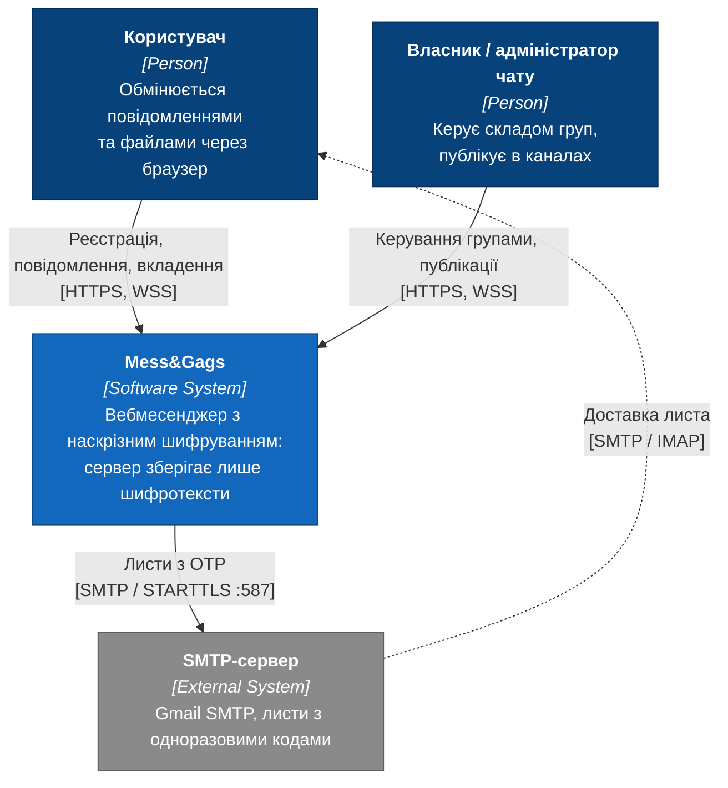
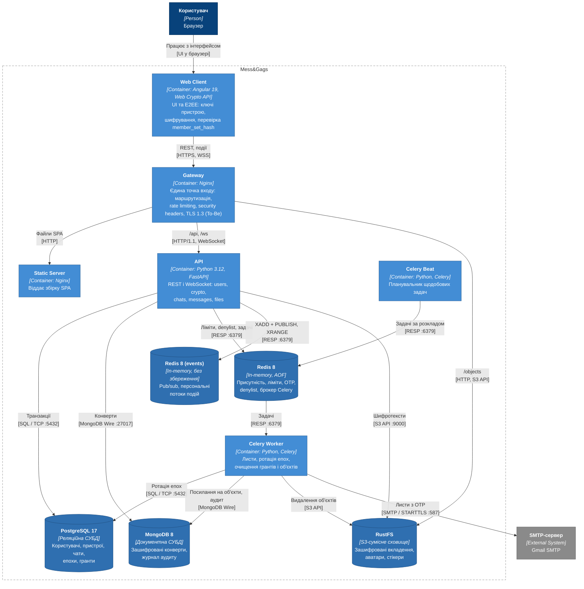
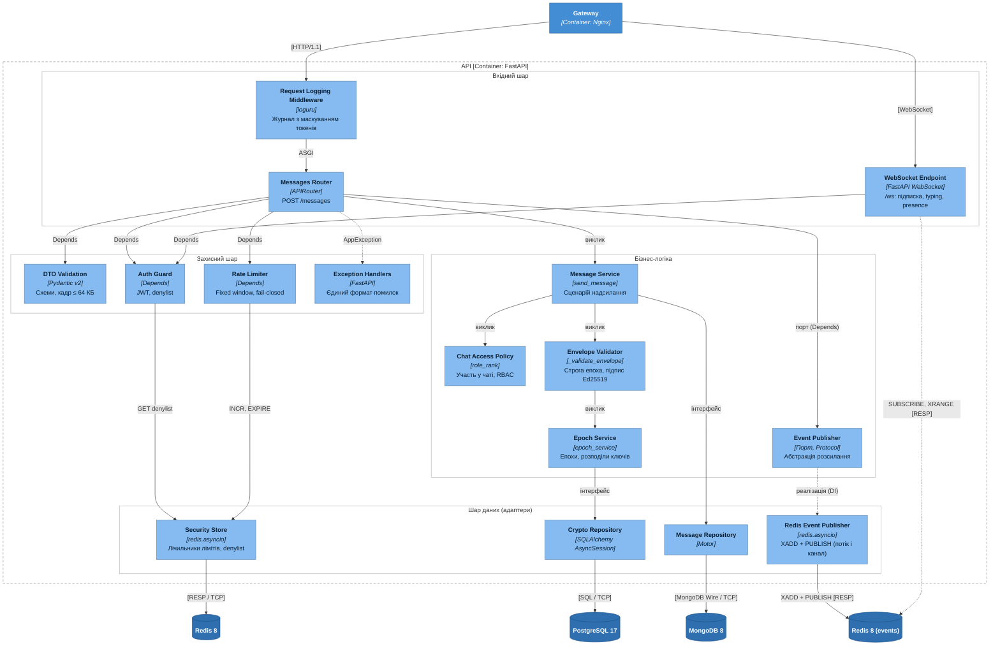
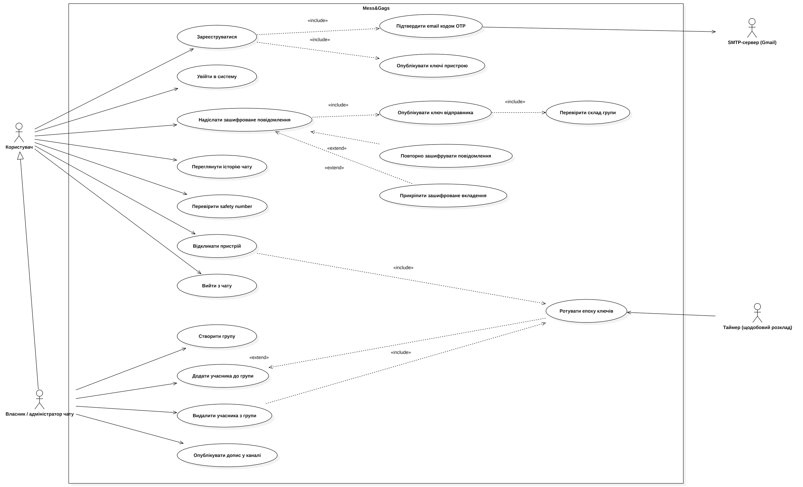
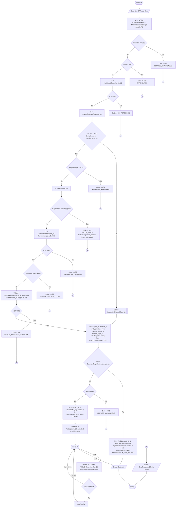
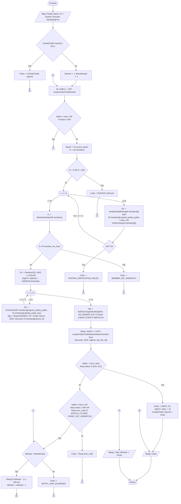
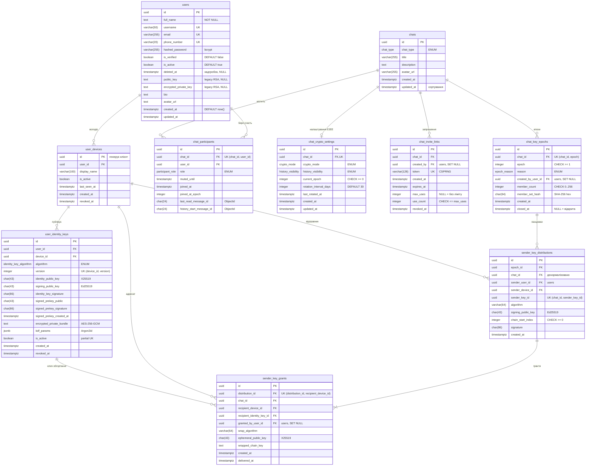
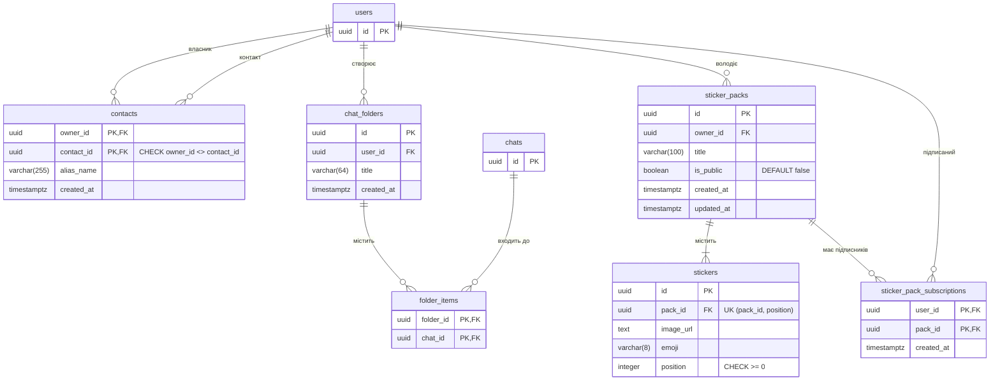
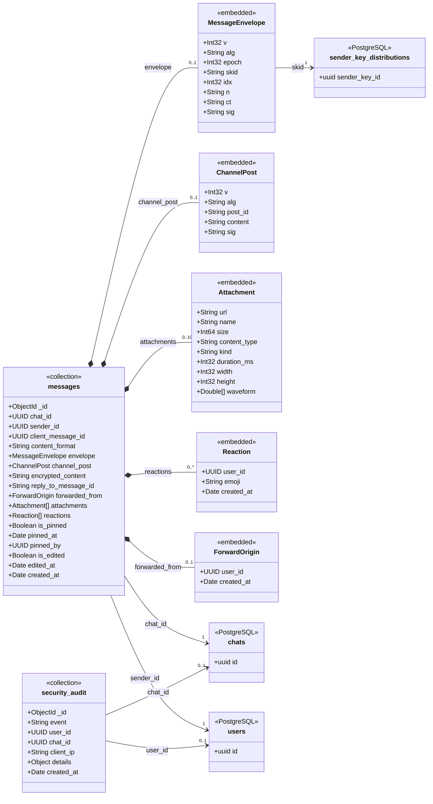

# РОЗДІЛ 2. ОБҐРУНТУВАННЯ АРХІТЕКТУРНИХ РІШЕНЬ ТА ПРОЄКТУВАННЯ СИСТЕМИ

> Розділ реалізує завдання 2–4 проєкту. Етапи 2–4 календарного плану: 19.10.2026 – 28.02.2027. Вимоги, на які посилаються діаграми, наведено в [специфікації вимог (SRS)](srs.md), ключове архітектурне рішення – в [ADR-001](adr/0001-choice-of-technology.md), API-контракт – у [api/openapi.yaml](api/openapi.yaml). Зведена версія для рецензування: [F2_Diploma_Chapter2_Zaloha (Google Docs)](https://docs.google.com/document/d/1S4RG0ErShjN4vgnKgb4gfjgN86WCFK6ndZU625NShKw/edit).

## 2.1 Обґрунтування архітектурного стилю та патернів проєктування

### 2.1.1 Глобальний архітектурний стиль

Система побудована як **модульний моноліт із багатошаровою організацією коду (Clean Architecture) та подієвою доставкою повідомлень**. Уся серверна бізнес-логіка виконується в одному процесі FastAPI (контейнер API, [рисунок 2.2](#diagram-level2)), поділеному на шість доменних модулів: `users`, `crypto`, `chats`, `messages`, `files`, `stickers`. Кожен модуль має власні підпакети `models`, `schemas`, `services` і `routers` і звертається до іншого модуля лише через функції його сервісного шару. Асинхронні операції, що не належать до шляху запиту (надсилання листів, ротація епох, очищення грантів і осиротілих об’єктів), винесено в окремі процеси Celery Worker і Celery Beat із брокером Redis.

Вибір зумовлено трьома властивостями предметної області.

1. **Транзакційна зв’язність криптографічного домену з доменом чатів.** Видалення учасника і створення нової епохи повинні фіксуватися однією транзакцією PostgreSQL ([SRS-FUN-11](srs.md#srs-fun-11)). У моноліті це локальна транзакція `AsyncSession`. У мікросервісній архітектурі ті самі дані належали б двом сервісам, і атомарність довелося б забезпечувати сагою з компенсаціями. Проміжок між кроками саги – це саме те вікно, у якому видалений учасник читає нові повідомлення.
2. **Масштаб навантаження.** Цільові показники – p95 ≤ 200 мс для `POST /messages` при 300 RPS ([SRS-NFR-PERF-01](srs.md#srs-nfr-perf-01)) і ≥ 5 000 WebSocket-з’єднань на екземпляр ([SRS-NFR-SCAL-01](srs.md#srs-nfr-scal-01)). Сервер не виконує криптографічних обчислень над вмістом (шифрування на клієнті, [ADR-001](adr/0001-choice-of-technology.md)), тому критичний шлях запиту складається з перевірки підпису Ed25519 (десяті частки мілісекунди), одного запиту до PostgreSQL за індексом, однієї вставки в MongoDB і однієї публікації в Redis. Мережевий виклик між сервісами додав би до цього бюджету ще один RTT і точку відмови без вигоди для пропускної здатності.
3. **Розгортання на одному вузлі** з 10 контейнерами Docker Compose. Незалежне розгортання і масштабування сервісів, заради яких існують мікросервіси, на одному вузлі не дає ефекту, а операційна вартість (трасування, версіонування контрактів між сервісами, мережева безпека) зростає лінійно з їх кількістю.

**Горизонтальне масштабування** закладено без зміни стилю: екземпляр API не зберігає стану сесії ([SRS-NFR-SCAL-02](srs.md#srs-nfr-scal-02)). JWT перевіряється без звернення до сховища сесій, denylist токенів, лічильники rate limiting і присутність зберігаються в Redis, а розсилання подій виконується через канали `user:{id}`. Тому N екземплярів API за Nginx отримують ту саму подію незалежно від того, до якого з них підключено WebSocket клієнта. Обмеження поточного розгортання: у Docker Compose працює один екземпляр API з одним процесом uvicorn, тож він є єдиною точкою відмови. Доступність ≥ 99,5 % ([SRS-NFR-REL-02](srs.md#srs-nfr-rel-02)) забезпечується автоматичним перезапуском контейнера (`restart: always`, ≤ 30 с), а не резервуванням.

**Подієвий контур** застосовано лише там, де він усуває блокування: доставка повідомлення онлайн-отримувачам (Redis pub/sub і персональний потік Redis Streams, з якого клієнт після обриву дочитує пропущені події за курсором; підтвердження доставки (ack) і групи споживачів не реалізовано, [SRS-FUN-19](srs.md#srs-fun-19)) і фонові задачі Celery. Збереження повідомлення відбувається синхронно до відповіді клієнту, тому клієнт отримує 201 лише після фіксації конверта в MongoDB. Повна подієва децентралізація (Event Sourcing, брокер Kafka) не застосовується: порядок повідомлень у чаті визначає монотонний ObjectId, і журнал подій як джерело істини не дає переваг над колекцією `messages`.

**Клієнт є активним учасником протоколу (smart client).** Генерацію ключів, шифрування, перевірку `member_set_hash` і safety number виконує Web Client ([SRS-FUN-06](srs.md#srs-fun-06), [SRS-FUN-14](srs.md#srs-fun-14), [SRS-FUN-15](srs.md#srs-fun-15)). Сервер розглядається як недовірений: він зберігає шифротексти, порядок і склад груп, але не може прочитати вміст і не може непомітно додати отримувача.

### 2.1.2 Патерни мікрорівня

| Патерн | Де застосовано | Яку проблему зв’язності розв’язує |
|---|---|---|
| Layered / Clean Architecture | Вхідний шар (маршрутизатори, middleware) → бізнес-логіка (сервіси, політики) → шар даних (репозиторії, адаптери) | Бізнес-правила E2EE (строга епоха, повнота грантів) не залежать від FastAPI, драйверів СУБД і формату HTTP-відповіді; їх можна тестувати без мережі |
| Dependency Injection | `Depends` FastAPI для `AsyncSession`, клієнта Motor, Redis, поточного користувача | Обробник не створює підключень сам: у тестах сесія і Redis підміняються фікстурами, а 329 інтеграційних тестів виконуються на ізольованих базах |
| Repository (To-Be: порти Message Repository і Crypto Repository) | Доступ до `messages` і криптографічних таблиць | Сервіси не залежать від Motor і SQLAlchemy: заміна MongoDB на інше сховище конвертів обмежується одним адаптером. Зараз сервіси звертаються до `AsyncSession` і колекцій Motor напряму, перехід описано в 2.3 |
| Unit of Work | `AsyncSession` як межа транзакції; сервіси (`allocate_epoch`, `touch_chat`) не викликають `commit`, його виконує ініціатор | Зміна складу групи, нова епоха і перенесення меж історії фіксуються або відкочуються разом |
| Publisher / Subscriber | Канали Redis `user:{id}` і порт `EventPublisher` (реалізація `RedisEventPublisher`, підключається через `Depends`) | Маршрутизатори не знають, які екземпляри API тримають WebSocket отримувачів, і не залежать від Redis напряму |
| Policy (Specification) | `get_chat_or_403`, `role_rank`, `_validate_envelope` | Перевірки доступу та інваріантів конверта зібрано в окремих функціях замість повторення в кожному маршрутизаторі |
| Strategy | Вибір обробки вмісту за `content_format` (`sender_keys_v1`, `channel_signed_v1`, `legacy_*`) | Новий формат конверта додається новою гілкою стратегії без зміни шляху збереження |

Патерни, які свідомо **не** застосовано:

- **CQRS з окремими моделями читання і запису.** Профіль навантаження – співмірні запис і читання історії тієї самої колекції за тим самим індексом `(chat_id, _id)`. Окрема модель читання потребувала б синхронізації та додавала б eventual consistency у стрічку повідомлень без виграшу в Latency.
- **Saga.** Атомарність ротації епохи забезпечує одна локальна транзакція PostgreSQL. Під час надсилання повідомлення конверт записується в MongoDB до фіксації транзакції PostgreSQL (`chats.updated_at`), а повтор запиту ідемпотентний за `client_message_id`, тому компенсувальні кроки не потрібні.
- **Circuit Breaker для внутрішніх сховищ.** Redis, PostgreSQL і MongoDB розміщені на тому самому вузлі, і без них запит не може бути виконаний коректно. Тому політика – fail-closed з відповіддю 503 і явними тайм-аутами підключення, а не обхід залежності. Ізоляцію відмов застосовано до єдиної зовнішньої залежності, SMTP-сервера: лист надсилає задача Celery, тому недоступність SMTP не блокує запит реєстрації. Задача `send_email` виконує до 3 повторних спроб з експоненційною затримкою (`autoretry_for=(SMTPException, OSError)`, `retry_backoff`, [SRS-NFR-REL-04](srs.md#srs-nfr-rel-04)).

### 2.1.3 Архітектурні ризики та засоби їх контролю

| Ризик | Наслідок | Засіб контролю |
|---|---|---|
| Один екземпляр API (SPOF) | Недоступність усього сервісу до перезапуску контейнера | `restart: always`; stateless API дозволяє запустити N екземплярів за Nginx без зміни коду |
| Втрата події pub/sub для офлайн-клієнта | Повідомлення збережене, але не доставлене в реальному часі | Кожна довготривала подія додатково записується в персональний потік Redis Streams (≈ 200 подій, 7 днів); клієнт після перепідключення передає курсор і отримує пропущене, а за застарілого курсора перезавантажує дані через HTTP (`resync_required`). Ack і повторної доставки немає, дедуплікацію за ідентифікатором повідомлення виконує клієнт ([SRS-FUN-19](srs.md#srs-fun-19)) |
| Дві СУБД без розподіленої транзакції | Розбіжність між PostgreSQL і MongoDB при збої між записами | Порядок «спочатку вставка в MongoDB, потім фіксація PostgreSQL»: збій MongoDB не змінює стану PostgreSQL, а збій після вставки залишає лише застарілий `chats.updated_at`; повтор клієнта ідемпотентний (`client_message_id`) |
| Каскадна відмова через синхронні виклики | Зростання Latency при деградації сховища | Тайм-аути драйверів, fail-closed з кодом 503, відсутність синхронних мережевих викликів між сервісами |
| Квадратичне зростання грантів S × (N − 1) | Зростання обсягу PostgreSQL і часу ротації | Ліміт 256 учасників ([SRS-FUN-22](srs.md#srs-fun-22)), лінива публікація ключів, очищення грантів закритих епох через 30 днів |
| Витрати на інфраструктуру (FinOps) | – | Хмарних керованих сервісів немає; усі 10 контейнерів працюють на одному вузлі з відкритим програмним забезпеченням |

### 2.1.4 Реєстр архітектурних рішень (ADR)

Архітектурні рішення фіксуються у форматі ADR за шаблоном Майкла Нігардза в каталозі [adr/](adr/).

| ADR | Рішення | Статус |
|---|---|---|
| [ADR-001](adr/0001-choice-of-technology.md) | Вибір схеми групового наскрізного шифрування: sender-key ratchet з явною моделлю епох замість попарних сесій Double Ratchet, класичних Sender Keys і MLS | Approved |
| [ADR-002](adr/0002-account-deletion-as-tombstone.md) | Видалення облікового запису як знеособлення з надгробком: рядок `users` лишається, щоб інші учасники могли відкрити й перевірити історію | Approved |

## 2.2 Контекстне та контейнерне моделювання системи (C4 Model)

Архітектуру описано за моделлю C4 у нотації Mermaid.js (Diagrams-as-Code): діаграми побудовано як flowchart зі стилями елементів C4 (Person, Software System, Container, Component, Database) і межами систем у вигляді subgraph. Діаграми зберігаються в репозиторії поруч із текстом і рендеряться GitHub.

### 2.2.1 Діаграма контексту (C4 Level 1)

<a id="diagram-level1"></a>



Рисунок 2.1 – Діаграма контексту системи (C4 Level 1)

| Елемент | Тип | Опис | Вимоги |
|---|---|---|---|
| Користувач | Person | Реєструється, обмінюється повідомленнями та вкладеннями через браузер | [SRS-FUN-01](srs.md#srs-fun-01), [SRS-FUN-18](srs.md#srs-fun-18) |
| Власник / адміністратор чату | Person | Змінює склад групи, публікує в каналах | [SRS-FUN-23](srs.md#srs-fun-23), [SRS-FUN-24](srs.md#srs-fun-24) |
| Mess&Gags | Software System | Вебмесенджер з наскрізним шифруванням; сервер зберігає лише шифротексти | [SRS, розділ 1](srs.md#1-system-context-контекст-системи) |
| SMTP-сервер | External System | Доставляє листи з одноразовими кодами підтвердження | [SRS-FUN-02](srs.md#srs-fun-02) |

| Зв’язок | Протокол | Призначення |
|---|---|---|
| Користувач → Mess&Gags | HTTPS, WSS | REST-запити та двобічний канал подій |
| Власник / адміністратор → Mess&Gags | HTTPS, WSS | Керування групами, публікації в каналах |
| Mess&Gags → SMTP-сервер | SMTP / STARTTLS, порт 587 | Надсилання OTP |
| SMTP-сервер → Користувач | SMTP / IMAP | Доставка листа до поштової скриньки |

### 2.2.2 Діаграма контейнерів (C4 Level 2)

<a id="diagram-level2"></a>



Рисунок 2.2 – Діаграма контейнерів системи (C4 Level 2)

Назовні опубліковано лише контейнер Gateway; СУБД, Redis і API доступні тільки у внутрішній мережі Docker Compose.

| Контейнер | Технологія | Відповідальність | Вимоги |
|---|---|---|---|
| Web Client | Angular 19, Web Crypto API | Інтерфейс; генерація ключів пристрою, шифрування повідомлень і вкладень, перевірка `member_set_hash`, safety number | [SRS-FUN-06](srs.md#srs-fun-06), [SRS-FUN-07](srs.md#srs-fun-07), [SRS-FUN-14](srs.md#srs-fun-14), [SRS-FUN-15](srs.md#srs-fun-15), [SRS-FUN-25](srs.md#srs-fun-25), [SRS-FUN-26](srs.md#srs-fun-26) |
| Gateway | Nginx | Єдина точка входу, маршрутизація `/api`, `/ws`, `/objects`, rate limiting, security headers, ліміт тіла запиту, TLS 1.3 (To-Be) | [SRS-NFR-SEC-02](srs.md#srs-nfr-sec-02) – [SRS-NFR-SEC-05](srs.md#srs-nfr-sec-05) |
| Static Server | Nginx | Віддає зібраний SPA | – |
| API | Python 3.12, FastAPI, Uvicorn | REST і WebSocket; домени `users`, `crypto`, `chats`, `messages`, `files`; перевірка епохи й підпису конвертів | [SRS-FUN-01](srs.md#srs-fun-01) – [SRS-FUN-04](srs.md#srs-fun-04), [SRS-FUN-08](srs.md#srs-fun-08) – [SRS-FUN-11](srs.md#srs-fun-11), [SRS-FUN-16](srs.md#srs-fun-16) – [SRS-FUN-24](srs.md#srs-fun-24), [SRS-FUN-27](srs.md#srs-fun-27), [SRS-FUN-28](srs.md#srs-fun-28) |
| Celery Worker | Python, Celery | Надсилання листів, ротація епох, очищення грантів, журналу аудиту та осиротілих об’єктів | [SRS-FUN-02](srs.md#srs-fun-02), [SRS-FUN-12](srs.md#srs-fun-12), [SRS-FUN-13](srs.md#srs-fun-13), [SRS-NFR-COMP-02](srs.md#srs-nfr-comp-02) |
| Celery Beat | Python, Celery | Планувальник щодобових задач | [SRS-FUN-12](srs.md#srs-fun-12) |
| PostgreSQL 17 | Реляційна СУБД | Користувачі, пристрої, чати, учасники, епохи, розподіли ключів, гранти (ACID-транзакції для атомарної ротації) | [SRS-FUN-11](srs.md#srs-fun-11) |
| MongoDB 8 | Документна СУБД | Незмінні зашифровані конверти повідомлень, журнал аудиту безпеки `security_audit` | [SRS-FUN-18](srs.md#srs-fun-18) |
| Redis 8 | In-memory, AOF, `noeviction` | Присутність, лічильники rate limiting, OTP, denylist токенів, брокер Celery | [SRS-FUN-04](srs.md#srs-fun-04), [SRS-NFR-SEC-03](srs.md#srs-nfr-sec-03) |
| Redis 8 (events) | In-memory, `allkeys-lru`, 256 МБ, без RDB і AOF | Pub/sub подій реального часу та персональні потоки Redis Streams для відновлення за курсором; окремий екземпляр, щоб потоки не конкурували з ключами denylist | [SRS-FUN-18](srs.md#srs-fun-18), [SRS-FUN-19](srs.md#srs-fun-19) |
| RustFS | S3-сумісне сховище | Шифротексти вкладень, аватари, стікери | [SRS-FUN-27](srs.md#srs-fun-27) |

| Зв’язок | Протокол | Призначення |
|---|---|---|
| Web Client → Gateway | HTTPS, WSS | REST-запити та події реального часу |
| Gateway → Static Server | HTTP | Статичні файли SPA |
| Gateway → API | HTTP/1.1, WebSocket | Проксіювання `/api` і `/ws` |
| Gateway → RustFS | HTTP, S3 API | Публічні об’єкти (`/objects`) |
| API → PostgreSQL | SQL / TCP 5432 (asyncpg) | Транзакції епох, чатів, ключів |
| API → MongoDB | MongoDB Wire Protocol / TCP 27017 (Motor) | Запис і читання конвертів |
| API → Redis | RESP / TCP 6379 | Лічильники, присутність, OTP, denylist, постановка задач Celery |
| API → Redis (events) | RESP / TCP 6379 | `XADD` + `PUBLISH` подій (один Lua-скрипт), читання потоку для повтору після перепідключення |
| API → RustFS | S3 API / HTTP 9000 (aiobotocore) | Збереження шифротекстів вкладень |
| Celery Beat → Redis | RESP / TCP 6379 | Публікація задач за розкладом |
| Celery Worker → Redis | RESP / TCP 6379 | Отримання задач |
| Celery Worker → PostgreSQL, MongoDB, RustFS | SQL / TCP, MongoDB Wire / TCP, S3 API / HTTP | Ротація епох, очищення грантів, журналу аудиту та об’єктів |
| Celery Worker → SMTP-сервер | SMTP / STARTTLS, порт 587 | Надсилання OTP |

## 2.3 Компонентне моделювання та опис серверного ядра

### 2.3.1 Діаграма компонентів контейнера API

Для декомпозиції обрано контейнер **API** (FastAPI), оскільки в ньому зосереджено перевірку інваріантів E2EE на сервері: строгої епохи, підпису конверта та прав учасника. Діаграма відображає шлях надсилання зашифрованого повідомлення.

<a id="diagram-level3"></a>



Рисунок 2.3 – Діаграма компонентів контейнера API (C4 Level 3)

| Шар | Компонент | Відповідальність | Взаємодія | Вимоги |
|---|---|---|---|---|
| Наскрізний | Request Logging Middleware | Журнал запитів з маскуванням токенів у шляху | ASGI-конвеєр | [SRS-NFR-OBS-01](srs.md#srs-nfr-obs-01), [SRS-NFR-COMP-02](srs.md#srs-nfr-comp-02) |
| Вхідний | Messages Router | Кінцеві точки REST для повідомлень | Отримує залежності через `Depends`, викликає Message Service | [SRS-FUN-18](srs.md#srs-fun-18) |
| Вхідний | WebSocket Endpoint | Підключення, підписка на персональний канал, typing, presence | `Depends(get_ws_current_user)`, `SUBSCRIBE` у Redis | [SRS-FUN-18](srs.md#srs-fun-18), [SRS-NFR-SEC-04](srs.md#srs-nfr-sec-04) |
| Вхідний | DTO Validation | Валідація тіла запиту схемами Pydantic, ліміт кадру 64 КБ | Автоматично до виклику обробника | [SRS-NFR-SEC-04](srs.md#srs-nfr-sec-04) |
| Захисний | Auth Guard | Перевірка JWT з cookie та denylist | `Depends`, читання через Security Store | [SRS-FUN-03](srs.md#srs-fun-03), [SRS-FUN-04](srs.md#srs-fun-04) |
| Захисний | Rate Limiter | Fixed window, fail-closed | `Depends`, `INCR` / `EXPIRE` через Security Store | [SRS-NFR-SEC-03](srs.md#srs-nfr-sec-03) |
| Захисний | Exception Handlers | Перетворення `AppException`, `RequestValidationError` і необроблених винятків у єдиний формат відповіді | Обробники винятків FastAPI | – |
| Бізнес-логіка | Message Service | Сценарій надсилання: перевірка доступу, валідація конверта, збереження, публікація події | Інтерфейсні виклики портів | [SRS-FUN-18](srs.md#srs-fun-18) |
| Бізнес-логіка | Chat Access Policy | Участь у чаті, ранги ролей OWNER/ADMIN/MEMBER | Виклик функції | [SRS-FUN-23](srs.md#srs-fun-23), [SRS-FUN-24](srs.md#srs-fun-24) |
| Бізнес-логіка | Envelope Validator | Строга рівність епохи, наявність sender key, підпис Ed25519 | Виклик функції | [SRS-FUN-16](srs.md#srs-fun-16), [SRS-FUN-17](srs.md#srs-fun-17), [ADR-001](adr/0001-choice-of-technology.md) |
| Бізнес-логіка | Epoch Service | Поточна епоха, розподіли ключів, ротація | Через Crypto Repository | [SRS-FUN-11](srs.md#srs-fun-11), [ADR-001](adr/0001-choice-of-technology.md) |
| Бізнес-логіка | Event Publisher (порт) | Абстракція розсилання подій (`publish_durable`, `publish_ephemeral`), від якої залежать маршрутизатори; Message Service подій не розсилає | Protocol, реалізація через DI | [SRS-FUN-18](srs.md#srs-fun-18), [SRS-FUN-19](srs.md#srs-fun-19) |
| Дані | Message Repository | Збереження та читання конвертів | Motor → MongoDB | [SRS-FUN-18](srs.md#srs-fun-18) |
| Дані | Crypto Repository | Епохи, розподіли, гранти | SQLAlchemy AsyncSession → PostgreSQL | [SRS-FUN-11](srs.md#srs-fun-11) |
| Дані | Redis Event Publisher | Реалізація порту: для довготривалої події один Lua-скрипт виконує `XADD stream:user:{id}` і `PUBLISH user:{id}`; розсилання пакетами по 500 одержувачів через pipeline; ефемерні події (typing, presence) лише `PUBLISH` | redis.asyncio → Redis (events) | [SRS-FUN-19](srs.md#srs-fun-19) |
| Дані | Security Store | Лічильники rate limiting і denylist токенів | redis.asyncio → Redis | [SRS-FUN-04](srs.md#srs-fun-04), [SRS-NFR-SEC-03](srs.md#srs-nfr-sec-03) |

### 2.3.2 Опис серверного ядра

Запит до контейнера API проходить три рівні. Кожен рівень залежить лише від нижчого через вузький інтерфейс, тому доменна логіка не має прямого доступу до сховищ і мережі.

**Вхідний рівень (Inbound Layer).** Рівень складається з Request Logging Middleware, маршрутизаторів REST і WebSocket Endpoint.

- **Request Logging Middleware** записує метод, шлях, статус і час обробки. Токен запрошення в шляху `/invite-links/{token}` замінюється на `<redacted>`, а штатний журнал доступу uvicorn вимкнено (`--no-access-log`), щоб токени не потрапляли в журнали ([SRS-NFR-COMP-02](srs.md#srs-nfr-comp-02)).
- **Маршрутизатор** оголошує залежності через `Depends`. До виклику обробника FastAPI виконує валідацію DTO (Pydantic v2), Auth Guard і Rate Limiter. Обробник отримує вже типізований об’єкт і ідентифікатор користувача з JWT і не читає сирого тіла запиту.
- **WebSocket Endpoint** до `accept()` перевіряє заголовок `Origin` за списком `ALLOWED_ORIGINS` (відсутній або сторонній – закриття з кодом 1008) і автентифікує з’єднання тим самим cookie `access_token`. Він відхиляє кадри понад 64 КБ, підписується лише на канал `user:{id}` власного користувача, за параметром `cursor` повторює пропущені події, а з відкликанням сесії закриває з’єднання кодом 4401.

**Рівень бізнес-логіки (Core Layer).** Рівень складається з Message Service, Epoch Service, Chat Access Policy і Envelope Validator.

- **Message Service** реалізує сценарій надсилання (алгоритм 2.6.4.1): перевірку участі, валідацію конверта, збереження і публікацію події.
- **Epoch Service** виділяє епохи (алгоритм 2.6.4.2), повертає склад пристроїв і приймає розподіли ключів.
- **Chat Access Policy** (`get_chat_or_403`, `role_rank`) і **Envelope Validator** (`_validate_envelope`) – чисті перевірки інваріантів. Вони отримують дані від сервісу і повертають рішення або `AppException` з машинно-читаним кодом.

Сервіси не формують HTTP-відповідей і не викликають `commit`: межу транзакції задає ініціатор (Unit of Work). Тому, наприклад, видалення учасника і ротація епохи фіксуються однією транзакцією.

**Вихідний рівень (Outbound Layer).** Рівень складається з Message Repository (Motor → MongoDB), Crypto Repository (SQLAlchemy AsyncSession → PostgreSQL), Redis Event Publisher і Security Store (лічильники та denylist у Redis), а також клієнта RustFS (aiobotocore).

- Усі звернення до PostgreSQL параметризовані засобами SQLAlchemy Core і ORM. Рядкової конкатенації SQL у коді немає.
- Фільтри MongoDB будуються з типізованих значень (`uuid.UUID`, `ObjectId`), а не з сирого JSON запиту, тому оператори на кшталт `$ne` чи `$where` не можуть потрапити у фільтр.

| Інваріант | Компонент, що його забезпечує |
|---|---|
| Користувач читає і пише лише в чатах, учасником яких є | Chat Access Policy (`get_chat_or_403`) у кожному обробнику з `chat_id` |
| Конверт прийнято лише для поточної епохи і з дійсним підписом відправника | Envelope Validator |
| Ланцюжок відправника належить відправнику, а гранти покривають рівно склад епохи | Epoch Service (`publish_sender_key`) |
| Зміна складу групи і нова епоха фіксуються разом | Unit of Work (`AsyncSession`) |
| Перевищення лімітів не доходить до бізнес-логіки | Rate Limiter (fail-closed) |

Цільова структура портів і адаптерів (Message Repository, Crypto Repository, Event Publisher) показана на [рисунку 2.3](#diagram-level3). Порт Event Publisher реалізовано: маршрутизатори отримують його через `Depends(get_event_publisher)`, а збій розсилання після збереження повідомлення журналюється й не змінює відповіді. Порти Message Repository і Crypto Repository ще не винесено: сервіси звертаються до `AsyncSession` і колекцій Motor безпосередньо.

## 2.4 Контур безпеки програмного рішення (Application Security)

Модель загроз включає зовнішнього зловмисника (перебір облікових даних, ін’єкції, IDOR, DoS) і скомпрометований або недобросовісний сервер. Від другого захищає наскрізне шифрування ([ADR-001](adr/0001-choice-of-technology.md)), тому контур AppSec розглядає сервер як компонент, який може бути зламаний, і мінімізує наслідки зламу. Цільовий рівень – OWASP ASVS 5.0 L2 для автентифікації, сесій і криптографії ([SRS-NFR-COMP-01](srs.md#srs-nfr-comp-01)).

### 2.4.1 Автентифікація і керування сесіями

| Механізм | Реалізація | Параметри |
|---|---|---|
| Зберігання пароля | bcrypt (бібліотека `bcrypt`, `gensalt()`) | cost factor 12 (2^12 ітерацій), сіль 128 біт; пароль 8–72 байти, верхня межа відповідає обмеженню вхідних даних bcrypt |
| Захист приватних ключів | Argon2id на клієнті, пакет ключів AES-256-GCM | m ≥ 64 МіБ, t ≥ 3, p = 4; сервер відхиляє пакет з m < 19 МіБ або t < 2 ([SRS-FUN-08](srs.md#srs-fun-08)) |
| Токени доступу | JWT HS256, claims `sub`, `iat`, `exp`, `type` | access 1 800 с, refresh 604 800 с; секрет підпису – змінна середовища `SECRET_KEY` |
| Транспорт токена | Cookie `HttpOnly; Secure; SameSite=Lax` | Токен недоступний JavaScript (захист від викрадення через XSS); SameSite=Lax не надсилає cookie у міжсайтових POST і WebSocket-рукостисканнях (захист від CSRF і CSWSH) |
| Відкликання | Denylist у Redis з TTL до завершення строку дії токена; мітка `force_logout:{user_id}` | Вихід і зміна пароля роблять недійсними всі токени, видані раніше; перевірка `iat` з точністю до часток секунди. У Redis зберігається SHA-256 токена (`blacklist:{sha256(token)}`), а не сам токен. Відкритий WebSocket закривається кодом 4401 за подією `session_revoked` і періодичною повторною перевіркою сесії (щонайбільше 60 с) |
| Одноразові коди (OTP) | 6 цифр із `secrets.randbelow` (CSPRNG), TTL 900 с | У Redis зберігається HMAC-SHA256 коду з похідним від `SECRET_KEY` ключем і прив’язкою до призначення та суб’єкта, а не сам код; не більше 5 спроб; порівняння `hmac.compare_digest` (без витоку через час виконання) |
| Перевірка Origin | Список `ALLOWED_ORIGINS` | WebSocket-рукостискання без дозволеного `Origin` відхиляється до `accept()` (код 1008). Запити POST, PUT, PATCH і DELETE з чужим `Origin` отримують 403 `ORIGIN_NOT_ALLOWED`; запит без `Origin` (не браузерний клієнт) пропускається |
| Перевірка email | Залежність `get_current_user` повертає 403 `NOT_VERIFIED` | Непідтверджений обліковий запис не має доступу до чатів і ключів |

### 2.4.2 Захист від вразливостей OWASP Top 10 (2021)

| Категорія | Вектор атаки в системі | Засіб захисту |
|---|---|---|
| A01 Broken Access Control (BOLA/IDOR) | Підміна `chat_id` або `object_key` у шляху для читання чужих повідомлень і вкладень | Chat Access Policy у кожному обробнику; вкладення видається лише якщо користувач є учасником чату **і** об’єкт згадано в повідомленні цього чату; RBAC за `role_rank` (OWNER, ADMIN, MEMBER) для зміни складу і каналів |
| A01 (підробка авторства) | Передача чужого `sender_id` у тілі запиту | `sender_id` береться з JWT, не з тіла; підпис Ed25519 конверта перевіряється ключем відправника |
| A02 Cryptographic Failures | Читання вмісту при витоку бази даних | Сервер зберігає лише шифротексти AES-256-GCM; приватні ключі пристрою зашифровано ключем, виведеним Argon2id на клієнті |
| A03 Injection (SQLi, NoSQLi) | Оператори MongoDB або SQL у параметрах | Параметризовані запити SQLAlchemy; типізовані фільтри Motor; валідація DTO Pydantic відкидає значення неправильного типу кодом 422 |
| A04 Insecure Design (Mass Assignment) | Додаткові поля в тілі (`role`, `is_verified`, `sender_id`) | DTO запитів, що змінюють стан, оголошують `extra="forbid"`: невідоме поле (`role`, `is_verified`) повертає 422. Вкладені об’єкти (конверт, вкладення, публікація каналу) зайві поля мовчки ігнорують |
| A05 Security Misconfiguration | Небезпечні заголовки, публічні СУБД, відкрита документація API | Security headers на шлюзі (CSP `default-src 'self'`, `frame-ancestors 'none'`, X-Frame-Options DENY, nosniff, Referrer-Policy no-referrer, COOP/CORP same-origin); порти СУБД і API прив’язано до 127.0.0.1; `/docs`, `/redoc` і `/openapi.json` вимкнено, якщо `EXPOSE_API_DOCS` не ввімкнено (за замовчуванням вимкнено) |
| A07 Identification and Authentication Failures | Перебір паролів і OTP | Rate limiting на двох рівнях: шлюз (1 r/s, burst 5 для автентифікації) і застосунок (20 спроб входу за 300 с з адреси, 8 – на обліковий запис; 5 спроб OTP) |
| A08 Software and Data Integrity Failures | Ін’єкція вкладення під виглядом стікера | Перехресна перевірка `kind` і бакета URL вкладення; URL обмежено одним ключем об’єкта в дозволеному бакеті |
| A09 Logging and Monitoring Failures | Відсутність сліду при зміні ключа чи складу групи | Журнал аудиту `security_audit` (19 типів подій, лише метадані, 365 днів); маскування токенів у журналах |
| A10 SSRF | – | Сервер не виконує запитів за URL, отриманими від клієнта; вкладення читаються лише з власного RustFS за ключем |

### 2.4.3 Обмеження ресурсів і захист від DoS

| Ресурс | Обмеження | Де застосовано |
|---|---|---|
| Частота запитів | 30 r/s на IP для API, 1 r/s (burst 5) для автентифікації; у застосунку 300 повідомлень/хв, 60 публікацій ключів за 300 с, 100 завантажень за годину на користувача | Nginx `limit_req`, Rate Limiter (Redis, fail-closed) |
| Тіло запиту | 55 МБ на шлюзі; вкладення ≤ 50 МБ, аватар і стікер ≤ 5 МБ | `client_max_body_size`; потокове читання частинами по 1 МБ з перериванням при перевищенні (413) |
| Кадр WebSocket | ≤ 64 КБ | WebSocket Endpoint |
| Вкладення на сторінці | ≤ 50 ключів за запит | `/files/attachments/batch` |
| Типи публічних файлів | Лише `image/jpeg`, `image/png`, `image/webp`, `image/gif` із перевіркою сигнатури | Завантаження аватарів і стікерів |

Вкладення повідомлень віддаються з `Content-Disposition: attachment` і `X-Content-Type-Options: nosniff`, тому шифротекст не може бути інтерпретований браузером як HTML чи скрипт на домені застосунку.

### 2.4.4 Захист середовища і ланцюга постачання

- **Секрети.** `SECRET_KEY`, паролі СУБД і SMTP передаються через змінні середовища з файлу `.env`, який не потрапляє в репозиторій (`.gitignore`). To-Be: секрети Docker Compose (`secrets:`) замість змінних середовища і сканування історії Git засобом gitleaks у CI (не реалізовано).
- **Мережева ізоляція.** Назовні опубліковано лише Gateway; PostgreSQL, MongoDB, RustFS і API прив’язано до 127.0.0.1 для локальних інструментів розробки.
- **Залежності й образи.** Вимога – 0 вразливостей рівня Critical або High без задокументованого винятку ([SRS-NFR-SEC-06](srs.md#srs-nfr-sec-06)). У GitHub Actions виконуються `pip-audit` і `npm audit --audit-level=high`, але лише інформаційно: знахідки не блокують злиття. Конвеєр також запускає Ruff (мінімальний набір правил E9, F63, F7, F82), ESLint, Pytest, Karma і `npm run interop` ([SRS-NFR-MAINT-01](srs.md#srs-nfr-maint-01)). To-Be: Trivy для образів, Bandit для коду Python, поріг покриття ≥ 80 %.
- **Транспорт.** To-Be: TLS 1.3 і HSTS `max-age=31536000` на шлюзі ([SRS-NFR-SEC-02](srs.md#srs-nfr-sec-02)).

### 2.4.5 Відомі обмеження і план посилення

Раніше заплановані заходи реалізовано й вилучено з переліку: зберігання OTP як HMAC-SHA256, ключ denylist як SHA-256 токена, перевірка `Origin` у WebSocket-рукостисканні, вимкнення Swagger UI і `/openapi.json` у виробничому середовищі, `extra="forbid"` для DTO запитів.

| № | Обмеження | План |
|---|---|---|
| 1 | Немає автоматичного сканування образів і секретів, а сканування залежностей лише інформаційне | Trivy, gitleaks і Bandit у CI, перехід `pip-audit` і `npm audit` у блокувальний режим |
| 2 | Відкликані токени у старому форматі (відкритий JWT як ключ) ще читаються: це зайвий запит `GET` на кожну перевірку | Прибрати читання старого формату через 7 днів після розгортання (позначено `TODO` у `core/security.py`) |
| 3 | Запис без заголовка `Origin` дозволено (потрібно для не браузерних клієнтів) | Прийнято: браузер не може надіслати міжсайтовий запит без `Origin` |
| 4 | Немає TLS і HSTS на шлюзі | Завершення TLS 1.3 у Nginx, `COOKIE_SECURE=true`, увімкнення HSTS ([SRS-NFR-SEC-02](srs.md#srs-nfr-sec-02)) |

## 2.5 Специфікація міжсервісних контрактів та топологія API-маршрутів

### 2.5.1 Контракт OpenAPI

Контракт описано за підходом API-First Design у форматі **OpenAPI 3.0.3** (YAML). Деталізовану специфікацію кінцевих точок зафіксовано у файлі [openapi.yaml](api/openapi.yaml). Файл проходить валідацію `openapi-spec-validator` і придатний для генерації серверних заготовок і клієнтського SDK (наприклад, OpenAPI Generator для TypeScript Angular).

**Між якими контейнерами реалізовано інтерфейс.** Контракт описує взаємодію **Web Client (Angular 19) → Gateway (Nginx) → API (FastAPI)** з [рисунка 2.2](#diagram-level2). Gateway знімає префікс `/api`, застосовує ліміти `limit_req` і проксіює запит до API без зміни тіла, тому базова адреса контракту – `https://{host}/api`. Події реального часу (WebSocket `/ws`, подія `new_message`) передають ту саму схему `Message` і в OpenAPI не описуються.

**Безпека.** Схема `cookieAuth` (`type: apiKey`, `in: cookie`, `name: access_token`) описує JWT HS256 у cookie з атрибутами HttpOnly, Secure, SameSite=Lax і TTL 1 800 с. Схему Bearer у заголовку `Authorization` не застосовано: токен у HttpOnly-cookie недоступний JavaScript, що виключає його викрадення через XSS. Глобальне правило `security` поширюється на всі операції, крім `POST /auth/login` (`security: []`), тож кожен мутуючий маршрут вимагає автентифікації.

**Модель помилок.** Усі відповіді 4xx/5xx мають єдину схему `ErrorResponse` (`status`, `error_code`, `message`, `details`), однакову з обробниками винятків FastAPI. Машинно-читані коди дозволяють клієнту реагувати без розбору тексту:

- `EPOCH_STALE` (409) – повторно зашифрувати повідомлення для епохи з `details.current_epoch`;
- `GRANT_SET_MISMATCH` (400) – отримати склад повторно;
- `RATE_LIMITED` (429) – чекати `details.retry_after_seconds`;
- `FILE_SIZE_TOO_LARGE` (413) – файл перевищує ліміт.

**Валідація вхідних даних.**

- Ключі та підписи мають шаблони фіксованої довжини (`^[A-Za-z0-9_-]{43}$`, `{86}`), `member_set_hash` – `^[0-9a-f]{64}$`, ObjectId – `^[0-9a-f]{24}$`.
- Масиви обмежено: `grants` ≤ 256, `attachments` ≤ 10, сторінка історії ≤ 100.
- `MessageCreateRequest` вимагає рівно одне поле вмісту (`oneOf`), а `additionalProperties: false` відхиляє невідомі поля.

Фрагмент контракту – операція надсилання повідомлення:

```yaml
  /messages:
    post:
      tags: [Messages]
      operationId: sendMessage
      requestBody:
        required: true
        content:
          application/json:
            schema:
              $ref: '#/components/schemas/MessageCreateRequest'
      responses:
        '201':
          description: Повідомлення створено
          content:
            application/json:
              schema:
                $ref: '#/components/schemas/MessageSuccessResponse'
        '409':
          description: EPOCH_STALE або SENDER_KEY_MISSING
          content:
            application/json:
              schema:
                $ref: '#/components/schemas/ErrorResponse'
        '429':
          $ref: '#/components/responses/TooManyRequests'
components:
  securitySchemes:
    cookieAuth:
      type: apiKey
      in: cookie
      name: access_token
```

Контракт відповідає поточному коду: `client_message_id`, статус 201, `edited_at`, заголовок `Retry-After` і код 409 `IDEMPOTENCY_KEY_REUSED` реалізовано. Позначку `planned` лишено лише для коду помилки `SENDER_KEY_EXISTS`, якого в коді ще немає.

### 2.5.2 Карта інтерфейсних маршрутів системи

Усі шляхи наведено відносно базової адреси `https://{host}/api`. Шлюз знімає префікс `/api`, тому контейнер API реєструє їх без нього. Для маршрутів API-REQ-01 – API-REQ-08 сигнатури, типи і коди відповідей збігаються з [openapi.yaml](api/openapi.yaml).

| ID | Метод | Шлях (URI) | Вхідні параметри / Payload | Призначення | Контейнер-обробник |
|---|---|---|---|---|---|
| API-REQ-01 | POST | `/auth/login` | body JSON `LoginRequest`: `username` string 6–50 `^[A-Za-z][A-Za-z0-9_]*$`, `password` string 8–72 | Вхід; встановлення cookie `access_token`, `refresh_token` | Gateway (`limit_req` 1 r/s, burst 5) → API, домен `users` |
| API-REQ-02 | GET | `/crypto/chats/{chat_id}/roster` | path `chat_id` uuid | Склад пристроїв і `member_set_hash` поточної епохи | API, домен `crypto` (Epoch Service) |
| API-REQ-03 | POST | `/crypto/chats/{chat_id}/epochs/{epoch}/sender-keys` | path `chat_id` uuid, `epoch` int32 ≥ 1; body JSON `SenderKeyUpload` з `grants[1..256]` | Публікація ланцюжка відправника з грантами | API, домен `crypto` (Epoch Service) → PostgreSQL |
| API-REQ-04 | GET | `/crypto/chats/{chat_id}/keys` | path `chat_id` uuid; query `since_epoch` int32 ≥ 0 | Епохи і гранти для пристроїв користувача | API, домен `crypto` → PostgreSQL |
| API-REQ-05 | POST | `/messages` | body JSON `MessageCreateRequest`: `chat_id` uuid, рівно одне з `envelope` / `channel_post` / `encrypted_content`, `attachments[0..10]`, `client_message_id` uuid | Надсилання конверта | API, домен `messages` (Message Service) → MongoDB, Redis |
| API-REQ-06 | GET | `/chats/{chat_id}/messages` | path `chat_id` uuid; query `limit` int 1–100 (типово 50), `before_id` ObjectId | Історія чату з курсорною пагінацією | API, домен `chats` → MongoDB |
| API-REQ-07 | POST | `/files/upload` | body `multipart/form-data`: `file` binary ≤ 50 МБ (вкладення) або ≤ 5 МБ (аватар, стікер), `category` enum | Завантаження шифротексту вкладення | Gateway (`client_max_body_size 55m`) → API, домен `files` → RustFS |
| API-REQ-08 | GET | `/files/attachments/{chat_id}/{object_key}` | path `chat_id` uuid, `object_key` `^[A-Za-z0-9._-]{1,128}$` | Отримання шифротексту вкладення | API, домен `files` → MongoDB (перевірка посилання), RustFS |
| API-WS-01 | GET (Upgrade) | `/ws` | cookie `access_token`; кадри JSON ≤ 64 КБ | Події реального часу (`new_message`, `key_epoch_started`, typing, presence) | Gateway (`proxy_http_version 1.1`, Upgrade) → API WebSocket Endpoint ↔ Redis pub/sub |

Карта решти маршрутів за доменами (усього 76 маршрутів REST і 1 WebSocket). Контракт OpenAPI деталізує 8 маршрутів критичного сценарію, решта описується автоматичною схемою FastAPI (`/openapi.json`, лише якщо ввімкнено `EXPOSE_API_DOCS`) і ще не перенесена в контракт.

| Домен | Префікс | Маршрутів | Призначення |
|---|---|---|---|
| `users` | `/auth`, `/profile`, `/users`, `/contact` | 19 | Реєстрація, OTP, вхід, вихід, оновлення токенів, профіль, видалення облікового запису, пошук, контакти |
| `chats` | `/chats`, `/chat-folder`, `/invite-links` | 25 | Чати, учасники, ролі, закріплення, стан прочитання, теки, запрошення |
| `crypto` | `/crypto` | 10 | Ключі ідентичності, prekey, відкликання пристроїв, епохи, гранти, safety number |
| `messages` | `/messages`, `/ws` | 7 + 1 | Надсилання, редагування, видалення, реакції, закріплення, WebSocket |
| `files` | `/files` | 3 | Завантаження, отримання вкладення, пакетне отримання (≤ 50 ключів) |
| `stickers` | `/stickers` | 12 | Набори стікерів, підписки, пошук набору за URL стікера |

Маршрути з дієсловом у шляху (`POST /chats/{chat_id}/delete-participants`, `POST /auth/get-verification-email`) не відповідають REST-іменуванню ресурсів. Заміну на `DELETE /chats/{chat_id}/participants/{user_id}` і `POST /auth/verification-codes` не виконано: поточні шляхи лишаються єдиними.

### 2.5.3 Потоки даних (Data Flows)

**DF-01. Надсилання зашифрованого повідомлення.**

1. Web Client шифрує текст AES-256-GCM ключем з ланцюжка відправника, підписує конверт Ed25519 і надсилає `POST /api/messages` через HTTPS (тіло JSON ≤ 64 КБ; cookie `access_token` додає браузер).
2. Gateway (Nginx) перевіряє `limit_req` (30 r/s на IP, перевищення – 429 з JSON-тілом `RATE_LIMITED` і заголовком `Retry-After`), обмеження тіла 55 МБ, знімає префікс `/api`, встановлює `X-Forwarded-For` у значення `$remote_addr` (підроблений клієнтом заголовок відкидається) і проксіює запит до `api:8000` по HTTP/1.1 у внутрішній мережі Docker.
3. API: Auth Guard декодує JWT і перевіряє denylist у Redis (401); Rate Limiter виконує `INCR ratelimit:message-send:{user}:{window}` (429 понад 300/хв, 503 при недоступності Redis); Pydantic валідує DTO (422).
4. Message Service перевіряє участь у чаті (`SELECT` за `uq_chat_user`, 403), читає `chat_crypto_settings`, порівнює `envelope.epoch` з `current_epoch` (409 `EPOCH_STALE`), знаходить розподіл за `uq_skd_chat_sender_key_id` і перевіряє підпис Ed25519 (400).
5. Якщо передано `client_message_id`, сервер шукає наявне повідомлення цього відправника в чаті: збіг із відбитком запиту повертає його без вставки (200), розбіжність – 409 `IDEMPOTENCY_KEY_REUSED`. Інакше конверт записується в MongoDB (`insert_one`), `chats.updated_at` оновлюється в PostgreSQL, транзакція фіксується; відповідь 201.
6. Подія `new_message` записується в персональні потоки `stream:user:{id}` і публікується в канали `user:{id}` усіх учасників (також під час повтору за `client_message_id`); кожен екземпляр API, що тримає WebSocket учасника, пересилає кадр клієнту (API-WS-01). Клієнт отримувача знаходить грант за `skid` і розшифровує повідомлення локально.

**DF-02. Завантаження зашифрованого вкладення.**

1. Web Client шифрує файл AES-256-GCM випадковим ключем на клієнті і надсилає шифротекст `POST /api/files/upload` як `multipart/form-data` (`category=message`). Ключ вкладення передається лише всередині зашифрованого конверта повідомлення.
2. Gateway відхиляє тіло понад 55 МБ кодом 413 до передачі в API.
3. API перевіряє JWT і ліміт 100 завантажень за годину, читає потік частинами по 1 МБ і перериває читання з кодом 413 `FILE_SIZE_TOO_LARGE`, щойно сума перевищить 50 МБ. Повний файл у пам’ять до перевірки не завантажується. Порожній файл повертає 400 `EMPTY_FILE`.
4. Об’єкт записується в приватний бакет RustFS з `Content-Type: application/octet-stream`; клієнт отримує `url`, `name`, `size`, `content_type` і додає їх у `attachments` повідомлення (DF-01). Об’єкти, на які не послалося жодне повідомлення протягом 24 годин, видаляє задача Celery.

**DF-03. Читання історії та вкладень.**

1. Web Client запитує `GET /api/chats/{chat_id}/messages?limit=50` і далі `before_id=<ObjectId найстарішого>`. Курсор по `_id` стабільний при надходженні нових повідомлень, на відміну від `page`/`offset`.
2. API перевіряє участь у чаті, обмежує `limit` діапазоном 1–100 (422 поза ним) і для учасника, що приєднався пізніше, додає умову `_id > history_start_message_id`. Запит обслуговує індекс `ix_chat_id_id`.
3. Для вкладення клієнт викликає `GET /api/files/attachments/{chat_id}/{object_key}`. API видає об’єкт, лише якщо користувач є учасником чату і об’єкт згадано в повідомленні саме цього чату (захист від IDOR), з `Content-Disposition: attachment` і `Cache-Control: private`.

### 2.5.4 Мережеві обмеження та інваріанти безпеки

| Інваріант | Значення | Де забезпечено |
|---|---|---|
| Max Body Size | 55 МБ на шлюзі; вкладення ≤ 50 МБ, аватар і стікер ≤ 5 МБ; кадр WebSocket ≤ 64 КБ | Nginx `client_max_body_size`; потокове читання в API; WebSocket Endpoint |
| Пагінація | Курсор `before_id` + `limit` 1–100 для історії; пакет вкладень ≤ 50 ключів | API, схема `listChatMessages` |
| CORS | Політика same-origin: SPA і API обслуговуються з одного origin через Gateway, тому заголовки `Access-Control-Allow-*` не видаються, і браузер блокує читання відповідей сторонніми сайтами. Cookie з SameSite=Lax не надсилаються в міжсайтових POST і WebSocket-рукостисканнях | Gateway, відсутність `CORSMiddleware` в API |
| Rate Limiting | 30 r/s на IP (API), 1 r/s burst 5 (автентифікація) на шлюзі; ліміти на користувача в API | Nginx `limit_req`, Rate Limiter |
| Конфіденційні дані в URL | Паролі, токени й OTP передаються лише в тілі запиту або cookie. Виняток – токен запрошення в шляху `/invite-links/{token}`: він маскується в журналах | Схеми запитів, Request Logging Middleware |
| Ідентифікатори в URL | `chat_id`, `object_key` у шляху завжди перевіряються Chat Access Policy | API |

## 2.6 Моделювання користувацького досвіду та транзакційних сценаріїв (Use Cases)

### 2.6.1 Діаграма прецедентів

Діаграму прецедентів побудовано в CASE-інструменті StarUML 7 за нотацією UML 2.5. Модель зберігається в репозиторії у файлі [uml/use-case.mdj](uml/use-case.mdj) і експортується в PNG засобом командного рядка StarUML.

<a id="diagram-use-case"></a>



Рисунок 2.4 – Діаграма прецедентів системи Mess&Gags (StarUML)

| Елемент | Тип | Опис |
|---|---|---|
| Користувач | Первинний актор | Реєструється, обмінюється зашифрованими повідомленнями, керує своїми пристроями |
| Власник / адміністратор чату | Первинний актор, узагальнення актора «Користувач» | Успадковує всі прецеденти користувача; додатково керує складом груп і публікує в каналах |
| SMTP-сервер (Gmail) | Вторинний актор | Доставляє листи з одноразовими кодами |
| Таймер (щодобовий розклад) | Вторинний актор | Ініціює планову ротацію епох (Celery Beat) |
| `«include»` | Внутрішня залежність | Обов’язкова частина базового прецедента, винесена для повторного використання: «Опублікувати ключ відправника» в надсиланні, «Ротувати епоху ключів» у видаленні учасника і відкликанні пристрою |
| `«extend»` | Внутрішня залежність з умовою | Необов’язкове розширення: «Повторно зашифрувати повідомлення» за умови `409 EPOCH_STALE`, «Прикріпити зашифроване вкладення», «Ротувати епоху ключів» при додаванні учасника за умови `history_visibility = joined` |
| Направлена асоціація | Зовнішня залежність | Від актора до прецедента, який він ініціює; від прецедента «Підтвердити email кодом OTP» до вторинного актора SMTP-сервер |

### 2.6.2 UC-01. Надіслати зашифроване повідомлення

| Поле | Значення |
|---|---|
| ID та назва | UC-01: Надіслати зашифроване повідомлення в групу з наскрізним шифруванням |
| Первинний актор | Користувач (учасник групи) |
| Вторинні актори | – (події отримувачам доставляє сама система через WebSocket) |
| Короткий опис | Користувач надсилає текст, який сервер зберігає і розсилає лише як шифротекст; повідомлення доступне лише учасникам поточної епохи |
| Пов’язані вимоги | [SRS-FUN-14](srs.md#srs-fun-14) – [SRS-FUN-18](srs.md#srs-fun-18), [SRS-FUN-20](srs.md#srs-fun-20), [SRS-NFR-PERF-01](srs.md#srs-nfr-perf-01) |

**Передумови (Preconditions).**

Продуктові:

- П1. Користувач автентифікований: cookie `access_token` містить дійсний JWT (не прострочений, відсутній у denylist), email підтверджено (`users.is_verified = true`).
- П2. Користувач є учасником групи: існує рядок `chat_participants (chat_id, user_id)`.
- П3. Для групи увімкнено E2EE: `chat_crypto_settings.crypto_mode = sender_keys_v1`, `current_epoch ≥ 1`.
- П4. Ключове сховище клієнта розблоковане: приватні ключі пристрою розшифровано паролем (Argon2id), активний ключ ідентичності пристрою опубліковано (`user_identity_keys.is_active = true`).
- П5. Відкрито вікно чату, поле введення містить непорожній текст.

Інфраструктурні:

- П6. Контейнери Gateway, API, PostgreSQL, MongoDB і Redis у стані healthy; WebSocket-з’єднання клієнта відкрите.
- П7. Для групи існує рівно одна відкрита епоха (`chat_key_epochs.closed_at IS NULL`).
- П8. Лічильник `ratelimit:message-send:{user}:{window}` < 300.

**Основний сценарій (Main Success Scenario).**

| Крок | Дія актора | Реакція та відповідь системи |
|---|---|---|
| 1 | Користувач вводить текст і підтверджує надсилання | Web Client генерує `client_message_id := UUIDv4()` і перевіряє кеш ланцюжка відправника для `(chat_id, current_epoch)` |
| 2 | – | Ланцюжка в кеші немає: клієнт виконує `GET /api/crypto/chats/{chat_id}/roster`. API перевіряє JWT і участь у чаті (`SELECT` за `uq_chat_user`), повертає пристрої учасників і збережений `member_set_hash` епохи |
| 3 | – | Клієнт перевіряє підписи прив’язки кожного пристрою, обчислює SHA-256 складу і порівнює з `member_set_hash` (алгоритм 2.6.4.3) |
| 4 | – | Клієнт генерує ключ ланцюжка, обгортає його X25519 для кожного пристрою і надсилає `POST /api/crypto/chats/{chat_id}/epochs/{epoch}/sender-keys`. API перевіряє підпис розподілу ключем ідентичності, рівність множини адресатів складу епохи і в одній транзакції вставляє `sender_key_distributions` і N рядків `sender_key_grants`; відповідь 201 |
| 5 | – | Клієнт виводить ключ повідомлення з ланцюжка, шифрує текст AES-256-GCM, підписує конверт Ed25519 і надсилає `POST /api/messages` з `envelope` і `client_message_id` |
| 6 | – | Gateway перевіряє `limit_req`; API перевіряє JWT, `INCR` лічильника частоти, DTO Pydantic, участь у чаті, `envelope.epoch = current_epoch`, належність `skid` відправнику і підпис Ed25519 (алгоритм 2.6.4.1) |
| 7 | – | API виконує `insert_one` у колекцію `messages` (`content_format = sender_keys_v1`), оновлює `chats.updated_at`, фіксує транзакцію і повертає 201 з `_id` повідомлення |
| 8 | Користувач бачить повідомлення в стрічці зі статусом «надіслано» | API публікує `new_message` у канали `user:{id}` учасників; екземпляри API пересилають кадр WebSocket підключеним отримувачам, клієнти отримувачів розшифровують його локально |

Коди відповідей наведено за контрактом 2.5.1. Ключ ідемпотентності `client_message_id` ([SRS-FUN-20](srs.md#srs-fun-20)), на який спираються EF-01B і EF-01C, реалізовано.

**Постумови (Postconditions).**

- У MongoDB існує документ `messages` з шифротекстом, `sender_id` з JWT, `content_format = sender_keys_v1` і унікальним `(chat_id, sender_id, client_message_id)`.
- Якщо виконувалися кроки 2–4: у PostgreSQL існує розподіл ланцюжка для поточної епохи і по одному гранту на кожен пристрій складу.
- `chats.updated_at` дорівнює часу надсилання; чат піднімається вгору в списку учасників.
- Лічильник частоти користувача збільшено на 1.
- Відкритий текст не залишив пристрою відправника; сервер не має ключа повідомлення.

**Альтернативні потоки (Alternative Flows).**

| Поле | AF-01A |
|---|---|
| Старт із кроку | 5 |
| Умова-тригер | Користувач прикріпив файл до повідомлення (`«extend»` «Прикріпити зашифроване вкладення») |
| Повернення на крок | 5 (повідомлення надсилається з `attachments`) |

| Крок | Дія актора | Реакція та відповідь системи |
|---|---|---|
| 1 | Користувач обирає файл | Клієнт шифрує файл AES-256-GCM випадковим ключем і надсилає `POST /api/files/upload` (`multipart/form-data`, `category=message`) |
| 2 | – | API читає потік частинами по 1 МБ (ліміт 50 МБ), зберігає об’єкт у приватному бакеті RustFS і повертає `url`, `name`, `size`, `content_type` |
| 3 | – | Клієнт додає метадані в `attachments`, а ключ файлу – у зашифрований текст повідомлення; перехід до кроку 5 |

| Поле | AF-01B |
|---|---|
| Старт із кроку | 6 |
| Умова-тригер | Сервер відхилив конверт кодом 409 `EPOCH_STALE`: між кроками 1 і 6 склад групи змінився і почалася нова епоха (`«extend»` «Повторно зашифрувати повідомлення») |
| Повернення на крок | 2 (для нової епохи), не більше одного повтору |

| Крок | Дія актора | Реакція та відповідь системи |
|---|---|---|
| 1 | – | Клієнт читає `details.current_epoch`, видаляє з кешу ланцюжок попередньої епохи і не повторює старий шифротекст (він доступний видаленому учаснику) |
| 2 | – | Клієнт повторно шифрує той самий відкритий текст для нової епохи з тим самим `client_message_id` і повертається до кроку 2 |
| 3 | Користувач бачить повідомлення без додаткових дій | Якщо повтор теж отримав `EPOCH_STALE`, повідомлення позначається «не надіслано» з кнопкою «Повторити» |

| Поле | AF-01C |
|---|---|
| Старт із кроку | 4 |
| Умова-тригер | API повернув 400 `GRANT_SET_MISMATCH` (склад змінився між кроками 2 і 4) або 409 `EPOCH_CLOSED` |
| Повернення на крок | 2, не більше 3 спроб з затримкою 2^n × 250 мс |

| Крок | Дія актора | Реакція та відповідь системи |
|---|---|---|
| 1 | – | Транзакція публікації відкочена API: жодного рядка розподілу чи гранту не збережено |
| 2 | – | Клієнт повторно отримує склад (крок 2) і повторює публікацію для нового складу; після 3 невдалих спроб – помилка `RETRY_LIMIT_EXCEEDED` в інтерфейсі |

| Поле | AF-01D |
|---|---|
| Старт із кроку | 6 |
| Умова-тригер | Користувача видалено з групи до надсилання: API повертає 403 `FORBIDDEN` |
| Повернення на крок | – (сценарій завершується) |

| Крок | Дія актора | Реакція та відповідь системи |
|---|---|---|
| 1 | Користувач бачить «Ви більше не учасник цього чату» | Клієнт видаляє чат зі списку за подією `chat_deleted` і очищає кеш ланцюжків цього чату |

**Виключні потоки (Exception Flows).**

| Поле | EF-01A |
|---|---|
| Назва збою | Недоступність Redis під час перевірки частоти |
| Умова-тригер | `INCR` повертає помилку з’єднання з Redis |

| Крок | Дії для UI / користувача | Технічні дії сервера та БД |
|---|---|---|
| 1 | Повідомлення позначається «не надіслано», текст залишається в полі введення | Rate Limiter працює у режимі fail-closed: запит відхиляється з кодом 503 до звернення до PostgreSQL і MongoDB, стан сховищ не змінюється |
| 2 | Користувач натискає «Повторити» після відновлення | Клієнт повторює `POST /api/messages` з тим самим `client_message_id`, дублікат неможливий |

| Поле | EF-01B |
|---|---|
| Назва збою | Збій MongoDB під час збереження конверта |
| Умова-тригер | `insert_one` повертає помилку або тайм-аут після успішних перевірок кроку 6 |

| Крок | Дії для UI / користувача | Технічні дії сервера та БД |
|---|---|---|
| 1 | Повідомлення позначається «не надіслано» | API повертає 503; транзакція PostgreSQL (`chats.updated_at`) не фіксується, подія `new_message` не публікується |
| 2 | Користувач натискає «Повторити» (автоматичного повтору немає) | Повтор з тим самим `client_message_id`: якщо документ усе ж було записано до тайм-ауту, частковий унікальний індекс повертає `DuplicateKey`, і API віддає наявне повідомлення з кодом 200 |

| Поле | EF-01C |
|---|---|
| Назва збою | Обрив з’єднання після збереження, до отримання відповіді |
| Умова-тригер | Клієнт не отримав відповіді на `POST /api/messages` (мережа, тайм-аут шлюзу) |

| Крок | Дії для UI / користувача | Технічні дії сервера та БД |
|---|---|---|
| 1 | Повідомлення в стані «надсилається» | Клієнт повторює запит з тим самим `client_message_id` після відновлення з’єднання |
| 2 | Повідомлення з’являється один раз | Сервер знаходить наявний документ за `client_message_id` і повертає 200 без нової вставки; подію `new_message` розсилає повторно, бо перший запит міг перерватися до розсилання (клієнти усувають дублікати за ідентифікатором повідомлення) |

| Поле | EF-01D |
|---|---|
| Назва збою | Помилка публікації події в Redis після збереження |
| Умова-тригер | `PUBLISH` повертає помилку на кроці 8 |

| Крок | Дії для UI / користувача | Технічні дії сервера та БД |
|---|---|---|
| 1 | Відправник бачить повідомлення як надіслане | API журналює помилку і повертає 201: повідомлення вже збережене, тому відповідь 5xx спричинила б дублікат |
| 2 | Отримувачі бачать повідомлення після оновлення чату | Якщо подію записано в потік Redis, клієнт після перепідключення отримує її за курсором; інакше він дочитує історію за `before_id` після перезавантаження через HTTP. Підтвердження доставки немає |

### 2.6.3 UC-02. Видалити учасника з групи

| Поле | Значення |
|---|---|
| ID та назва | UC-02: Видалити учасника із зашифрованої групи з ротацією епохи |
| Первинний актор | Власник / адміністратор чату |
| Вторинні актори | – |
| Короткий опис | Адміністратор видаляє учасника так, щоб той не міг прочитати жодного повідомлення, надісланого після видалення |
| Пов’язані вимоги | [SRS-FUN-11](srs.md#srs-fun-11), [SRS-FUN-16](srs.md#srs-fun-16), [SRS-FUN-23](srs.md#srs-fun-23), [SRS-NFR-COMP-02](srs.md#srs-nfr-comp-02) |

**Передумови.**

Продуктові:

- П1. Актор автентифікований і має в групі роль OWNER або ADMIN (`chat_participants.role`).
- П2. Чат має тип `group` або `channel` (склад особистого чату не змінюється).
- П3. Учасник, якого видаляють, є в групі і має нижчу роль (`role_rank(target) < role_rank(actor)`); актор не видаляє сам себе.
- П4. Відкрито екран «Учасники групи».

Інфраструктурні:

- П5. PostgreSQL доступний; у групі рівно одна відкрита епоха.
- П6. Redis доступний для розсилання подій; MongoDB доступний для журналу аудиту.

**Основний сценарій.**

| Крок | Дія актора | Реакція та відповідь системи |
|---|---|---|
| 1 | Адміністратор обирає учасника і підтверджує видалення | Клієнт надсилає `POST /api/chats/{chat_id}/delete-participants` з `user_ids` |
| 2 | – | API перевіряє JWT, участь актора і його роль, тип чату, ранги ролей кожного адресата (403 / 400 при порушенні) |
| 3 | – | У відкритій транзакції API видаляє рядки `chat_participants` і викликає ротацію епохи (алгоритм 2.6.4.2): `pg_advisory_xact_lock`, новий склад пристроїв, `member_set_hash`, закриття поточної епохи, вставка нової, `current_epoch := current_epoch + 1` |
| 4 | – | Транзакція фіксується: склад і епоха змінюються атомарно |
| 5 | – | API публікує `key_epoch_started` і `participants_removed` учасникам, що залишилися, і `chat_deleted` видаленим |
| 6 | – | API записує подію `participants_removed` у `security_audit` (ідентифікатори актора, чату і видалених учасників) |
| 7 | Адміністратор бачить оновлений список учасників | API повертає 200 з оновленими даними чату; клієнти учасників під час наступного надсилання публікують ключі нової епохи (UC-01, кроки 2–4) |

**Постумови.**

- Рядки `chat_participants` видалених користувачів відсутні.
- `chat_crypto_settings.current_epoch` збільшено на 1, попередня епоха має `closed_at`, нова – `reason = member_removed` і `member_set_hash` без пристроїв видалених учасників.
- Будь-який конверт попередньої епохи після цього моменту відхиляється з кодом 409 `EPOCH_STALE`.
- У `security_audit` є запис `participants_removed`.
- Видалені учасники не отримують грантів нової епохи і не мають доступу до історії чату через API (403).

**Альтернативні потоки.**

| Поле | AF-02A |
|---|---|
| Старт із кроку | 2 |
| Умова-тригер | Адміністратор намагається видалити учасника з рівною або вищою роллю (ADMIN видаляє ADMIN або OWNER) |
| Повернення на крок | 1 |

| Крок | Дія актора | Реакція та відповідь системи |
|---|---|---|
| 1 | – | API повертає 403 `ACCESS_DENIED` до будь-яких змін у базі |
| 2 | Адміністратор бачить «Неможливо видалити учасника з рівною або вищою роллю» і обирає іншого учасника | – |

| Поле | AF-02B |
|---|---|
| Старт із кроку | 1 |
| Умова-тригер | Адміністратор обирає себе в переліку видалення |
| Повернення на крок | – (перехід до прецедента «Вийти з чату») |

| Крок | Дія актора | Реакція та відповідь системи |
|---|---|---|
| 1 | – | API повертає 400 `INVALID_TARGET` |
| 2 | Адміністратор бачить пропозицію вийти з чату окремою дією | – |

| Поле | AF-02C |
|---|---|
| Старт із кроку | 2 |
| Умова-тригер | Чат не зашифрований (`crypto_mode ≠ sender_keys_v1`) |
| Повернення на крок | 5 (ротація не виконується) |

| Крок | Дія актора | Реакція та відповідь системи |
|---|---|---|
| 1 | – | Алгоритм ротації повертає `NULL`; транзакція фіксує лише зміну складу |

**Виключні потоки.**

| Поле | EF-02A |
|---|---|
| Назва збою | Збій під час ротації епохи |
| Умова-тригер | Помилка PostgreSQL або порушення `uq_chat_epoch` / `uq_open_epoch_per_chat` на кроці 3 |

| Крок | Дії для UI / користувача | Технічні дії сервера та БД |
|---|---|---|
| 1 | Адміністратор бачить «Не вдалося видалити учасника, спробуйте ще раз»; учасник залишається в списку | Транзакція відкочується повністю: учасник не видалений, епоха не створена. Стан «учасника видалено, а епоху не змінено», у якому він читав би нові повідомлення, неможливий |
| 2 | Адміністратор повторює дію | Повторний запит ідемпотентний щодо результату: видалення відсутнього учасника не змінює стан |

| Поле | EF-02B |
|---|---|
| Назва збою | Недоступність Redis після фіксації транзакції |
| Умова-тригер | `PUBLISH` подій на кроці 5 завершується помилкою |

| Крок | Дії для UI / користувача | Технічні дії сервера та БД |
|---|---|---|
| 1 | Адміністратор бачить оновлений список | Зміни вже зафіксовані; помилка розсилання журналюється |
| 2 | Учасники дізнаються про нову епоху під час наступного надсилання | Сервер відхиляє конверт старої епохи кодом 409 з `current_epoch`, клієнт оновлює ключі (AF-01B). Безпека не залежить від доставки події |

| Поле | EF-02C |
|---|---|
| Назва збою | Недоступність MongoDB для журналу аудиту |
| Умова-тригер | `insert_one` у `security_audit` завершується помилкою на кроці 6 |

| Крок | Дії для UI / користувача | Технічні дії сервера та БД |
|---|---|---|
| 1 | Видалення завершується успішно | Запис аудиту не блокує дію: помилка журналюється в журнал застосунку з рівнем ERROR. Відмова видалення через недоступний журнал залишила б учасника в групі, що гірше за втрату одного запису |

### 2.6.4 Алгоритми критичних вузлів системи

Сценарії UC-01 і UC-02 спираються на три алгоритми. Для алгоритмізації обрано три вузли, у яких зосереджено інваріанти наскрізного шифрування: прийом зашифрованого повідомлення сервером, ротацію епохи та розподіл ключа відправника клієнтом. Блок-схеми виконано за ГОСТ 19.701-90 (ISO 5807:1985) у нотації Mermaid.js:

| Символ | Mermaid | Призначення |
|---|---|---|
| Термінатор | `([…])` | Початок і кінець |
| Дані | `[/…/]` | Ввід і вивід |
| Процес | `[…]` | Операції присвоювання `:=` |
| Рішення | `{…}` | Умови з операторами AND, OR, NOT |
| Підготовка | `{{…}}` | Заголовок циклу з параметром `i := 1, N` |
| Визначений процес | `[[…]]` | Виклик описаного окремо алгоритму |
| З’єднувач | `((A))` | Продовження лінії потоку з тією самою міткою |

Позначення: `:=` – присвоювання; `=`, `≠`, `>`, `≤` – порівняння; `∥` – конкатенація байтових рядків; `|X|` – потужність множини; `X[i]` – i-й елемент масиву.

#### 2.6.4.1 Алгоритм прийому зашифрованого повідомлення

Вхід: `U` – ідентифікатор користувача з JWT; `Req` – тіло `MessageCreateRequest`. Вихід: збережене повідомлення `M` або `ErrorResponse`. Вимоги: [SRS-FUN-16](srs.md#srs-fun-16) – [SRS-FUN-18](srs.md#srs-fun-18), [SRS-FUN-20](srs.md#srs-fun-20), [SRS-NFR-SEC-03](srs.md#srs-nfr-sec-03).

1. `W := ⌊t / 60⌋`; `(Used, RedisErr) := INCR(ratelimit:message-send:U:W)`; якщо `Used = 1`, то `EXPIRE(…, 60)`.
2. Якщо `RedisErr ≠ NULL`, то `Code := 503` (fail-closed). Якщо `Used > 300`, то `Code := 429 RATE_LIMITED`.
3. `P := Participant(Req.chat_id, U)`. Якщо `P = NULL`, то `Code := 403 FORBIDDEN`.
4. `S := CryptoSettings(Req.chat_id)`. Якщо `S = NULL OR S.crypto_mode ≠ sender_keys_v1`, то `Doc := LegacyOrChannel(Req, U)` (визначений процес) і перехід до кроку 9.
5. Якщо `Req.envelope = NULL`, то `Code := 400 ENVELOPE_REQUIRED`; інакше `E := Req.envelope`.
6. Якщо `E.epoch ≠ S.current_epoch`, то `Code := 409 EPOCH_STALE`, `Details := {current_epoch: S.current_epoch}`. Вікно допуску не застосовується: повідомлення попередньої епохи після видалення учасника було б доступне йому.
7. `D := Distribution(Req.chat_id, S.current_epoch, E.skid)`. Якщо `D = NULL`, то `Code := 409 SENDER_KEY_MISSING`. Якщо `D.sender_user_id ≠ U`, то `Code := 403 SENDER_KEY_NOT_YOURS`.
8. `Valid := Ed25519.Verify(D.signing_public_key, AAD(Req.chat_id, U) ∥ E, E.sig)`. Якщо `NOT Valid`, то `Code := 400 INVALID_MESSAGE_SIGNATURE`.
9. `Doc := {chat_id, sender_id := U, envelope := E, content_format := sender_keys_v1, created_at := now()}`; `Res := InsertOne(messages, Doc)`.
10. Якщо `Res = DuplicateKey(client_message_id)` (на практиці наявний документ знаходиться ще перед вставкою, а `DuplicateKey` страхує від гонки), то `M := FindOne(chat_id, U, Req.client_message_id)`. Якщо відбиток тіла запиту (вид вмісту, відповідь, вкладення, пересилання) відрізняється від збереженого, то `Code := 409 IDEMPOTENCY_KEY_REUSED`; інакше `Status := 200` – повтор не створює дубліката. Якщо `Res = Error`, то `Code := 503`.
11. `M := Doc ∪ {_id := Res.inserted_id}`; `Status := 201`; `chats.updated_at := now()`; COMMIT.
12. `Members := ParticipantIds(Req.chat_id)`; `N := |Members|`. Для `i := 1, N`: `PubErr := XADD(stream:user:Members[i], Event) ∥ PUBLISH(user:Members[i], Event(new_message, M))` (один скрипт Redis, пакети по 500 одержувачів у pipeline; те саме виконується для відповіді 200 на повтор); якщо `PubErr ≠ NULL`, то `Log(PubErr)`, оскільки повідомлення вже збережене.
13. Вивід `Status, M` або `ErrorResponse(Code, Details)`.

<a id="diagram-alg-send"></a>



Рисунок 2.5 – Блок-схема алгоритму прийому зашифрованого повідомлення

**Крайові випадки.** Цикл розсилання має фіксовану межу `N ≤ 256` для зашифрованої групи. Недоступність Redis зупиняє запит до запису (fail-closed), недоступність MongoDB – до зміни стану PostgreSQL. Помилка розсилання після збереження не повертає клієнту 500, тому клієнт не повторює запит і не створює дубліката; пропущену подію клієнт отримує за курсором потоку Redis Streams або після перезавантаження через HTTP. Підтвердження доставки й повторної доставки немає ([SRS-FUN-19](srs.md#srs-fun-19)). Збій розсилання не змінює відповіді лише для маршрутів повідомлень; маршрути чатів, учасників, криптографії та профілю на збій публікації повертають 5xx після вже виконаної зміни. Повтор запиту після обриву з’єднання захищено ключем `client_message_id`.

#### 2.6.4.2 Алгоритм ротації епохи групових ключів

Вхід: `ChatId`; `Reason ∈ {member_added, member_removed, device_revoked, periodic, manual}`; `Joiners[1..M]` – учасники, що приєднуються (M ≥ 0). Вихід: нова епоха `Epoch` або `NULL`, якщо ротація не потрібна. Алгоритм виконується в транзакції ініціатора (зміна складу, відкликання пристрою або планова задача Celery). Вимоги: [SRS-FUN-10](srs.md#srs-fun-10) – [SRS-FUN-12](srs.md#srs-fun-12), [SRS-FUN-14](srs.md#srs-fun-14).

1. `S := CryptoSettings(ChatId)`. Якщо `S = NULL OR S.crypto_mode ≠ sender_keys_v1`, то `Epoch := NULL`.
2. Якщо `Reason = member_added AND S.history_visibility = shared`, то `Epoch := NULL`: наявні учасники передають новому учаснику гранти попередніх епох.
3. `pg_advisory_xact_lock(hashtext(ChatId))` – серіалізація ротацій одного чату.
4. `R := SortBy(Roster(ChatId), device_id)`; `N := |R|`.
5. Для `i := 1, N`: `Rec[i] := Join(':', R[i].device_id, R[i].identity_public_key, R[i].signing_public_key, R[i].signed_prekey_public)`.
6. `Rec := Sort(Rec)`; `H := SHA-256(DS_MEMBER_SET ∥ Join('|', Rec))`.
7. `closed_at := now()` для відкритої епохи чату.
8. `K := S.current_epoch + 1`; вставка `chat_key_epochs(ChatId, K, Reason, member_count := N, member_set_hash := H)`.
9. `S.current_epoch := K`; `S.last_rotated_at := now()`.
10. Якщо `M > 0 AND S.history_visibility = joined`, то `(Floor, MongoErr) := NewestMessageId(ChatId)`; якщо `MongoErr ≠ NULL`, то ROLLBACK. Для `j := 1, M`: `Joiners[j].joined_at_epoch := K`, `Joiners[j].history_start_message_id := Floor`.
11. `IntegrityErr := FLUSH()` (обмеження `uq_chat_epoch`, `uq_open_epoch_per_chat`). Якщо `IntegrityErr ≠ NULL`, то ROLLBACK транзакції зміни складу, `Code := 500`.
12. `Epoch := (K, H, N)`; ініціатор фіксує COMMIT разом зі зміною складу і публікує подію `key_epoch_started(ChatId, K, H)` учасникам.

<a id="diagram-alg-rotation"></a>


Рисунок 2.6 – Блок-схема алгоритму ротації епохи

**Крайові випадки.** Видалення учасника без ротації неможливе: обидві зміни фіксуються однією транзакцією, і помилка будь-якого кроку відкочує і склад, і епоху. Порожній склад (`N = 0`, усі пристрої відкликано) допустимий: створюється епоха з `member_count := 0`, у яку ніхто не може опублікувати ключ до реєстрації нового пристрою, що ініціює наступну ротацію. Обидва цикли скінченні (`N ≤ 256`, `M ≤ 256`). Планова задача Celery для кожного зашифрованого чату `k` перевіряє умову `now() − S[k].last_rotated_at ≥ S[k].rotation_interval_days AND Count(Distributions(S[k].current_epoch)) > 0` і лише тоді викликає алгоритм з `Reason := periodic`, тому неактивні чати не накопичують епох.

#### 2.6.4.3 Алгоритм розподілу ключа відправника з перевіркою складу групи

Алгоритм виконується клієнтом (Web Client) ліниво перед першим надсиланням в епосі. Вхід: `ChatId`, `Epoch`, ідентичність пристрою `Id := (UserId, DeviceId, IdentitySigPriv)`. Вихід: ланцюжок `Chain` або помилка, що блокує надсилання. Вимоги: [SRS-FUN-14](srs.md#srs-fun-14), [SRS-FUN-15](srs.md#srs-fun-15).

1. Якщо `Cache[ChatId, Epoch] ≠ NULL`, то `Chain := Cache[ChatId, Epoch]`, вихід.
2. `Attempt := 1`; `MaxAttempts := 3`.
3. `(R, NetErr) := GET /crypto/chats/ChatId/roster`. Якщо `NetErr ≠ NULL OR R.status ≥ 500`, то перехід до кроку 12.
4. `Epoch := R.current_epoch`; `N := |R.members|`. Якщо `N = 0 OR N > 256`, то `Code := ROSTER_INVALID`.
5. Для `i := 1, N`: `Ok := VerifyIdentityBinding(R.members[i]) AND (R.members[i].signed_prekey_public = NULL OR VerifyPrekey(R.members[i]))`. Якщо `NOT Ok`, то `Code := ROSTER_VERIFICATION_FAILED`.
6. `H := MemberSetHash(R.members)`. Якщо `H ≠ R.member_set_hash`, то `Code := MEMBER_SET_MISMATCH` – захист від «пристрою-привида», доданого сервером.
7. `CK := Random(32)`; `SKID := UUIDv4()`; `(SigPriv, SigPub) := Ed25519.Generate()`.
8. Для `j := 1, N`: `PK := COALESCE(R.members[j].signed_prekey_public, R.members[j].identity_public_key)`; `G[j] := WrapX25519(CK, PK, ChatId, Epoch, SKID, DeviceId, R.members[j].device_id)`.
9. `Sig := Ed25519.Sign(IdentitySigPriv, DS_SENDER_KEY ∥ ChatId ∥ Epoch ∥ SKID ∥ SigPub ∥ 0)`.
10. `(Resp, NetErr) := POST /crypto/chats/ChatId/epochs/Epoch/sender-keys` з `G[1..N]`.
11. Якщо `NetErr = NULL AND Resp.status ∈ {200, 201}`, то `Chain := (SKID, CK, SigPriv, Index := 0)`, `Cache[ChatId, Epoch] := Chain`, вихід.
12. Якщо `(NetErr ≠ NULL OR Resp.status ≥ 500 OR Resp.error_code ∈ {EPOCH_CLOSED, GRANT_SET_MISMATCH}) AND Attempt < MaxAttempts`, то `Delay(2^(Attempt − 1) × 250 мс)` (250 мс, потім 500 мс), `Attempt := Attempt + 1` і перехід до кроку 3; інакше `Code := RETRY_LIMIT_EXCEEDED` або `Code := Resp.error_code`.
13. Вивід `Code`; `Blocked := TRUE` – надсилання заблоковано, відкритий текст не передається.

<a id="diagram-alg-sender-key"></a>



Рисунок 2.7 – Блок-схема алгоритму розподілу ключа відправника

**Крайові випадки.** Цикл повторів обмежено трьома спробами з експоненційною затримкою, тому зациклення при постійних ротаціях неможливе. Будь-яка невдала перевірка складу (крок 5 або 6) завершує алгоритм без повтору: повтор не змінює підписаних даних, а невідповідність означає спробу підміни ключа. Помилка `EPOCH_STALE` під час надсилання повідомлення обробляється окремо: клієнт відкидає кешований ланцюжок, повторно шифрує відкритий текст для `details.current_epoch` і повторює надсилання один раз.

## 2.7 Проєктування та документування моделей даних

Шар збереження даних побудовано за принципом polyglot persistence відповідно до контейнерів рівня 2 ([рисунок 2.2](#diagram-level2)). Кожне сховище обрано за характером даних:

| Сховище | Дані | Обґрунтування вибору |
|---|---|---|
| PostgreSQL 17 | Користувачі, пристрої, ключі ідентичності, чати, учасники, епохи, розподіли ключів відправників, гранти, запрошення, теки, стікери | ACID-транзакції: ротація епохи фіксується в одній транзакції зі зміною складу учасників ([SRS-FUN-11](srs.md#srs-fun-11)); обмеження FK, UNIQUE і часткові індекси гарантують криптографічні інваріанти на рівні СУБД |
| MongoDB 8 | Зашифровані конверти повідомлень (`messages`), журнал аудиту безпеки (`security_audit`) | Незмінні документи змінної форми (конверт, публікація каналу або застарілий формат), висока інтенсивність вставки, читання сторінками за `chat_id`; журнал аудиту не конкурує за блокування рядків з транзакційними таблицями |
| Redis 8 (два екземпляри) | Основний: лічильники rate limiting, OTP (HMAC), denylist токенів, присутність, брокер Celery. Events: канали pub/sub і персональні потоки подій | Короткоживучі ключі з TTL, атомарні `INCR` / `EXPIRE`. Потоки подій винесено в окремий екземпляр з витісненням `allkeys-lru` і без збереження на диск, щоб вони не конкурували з ключами denylist, які не можна втрачати |

Схеми описано кодом Mermaid.js (Diagrams-as-Code): реляційна модель – синтаксисом `erDiagram` у нотації Crow’s Foot, документна – синтаксисом `classDiagram` зі стереотипами `<<collection>>` і `<<embedded>>`.

Загальні правила моделі:

- **Первинні ключі** – UUID v4 (16 байт). Послідовні цілі ключі не застосовано: ідентифікатор пристрою генерує клієнт до реєстрації (він входить до підписаного повідомлення прив’язки ключа), а UUID не дозволяє перебирати ресурси за порядковим номером.
- **Час** – `timestamptz` у UTC; у MongoDB – тип BSON `Date`.
- **Перелічувані значення** – типи `ENUM` PostgreSQL, однакові з перелічуваннями Pydantic і схемами `openapi.yaml`.
- **Двійкові ключі** – base64url без доповнення фіксованої довжини: 43 символи для 32-байтових ключів X25519 і Ed25519, 86 символів для 64-байтових підписів Ed25519.
- **Видалення облікового запису** – знеособлення з надгробком, а не фізичне видалення рядка `users` ([SRS-FUN-05](srs.md#srs-fun-05), GDPR ст. 17, [ADR-002](adr/0002-account-deletion-as-tombstone.md)): каскадні зовнішні ключі знищили б ключі ідентичності, розподіли й гранти, потрібні іншим учасникам для розшифрування та перевірки історії. Персональні поля замінюються нейтральними значеннями, `deleted_at` фіксує момент видалення. Криптографічні ключі не видаляються, а відкликаються (`is_active := false`, `revoked_at := now()`), щоб зміна ключа залишала слід для розслідування.
- **Конкурентний доступ** – замість оптимістичного блокування через стовпець версії: виділення епохи серіалізується транзакційним advisory-блокуванням `pg_advisory_xact_lock` з резервним обмеженням `UNIQUE (chat_id, epoch)`; лічильник використань запрошення змінюється атомарним `UPDATE … WHERE use_count < max_uses`.

### 2.7.1 Реляційна модель PostgreSQL

<a id="diagram-erd-core"></a>



Рисунок 2.8 – ERD ядра системи: ідентичність, чати та криптографічний домен (PostgreSQL 17)

Службові зовнішні ключі до `users` (`user_identity_keys.user_id`, `chat_key_epochs.created_by_user_id`, `sender_key_distributions.sender_user_id`, `sender_key_grants.granted_by_user_id`, `chat_invite_links.created_by`) позначено в атрибутах і не продубльовано лініями, щоб не перевантажувати рисунок.

<a id="diagram-erd-aux"></a>



Рисунок 2.9 – ERD допоміжних сутностей: контакти, теки чатів, стікери

#### Специфікація таблиць

**`users`** – обліковий запис ([SRS-FUN-01](srs.md#srs-fun-01)).

| Поле | Тип | Обмеження | Опис |
|---|---|---|---|
| `id` | uuid | PK | Ідентифікатор користувача |
| `full_name` | text | NOT NULL, довжина ≤ 30 перевіряється схемою | Відображуване ім’я |
| `username` | varchar(50) | UNIQUE, NOT NULL, B-tree | Унікальне ім’я, `^[A-Za-z][A-Za-z0-9_]*$` |
| `email` | varchar(255) | UNIQUE, NOT NULL | Адреса для OTP |
| `phone_number` | varchar(20) | UNIQUE, NOT NULL | Номер телефону |
| `hashed_password` | varchar(255) | NOT NULL | Хеш bcrypt (60 символів) |
| `is_verified` | boolean | DEFAULT false | Email підтверджено |
| `is_active` | boolean | DEFAULT true | Обліковий запис не вимкнено |
| `deleted_at` | timestamptz | NULL | Момент видалення облікового запису: рядок лишається надгробком, персональні поля замінено, вхід неможливий |
| `public_key`, `encrypted_private_key` | text | NULL (To-Be) | Застаріла схема RSA; вилучаються після міграції всіх чатів на `sender_keys_v1` |
| `bio`, `avatar_url` | text | NULL | Профіль |
| `created_at`, `updated_at` | timestamptz | `created_at` DEFAULT now() | Аудит змін рядка |

**`user_devices`** – встановлення клієнта зі своєю парою ключів.

| Поле | Тип | Обмеження | Опис |
|---|---|---|---|
| `id` | uuid | PK, генерує клієнт | Входить до підпису прив’язки ключа ідентичності |
| `user_id` | uuid | FK → users, CASCADE, B-tree | Власник |
| `display_name` | varchar(100) | NOT NULL | Назва пристрою |
| `is_active` | boolean | NOT NULL | Пристрій не відкликано |
| `last_seen_at`, `created_at`, `revoked_at` | timestamptz | – | Життєвий цикл пристрою ([SRS-FUN-10](srs.md#srs-fun-10)) |

**`user_identity_keys`** – публічні ключі пристрою і зашифрований пакет приватних ключів ([SRS-FUN-06](srs.md#srs-fun-06) – [SRS-FUN-09](srs.md#srs-fun-09)).

| Поле | Тип | Обмеження | Опис |
|---|---|---|---|
| `id` | uuid | PK | Ідентифікатор версії ключа |
| `user_id` | uuid | FK → users, CASCADE | Денормалізовано для пакетного запиту ключів за списком користувачів |
| `device_id` | uuid | FK → user_devices, CASCADE | Пристрій |
| `algorithm` | enum `identity_key_algorithm` | NOT NULL | `x25519_ed25519_v1` |
| `version` | integer | UNIQUE (device_id, version) | Номер версії ключа пристрою |
| `identity_public_key` | char(43) | NOT NULL, CHECK довжини | X25519, узгодження ключів |
| `signing_public_key` | char(43) | NOT NULL | Ed25519, підписи |
| `identity_key_signature` | char(86) | NOT NULL | Ed25519 над `DS_IDENTITY_BIND ∥ user_id ∥ device_id ∥ identity_public_key` |
| `signed_prekey_public`, `signed_prekey_signature`, `signed_prekey_created_at` | char(43), char(86), timestamptz | NULL | Signed prekey, ротація приблизно щотижня |
| `encrypted_private_bundle` | text | NOT NULL | Пакет приватних ключів, AES-256-GCM |
| `kdf_params` | jsonb | NOT NULL | `{kdf, m, t, p, salt, nonce}` Argon2id; сервер відхиляє m < 19 МіБ або t < 2 |
| `is_active` | boolean | Частковий UNIQUE (device_id) WHERE is_active | Не більше одного активного ключа на пристрій |
| `created_at`, `revoked_at` | timestamptz | – | Попередні ключі зберігаються для аудиту |

**`chats`** і **`chat_participants`** – чати та членство ([SRS-FUN-21](srs.md#srs-fun-21) – [SRS-FUN-23](srs.md#srs-fun-23)).

| Поле | Тип | Обмеження | Опис |
|---|---|---|---|
| `chats.id` | uuid | PK | Ідентифікатор чату |
| `chats.chat_type` | enum `chat_type` | NOT NULL | `private`, `group`, `channel` |
| `chats.title`, `chats.description`, `chats.avatar_url` | varchar(255), text, varchar(255) | NULL | Атрибути групи або каналу |
| `chats.updated_at` | timestamptz | Індекс `ix_chats_updated_at` | Час останнього повідомлення, сортування списку чатів |
| `chat_participants.id` | uuid | PK | Ідентифікатор членства |
| `chat_participants.chat_id`, `user_id` | uuid | FK, CASCADE; UNIQUE (chat_id, user_id) | Членство без дублікатів |
| `chat_participants.role` | enum `participant_role` | NOT NULL, DEFAULT member | `owner`, `admin`, `member` |
| `chat_participants.muted_until`, `joined_at` | timestamptz | – | Сповіщення та дата приєднання |
| `chat_participants.joined_at_epoch` | integer | NULL | Епоха приєднання при `history_visibility = joined` |
| `chat_participants.last_read_message_id` | char(24) | NULL | ObjectId останнього прочитаного повідомлення (стан прочитання на учасника) |
| `chat_participants.history_start_message_id` | char(24) | NULL | Нижня межа історії для учасника, що приєднався |

**`chat_crypto_settings`** – налаштування E2EE чату (зв’язок 1:0..1 з `chats`).

| Поле | Тип | Обмеження | Опис |
|---|---|---|---|
| `id` | uuid | PK | Сурогатний ключ |
| `chat_id` | uuid | FK → chats, CASCADE; UNIQUE | Чат |
| `crypto_mode` | enum `crypto_mode` | NOT NULL | `legacy`, `sender_keys_v1`, `not_encrypted` (канали) |
| `history_visibility` | enum `history_visibility` | NOT NULL | `joined` або `shared` |
| `current_epoch` | integer | NOT NULL, CHECK ≥ 0 | Номер відкритої епохи |
| `rotation_interval_days` | integer | DEFAULT 30 | Період планової ротації ([SRS-FUN-12](srs.md#srs-fun-12)) |
| `last_rotated_at`, `created_at`, `updated_at` | timestamptz | – | Час останньої ротації |

**`chat_key_epochs`** – період ключів чату; ключового матеріалу не містить ([ADR-001](adr/0001-choice-of-technology.md)).

| Поле | Тип | Обмеження | Опис |
|---|---|---|---|
| `id` | uuid | PK | Ідентифікатор епохи |
| `chat_id` | uuid | FK → chats, CASCADE | Чат |
| `epoch` | integer | NOT NULL, CHECK ≥ 1; UNIQUE (chat_id, epoch) | Номер епохи |
| `reason` | enum `epoch_reason` | NOT NULL | `initial`, `member_added`, `member_removed`, `device_revoked`, `periodic`, `manual` |
| `created_by_user_id` | uuid | FK → users, SET NULL | Ініціатор |
| `member_count` | integer | NOT NULL, CHECK 0..256 | Кількість пристроїв складу |
| `member_set_hash` | char(64) | NOT NULL, CHECK `^[0-9a-f]{64}$` | SHA-256 відсортованого складу разом з публічними ключами ([SRS-FUN-14](srs.md#srs-fun-14)) |
| `created_at`, `closed_at` | timestamptz | Частковий UNIQUE (chat_id) WHERE closed_at IS NULL | `closed_at IS NULL` – відкрита епоха; не більше однієї на чат |

**`sender_key_distributions`** – публічна частина ланцюжка відправника в епосі.

| Поле | Тип | Обмеження | Опис |
|---|---|---|---|
| `id` | uuid | PK | Ідентифікатор розподілу |
| `epoch_id` | uuid | FK → chat_key_epochs, CASCADE | Епоха |
| `chat_id` | uuid | FK → chats; композитний FK (epoch_id, chat_id) → chat_key_epochs (id, chat_id) | Денормалізовано: усі шляхи читання фільтрують за чатом |
| `sender_user_id` | uuid | FK → users, CASCADE | Денормалізовано для перевірки власника ланцюжка під час надсилання без з’єднання з `user_devices` |
| `sender_device_id` | uuid | FK → user_devices, CASCADE | Пристрій відправника |
| `sender_key_id` | uuid | UNIQUE (chat_id, sender_key_id) | Поле `skid` конверта |
| `algorithm` | varchar(64) | NOT NULL | Алгоритм ланцюжка |
| `signing_public_key` | char(43) | NOT NULL | Ключ Ed25519 ланцюжка для перевірки підписів конвертів |
| `chain_start_index` | integer | CHECK ≥ 0 | Початковий індекс ланцюжка |
| `signature` | char(86) | NOT NULL | Підпис розподілу довготривалим ключем пристрою |

Розподіли не видаляються: вони містять ключі перевірки підписів історичних повідомлень.

**`sender_key_grants`** – ключ ланцюжка, обгорнутий для одного пристрою-адресата. Обсяг таблиці зростає як S × (N − 1) на епоху, тому для зашифрованих груп діє ліміт 256 учасників ([SRS-FUN-22](srs.md#srs-fun-22)).

| Поле | Тип | Обмеження | Опис |
|---|---|---|---|
| `id` | uuid | PK | Ідентифікатор гранту |
| `distribution_id` | uuid | FK → sender_key_distributions, CASCADE; UNIQUE (distribution_id, recipient_device_id) | Один грант на пристрій |
| `chat_id` | uuid | FK → chats, CASCADE; індекс (chat_id, recipient_device_id) | Основний запит «гранти для мого пристрою в чаті» |
| `recipient_device_id` | uuid | FK → user_devices, CASCADE; індекс | Пристрій-адресат |
| `recipient_identity_key_id` | uuid | FK → user_identity_keys, CASCADE; індекс | Версія ключа, якою обгорнуто грант |
| `granted_by_user_id` | uuid | FK → users, SET NULL | Власник ланцюжка або учасник, що передає історію новому учаснику |
| `wrap_algorithm` | varchar(64) | NOT NULL | X25519 + HKDF-SHA256 + AES-256-GCM |
| `ephemeral_public_key` | char(43) | NOT NULL | Ефемерний ключ X25519 |
| `wrapped_chain_key` | text | NOT NULL | Зашифрований ключ ланцюжка |
| `created_at`, `delivered_at` | timestamptz | – | `delivered_at` дозволяє видаляти гранти закритих епох після отримання ([SRS-FUN-13](srs.md#srs-fun-13)) |

**`chat_invite_links`** – запрошення до групи або каналу.

| Поле | Тип | Обмеження | Опис |
|---|---|---|---|
| `id` | uuid | PK | Ідентифікатор запрошення (лише він потрапляє до журналу аудиту) |
| `chat_id` | uuid | FK → chats, CASCADE | Чат |
| `created_by` | uuid | FK → users, SET NULL | Автор |
| `token` | varchar(128) | UNIQUE, NOT NULL | 32 байти `secrets.token_urlsafe` |
| `expires_at`, `revoked_at` | timestamptz | NULL | Строк дії та відкликання |
| `max_uses`, `use_count` | integer | CHECK use_count ≤ max_uses | NULL у `max_uses` – без обмеження |

**Допоміжні таблиці** (рисунок 2.9): `contacts` – записна книга, PK (owner_id, contact_id), CHECK owner_id ≠ contact_id; `chat_folders` і `folder_items` – теки чатів (M:N між теками і чатами через `folder_items`); `sticker_packs`, `stickers` – набори стікерів, UNIQUE (pack_id, position); `sticker_pack_subscriptions` – M:N між користувачами і публічними наборами з PK (user_id, pack_id).

### 2.7.2 Документна модель MongoDB

<a id="diagram-nosql"></a>



Рисунок 2.10 – Документна модель MongoDB 8 (композиція – вкладені документи, асоціація – посилання на сутності PostgreSQL)

**Стратегія вкладення та посилань.** Конверт, публікація каналу, вкладення, реакції та дані пересилання вкладено в документ повідомлення: вони читаються разом з ним і не існують окремо. Посилання (`chat_id`, `sender_id`, `envelope.skid`) ведуть до PostgreSQL, де зберігаються сутності зі змінним станом. Розмір документа обмежено: конверт ≤ 64 КБ (ліміт кадру), до 10 вкладень, реакції обмежено складом групи (≤ 256 учасників); для каналів верхню межу реакцій на документ задає перевірка схеми (To-Be). Таким чином документ на порядки менший за ліміт BSON 16 МБ.

#### Колекція `messages`

| Поле | Тип BSON | Обмеження | Опис |
|---|---|---|---|
| `_id` | ObjectId | PK | Курсор пагінації (монотонно зростає) |
| `chat_id` | Binary UUID | NOT NULL | Посилання на `chats.id` |
| `sender_id` | Binary UUID | NOT NULL | Посилання на `users.id`; береться з JWT |
| `client_message_id` | Binary UUID | Частковий UNIQUE (chat_id, sender_id, client_message_id) | Ключ ідемпотентності ([SRS-FUN-20](srs.md#srs-fun-20)); разом із ним зберігається відбиток запиту, за яким відрізняється повтор від зловживання ключем |
| `content_format` | String (enum) | NOT NULL | `legacy_plaintext`, `legacy_rsa`, `sender_keys_v1`, `channel_signed_v1` |
| `envelope` | MessageEnvelope | Рівно одне з трьох полів вмісту | Зашифрований конверт |
| `channel_post` | ChannelPost | – | Підписана публікація каналу |
| `encrypted_content` | String | – | Застарілий формат |
| `reply_to_message_id` | String (24 hex) | NULL; To-Be: тип ObjectId | Посилання на інше повідомлення того самого чату |
| `forwarded_from` | ForwardOrigin | NULL | Заява пересилача про автора (не перевіряється сервером) |
| `attachments` | Array\<Attachment\> | ≤ 10 | Метадані зашифрованих вкладень |
| `reactions` | Array\<Reaction\> | – | Одна реакція на emoji від користувача |
| `is_pinned`, `pinned_at`, `pinned_by` | Boolean, Date, Binary UUID | – | Закріплення |
| `is_edited`, `edited_at` | Boolean, Date | `edited_at` встановлюється під час редагування | Редагування |
| `created_at` | Date | NOT NULL | Час прийняття сервером |

Поле `is_read` позначено як застаріле: стан прочитання зберігається для кожного учасника в `chat_participants.last_read_message_id`; поле видаляється після оновлення клієнтів.

#### Вкладені документи

| Документ | Поля | Опис |
|---|---|---|
| MessageEnvelope | `v` Int32 ≥ 1; `alg` String ≤ 32; `epoch` Int32 ≥ 0; `skid` String (UUID); `idx` Int32 ≥ 0; `n` String (12-байтовий nonce, 16 символів); `ct` String (шифротекст і тег GCM); `sig` String (86 символів) | `chat_id` і `sender_id` до конверта не входять: вони прив’язані до AAD |
| ChannelPost | `v`, `alg`, `post_id` (UUID), `content` ≤ 64 000 символів, `sig` | Публікація каналу підписана, але не зашифрована |
| Attachment | `url` (один ключ об’єкта RustFS), `name` ≤ 255, `size` Int64 ≤ 50 МБ, `content_type`, `kind` (`file`, `image`, `video`, `gif`, `audio`, `sticker`), `duration_ms`, `width`, `height`, `waveform` ≤ 64 значень | Вміст вкладення зашифровано клієнтом ([SRS-FUN-26](srs.md#srs-fun-26)) |
| Reaction | `user_id` Binary UUID, `emoji` ≤ 8, `created_at` Date | – |
| ForwardOrigin | `user_id` Binary UUID, `created_at` Date | – |

**Колекція `security_audit`** – журнал подій безпеки, лише метадані без вмісту повідомлень, ключів, OTP і паролів ([SRS-NFR-COMP-02](srs.md#srs-nfr-comp-02)).

| Поле | Тип BSON | Опис |
|---|---|---|
| `_id` | ObjectId | Ідентифікатор запису |
| `event` | String (enum, 19 значень) | `login_succeeded`, `identity_published`, `device_revoked`, `participants_removed` тощо |
| `user_id`, `chat_id` | Binary UUID, NULL | Суб’єкт і чат |
| `client_ip` | String | Перша адреса з `X-Forwarded-For` |
| `details` | Object | Ідентифікатори та причини, без секретів |
| `created_at` | Date | TTL-індекс 365 днів (To-Be) |

### 2.7.3 Ключі Redis

| Шаблон ключа | Тип | TTL | Призначення |
|---|---|---|---|
| `ratelimit:{scope}:{id}:{window}` | String (лічильник) | Довжина вікна | Fixed window, `INCR` + `EXPIRE` ([SRS-NFR-SEC-03](srs.md#srs-nfr-sec-03)) |
| `blacklist:{sha256(token)}` | String | Залишок строку дії токена | Denylist відкликаних JWT ([SRS-FUN-04](srs.md#srs-fun-04)); у ключі зберігається хеш токена, а не сам токен; ключі старого формату (з відкритим токеном) читаються до завершення переходу |
| `force_logout:{user_id}` | String (timestamp) | 7 днів | Відкликання всіх сесій, виданих до моменту зміни пароля |
| `presence:{user_id}`, `status:{user_id}` | String | Сесія WebSocket | Присутність користувача |
| `user:{user_id}` | Канал pub/sub (екземпляр events) | – | Події реального часу ([SRS-FUN-18](srs.md#srs-fun-18)) |
| `stream:user:{user_id}` | Stream (екземпляр events) | `MAXLEN ~ 200`, 7 днів; запис ≤ 32 КБ | Персональний потік довготривалих подій для відновлення за курсором після перепідключення; підтвердження доставки немає ([SRS-FUN-19](srs.md#srs-fun-19)) |
| `stream-gap:{user_id}` | String (мітка часу, мс) | 7 днів | Позначає, що подію не вдалося записати в потік; клієнт із давнішим курсором отримує `resync_required` |
| `email-verification:{email}`, `password_reset:{user_id}` | String (HMAC-SHA256) | 900 с | Одноразовий код, збережений як HMAC, а не відкритим текстом ([SRS-FUN-02](srs.md#srs-fun-02)) |

### 2.7.4 План індексування

| Індекс | Сховище, об’єкт | Тип | Запит, який обслуговує | Стан |
|---|---|---|---|---|
| `ix_chat_id_id` `(chat_id, _id DESC)` | MongoDB, messages | B-tree складений | Історія чату з курсором `before_id`, останнє повідомлення для списку чатів | Наявний |
| `ix_chat_sender_read` (chat_id, sender_id, is_read) | MongoDB, messages | B-tree складений | Застаріле позначення прочитання | Видаляється разом з `is_read` |
| `ix_attachment_url`, `ix_chat_attachment_url` | MongoDB, messages | B-tree, sparse | Перевірка посилань на об’єкт перед видаленням і перед пересиланням | Наявний |
| `ux_chat_sender_client_msg` (chat_id, sender_id, client_message_id) | MongoDB, messages | B-tree, unique, partial | Ідемпотентне надсилання | Наявний |
| `ix_audit_user_time`, `ix_audit_event_time` | MongoDB, security_audit | B-tree складений | Розслідування за користувачем і типом події | Наявний |
| `ttl_audit_created_at` (created_at, expireAfterSeconds = 31 536 000) | MongoDB, security_audit | TTL | Автоматичне видалення записів старших за 365 днів; замінює `ix_audit_time` | To-Be |
| `uq_chat_user` | PostgreSQL, chat_participants | B-tree unique | Перевірка участі в чаті (кожен запит) | Наявний |
| `uq_chat_epoch` | PostgreSQL, chat_key_epochs | B-tree unique | Пошук епохи за номером | Наявний |
| `uq_open_epoch_per_chat` (chat_id) WHERE closed_at IS NULL | PostgreSQL, chat_key_epochs | B-tree unique, частковий | Інваріант «одна відкрита епоха на чат» | Наявний |
| `uq_skd_chat_sender_key_id` | PostgreSQL, sender_key_distributions | B-tree unique | Пошук розподілу за `skid` конверта під час надсилання | Наявний |
| `ix_grant_chat_recipient` (chat_id, recipient_device_id) | PostgreSQL, sender_key_grants | B-tree складений | Гранти для пристрою в чаті | Наявний |
| `ix_grant_recipient_device`, `ix_grant_recipient_identity_key` | PostgreSQL, sender_key_grants | B-tree | Каскадне видалення під час відкликання пристрою або ключа без повного сканування | Наявний |
| `uq_identity_key_active_per_device` (device_id) WHERE is_active | PostgreSQL, user_identity_keys | B-tree unique, частковий | Активний ключ пристрою | Наявний |
| `ix_chats_updated_at` (updated_at DESC) | PostgreSQL, chats | B-tree | Сортування списку чатів | Наявний |
| `chat_invite_links.token` | PostgreSQL | B-tree unique | Приєднання за запрошенням | Наявний |

Індекси GIN і векторні індекси (HNSW, IVF) не застосовуються: сервер не має доступу до відкритого тексту, тому повнотекстовий і семантичний пошук за вмістом можливий лише на клієнті.

### 2.7.5 Відмінності цільової схеми від поточних міграцій

Реалізовано міграціями Alembic і змінами схем: CHECK-обмеження довжини та формату для ключів (`char(43)`), підписів (`char(86)`), `member_set_hash` (`char(64)`) і `char(24)` для ObjectId у `chat_participants`; частковий унікальний індекс `uq_open_epoch_per_chat` і композитний FK `(epoch_id, chat_id)`; індекси `ix_grant_recipient_device`, `ix_grant_recipient_identity_key`, `ix_chats_updated_at`; CHECK `use_count ≤ max_uses`, `owner_id ≠ contact_id` і UNIQUE `(pack_id, position)`; поля `client_message_id` (з частковим унікальним індексом) і `edited_at`; хеш SHA-256 токена в denylist; стовпець `users.deleted_at`. Міграції перед застосуванням обмежень перевіряють наявні дані й перериваються з переліком порушників.

Лишаються To-Be:

1. Вилучення надлишкового стовпця `sender_key_grants.recipient_user_id`, який записується, але не читається під час роботи з повідомленнями (його використовує лише видалення облікового запису).
2. Тип ObjectId для `reply_to_message_id` (зараз рядок), TTL-індекс журналу аудиту `security_audit` (очищення виконує задача Celery), перевірка схеми колекції `$jsonSchema`, вилучення застарілого поля `is_read` та індексу `ix_chat_sender_read`.
3. Зміна `users.public_key` і `users.encrypted_private_key` на NULL з подальшим вилученням разом з кодом `legacy_rsa`.

## 2.8 Інтеграційний аудит та верифікація цілісності доменів

Артефакти підрозділів 2.5, 2.6.4 і 2.7 звірено попарно: схему даних з API-контрактом (типи, розмірності, обов’язковість полів) і алгоритми зі схемою даних та контрактом (кожна змінна алгоритму відображається на атрибут сховища або поле контракту).

### 2.8.1 Узгодженість типів API і сховищ

| Поле контракту | Тип і обмеження в `openapi.yaml` | Тип у сховищі | Результат |
|---|---|---|---|
| `chat_id`, `sender_id`, `user_id`, `device_id`, `skid` | `string`, `format: uuid` | `uuid` (PostgreSQL), Binary UUID (MongoDB); `envelope.skid` – String | Узгоджено; текстове `skid` прийнято, оскільки поле не використовується в запитах MongoDB |
| `_id`, `reply_to_message_id`, `before_id`, `last_read_message_id` | `^[0-9a-f]{24}$` | ObjectId (`_id`); String → ObjectId (`reply_to_message_id`, To-Be); `char(24)` + CHECK (було `varchar` без довжини) | Виправлено, крім `reply_to_message_id` (To-Be) |
| `identity_public_key`, `signing_public_key`, `ephemeral_public_key` | `^[A-Za-z0-9_-]{43}$` | `char(43)` + CHECK (було `text`) | Виправлено |
| `signature`, `identity_key_signature`, `envelope.sig` | `^[A-Za-z0-9_-]{86}$` | `char(86)`; String | Виправлено |
| `member_set_hash` | `^[0-9a-f]{64}$` | `char(64)` + CHECK (було `text`) | Виправлено |
| `epoch`, `current_epoch`, `idx`, `chain_start_index` | `integer`, `int32`, `minimum` | `integer` + CHECK; Int32 | Узгоджено |
| `reason`, `crypto_mode`, `history_visibility`, `content_format`, `kind` | `enum` | ENUM PostgreSQL; String з перевіркою Pydantic | Узгоджено: множини значень збігаються |
| `created_at`, `closed_at`, `pinned_at` | `string`, `format: date-time` (RFC 3339) | `timestamptz`; Date | Узгоджено |
| `Attachment.size` | `int64`, `maximum: 52428800` | Int64 | Узгоджено з [SRS-FUN-27](srs.md#srs-fun-27) |
| `client_message_id`, `edited_at` | `Uuid`, `Timestamp` | поля й частковий унікальний індекс у `messages` | Узгоджено |

### 2.8.2 Узгодженість алгоритмів зі схемою та контрактом

| Змінна алгоритму | Атрибут сховища | Поле контракту |
|---|---|---|
| `S.current_epoch`, `S.crypto_mode`, `S.history_visibility` (2.6.4.1, 2.6.4.2) | `chat_crypto_settings` | `ChatKeys.current_epoch`, `crypto_mode`, `history_visibility` |
| `E.epoch`, `E.skid`, `E.sig` (2.6.4.1) | `messages.envelope` | `MessageEnvelope.epoch`, `skid`, `sig` |
| `D.sender_user_id`, `D.signing_public_key` (2.6.4.1) | `sender_key_distributions` | `Distribution.sender_user_id`, `signing_public_key` |
| `R[i]`, `R.members[i]`, `H` (2.6.4.2, 2.6.4.3) | Roster: `user_devices` ⋈ `user_identity_keys` ⋈ `chat_participants`; `chat_key_epochs.member_set_hash` | `Roster.members[]`, `Roster.member_set_hash` |
| `Joiners[j].joined_at_epoch`, `history_start_message_id` (2.6.4.2) | `chat_participants` | `ChatKeys.my_join_epoch` |
| `G[j]` (2.6.4.3) | `sender_key_grants` | `SenderKeyUpload.grants[]` |
| Коди `EPOCH_STALE`, `SENDER_KEY_MISSING`, `EPOCH_CLOSED`, `GRANT_SET_MISMATCH`, `RATE_LIMITED` | – | Описані у відповідях 400, 409, 429 |

### 2.8.3 Виявлені розбіжності та їх усунення

| № | Розбіжність | Тип | Усунення |
|---|---|---|---|
| I-01 | Журнал аудиту на діаграмі контейнерів віднесено до PostgreSQL; фактично – колекція MongoDB `security_audit` | Документація ↔ дані | Виправлено рисунок 2.2 і таблицю контейнерів у 2.2 |
| I-02 | [SRS-FUN-12](srs.md#srs-fun-12) вимагає ротації чатів з «хоча б одним повідомленням», алгоритм і задача Celery перевіряють наявність розподілу ключа в поточній епосі | Вимога ↔ логіка | Уточнено формулювання SRS-FUN-12: публікація ключа передує кожному повідомленню епохи, а підрахунок у PostgreSQL не потребує звернення до MongoDB |
| I-03 | [SRS-FUN-20](srs.md#srs-fun-20) (ідемпотентність) не мала поля ні в контракті, ні в колекції | API ↔ дані ↔ логіка | Реалізовано: `client_message_id` у контракті, поле й частковий унікальний індекс у `messages`, крок 10 алгоритму 2.6.4.1; повтор з іншим тілом отримує 409 `IDEMPOTENCY_KEY_REUSED` |
| I-04 | Контракт фіксує шлях `/messages`, реалізація реєструє `/messages/` (переадресація 307) | API ↔ код | Реалізовано: канонічний шлях `/messages` (відповідь 201 без переадресації); шлях зі скісною рискою лишено без запису у схемі |
| I-05 | Відповідь 429 шлюзу Nginx має HTML-тіло замість `ErrorResponse` | API ↔ інфраструктура | Реалізовано: `error_page 429` шлюзу повертає JSON-тіло `RATE_LIMITED` із заголовком `Retry-After`; застосунок теж додає `Retry-After` |
| I-06 | `Epoch.member_count` і `Roster.members` рахують пристрої, ліміт 256 у [SRS-FUN-22](srs.md#srs-fun-22) – учасників | API ↔ вимога | Прийнято обмеження 256 для обох величин, оскільки зараз пристрій один на користувача; при підтримці кількох пристроїв ліміт масивів переглядається |
| I-07 | Масив `attachments` обмежено в контракті (≤ 10), схема Pydantic не має межі | API ↔ код | Реалізовано: `max_length=10` у схемах створення й редагування повідомлення (11 вкладень – 422) |
| I-08 | Алгоритм 2.6.4.3 повторює публікацію після `EPOCH_CLOSED`, якого не було у відповідях першої версії контракту | Логіка ↔ API | Код `EPOCH_CLOSED` описано у відповіді 409 операції `publishSenderKey` |
| I-09 | Типи ключів, підписів, хешу та ObjectId у сховищі (`text`, `varchar`) ширші за шаблони контракту | API ↔ дані | Реалізовано: типи й CHECK-обмеження приведено до розмірності контракту (2.8.1), крім `reply_to_message_id` |

### 2.8.4 Висновок про готовність до реалізації (Production Readiness Report)

| Критерій | Стан |
|---|---|
| Кожне поле контракту має відповідник у схемі даних з однаковим типом і розмірністю | Виконано (2.8.1) |
| Кожна змінна алгоритмів відображається на атрибут сховища і поле контракту | Виконано (2.8.2) |
| Кожен код помилки алгоритмів описано в контракті | Виконано |
| Інваріанти E2EE (строга епоха, повнота грантів, один активний ключ, одна відкрита епоха) забезпечено обмеженнями СУБД або перевірками сервера | Виконано, зокрема `uq_open_epoch_per_chat` |
| Цикли алгоритмів мають межі, зовнішні залежності – обробку відмов | Виконано (2.6.4) |
| Розбіжності I-01 – I-09 | Усунено; I-03 – I-05, I-07 і більшість змін 2.7.5 реалізовано в коді, решта (2.7.5, лишається To-Be) відкрита |

**Висновок.** Критичних блокерів (showstoppers) не виявлено. Специфікації даних, API-контракт і алгоритми узгоджені між собою та з [SRS](srs.md) і [ADR-001](adr/0001-choice-of-technology.md) і готові до передачі в реалізацію (Розділ 3). Зміни з позначкою To-Be, що лишилися, не змінюють контракт, а лише доводять поточний код до нього.

## Висновки до розділу 2

Для системи обґрунтовано архітектуру модульного моноліту з багатошаровою організацією коду і подієвою доставкою повідомлень. Вибір зумовлений тим, що ротація ключів групи повинна фіксуватися в одній транзакції зі зміною складу учасників, а цільове навантаження (300 RPS, 5 000 WebSocket-з’єднань на екземпляр) досяжне без розподілу на сервіси. Масштабування закладено через stateless-екземпляри API зі станом у Redis. Ключове рішення – sender-key ratchet із серверними епохами (ADR-001) – переносить шифрування на клієнт і перетворює сервер на недовірений компонент, що зберігає лише шифротексти.

Архітектуру описано моделлю C4 на трьох рівнях і доповнено текстовим описом серверного ядра та контуром безпеки за OWASP Top 10: bcrypt (cost 12) для паролів, Argon2id для ключів пристрою, JWT у cookie HttpOnly з SameSite=Lax, перевірки доступу на рівні об’єктів, обмеження частоти і розміру запитів, журнал аудиту безпеки. Поведінку системи формалізовано діаграмою прецедентів у StarUML і специфікаціями UC-01, UC-02 з альтернативними і виключними потоками, а її реалізацію – трьома алгоритмами критичних вузлів, контрактом OpenAPI на 8 операцій з картою маршрутів і потоками даних, моделлю даних на 16 таблиць PostgreSQL і 2 колекції MongoDB.

Інтеграційний аудит підтвердив узгодженість схеми даних, контракту, алгоритмів і сценаріїв; виявлені розбіжності усунено в документації, а більшість змін коду (позначки To-Be) уже внесено; решту описано в 2.7.5. Розділ 2 є завершеною специфікацією, достатньою для початку реалізації.
