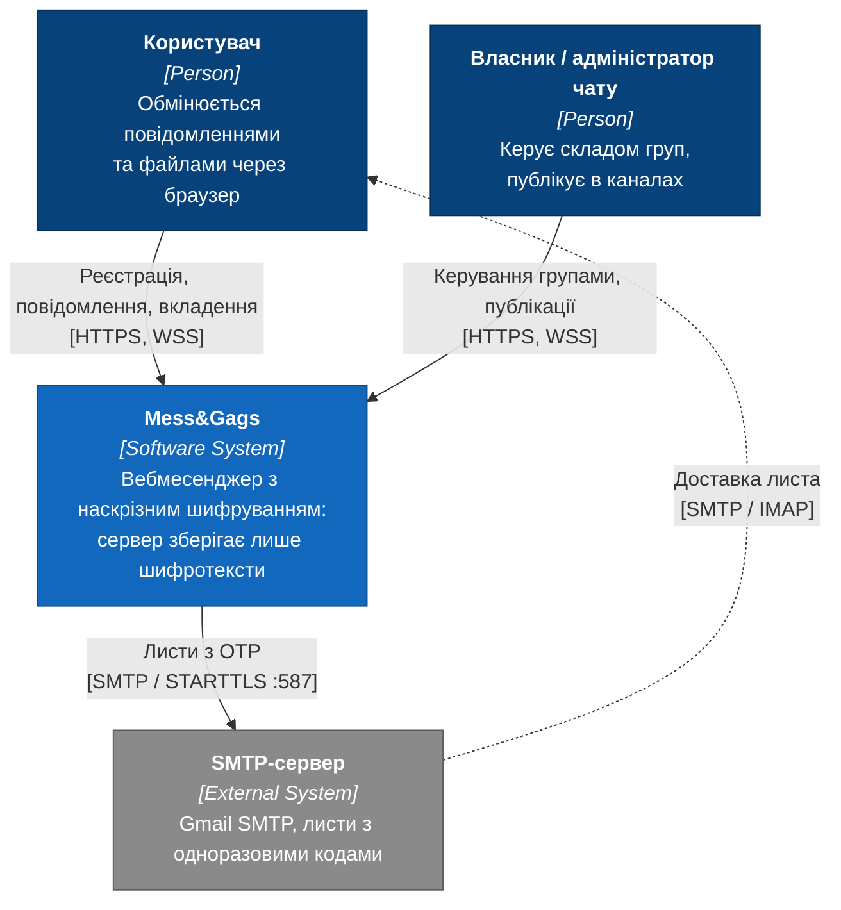
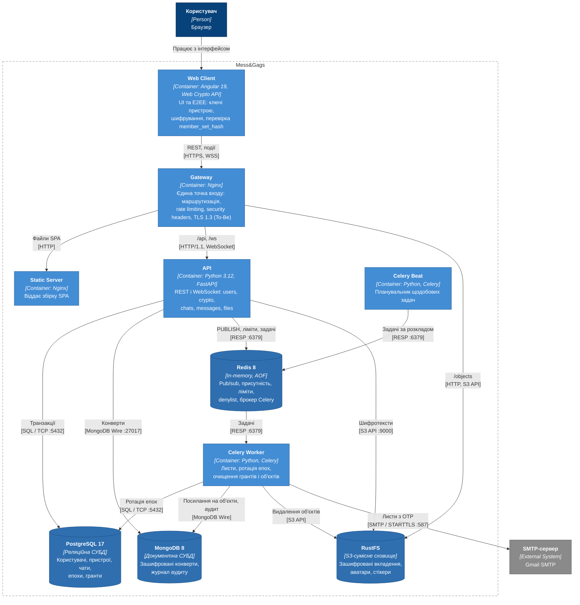
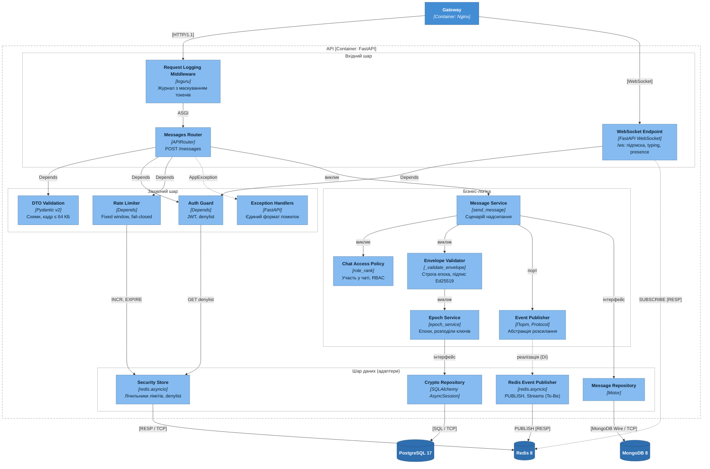
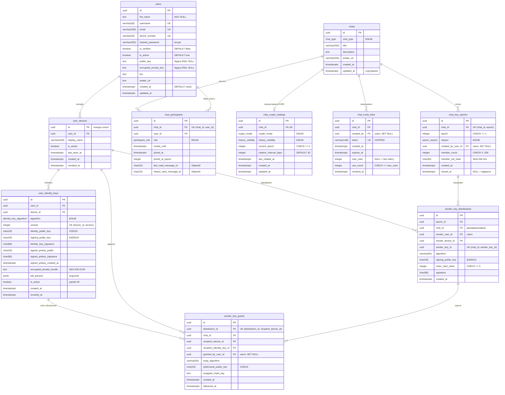
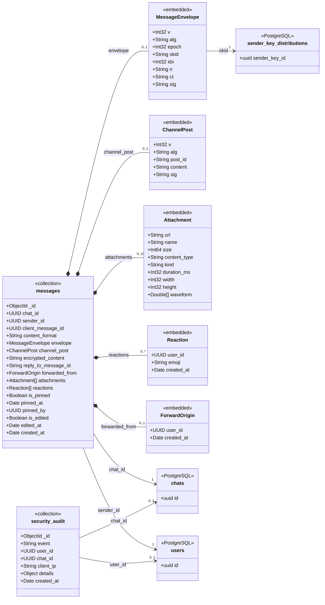
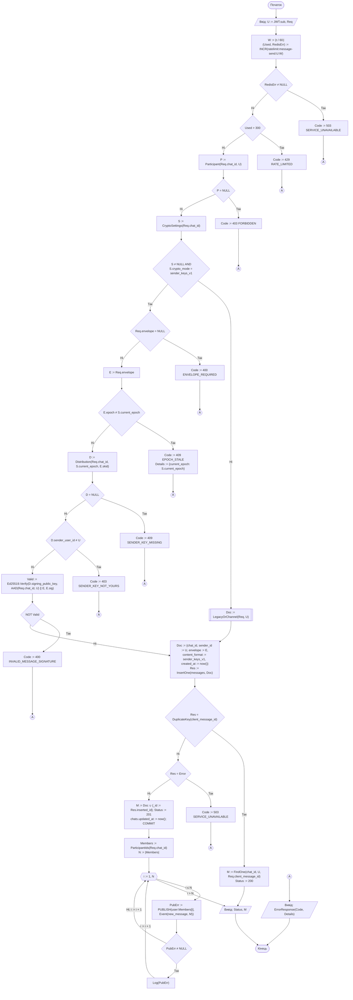
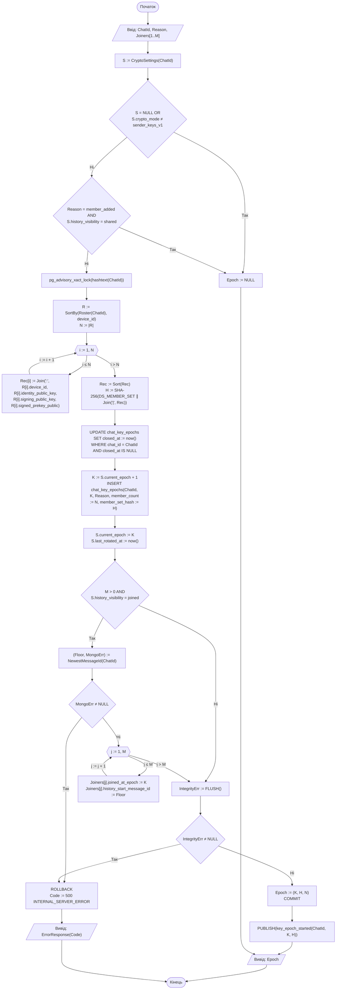
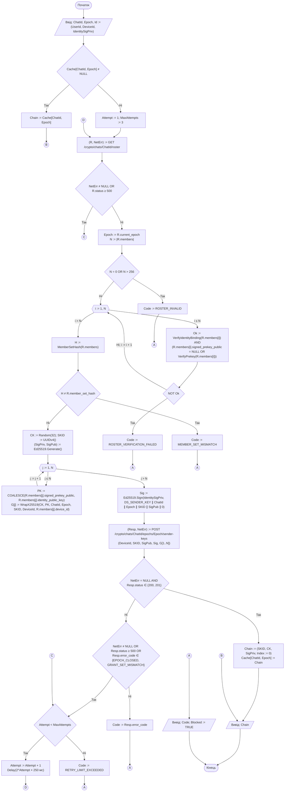

# РОЗДІЛ 2. ПРОЄКТУВАННЯ АРХІТЕКТУРИ СИСТЕМИ

> Розділ реалізує завдання 2–4 проєкту. Етапи 2–4 календарного плану: 19.10.2026 – 28.02.2027. Вимоги, на які посилаються діаграми, наведено в [специфікації вимог (SRS)](srs.md), ключове архітектурне рішення – в [ADR-001](adr/0001-choice-of-technology.md), API-контракт – у [api/openapi.yaml](api/openapi.yaml).

## 2.1 Контекстне та контейнерне моделювання системи (C4 Model)

Архітектуру описано за моделлю C4 у нотації Mermaid.js (Diagrams-as-Code): діаграми побудовано як flowchart зі стилями елементів C4 (Person, Software System, Container, Component, Database) і межами систем у вигляді subgraph. Діаграми зберігаються в репозиторії поруч із текстом і рендеряться GitHub.

### 2.1.1 Діаграма контексту (C4 Level 1)

<a id="diagram-level1"></a>



Рисунок 2.1 – Діаграма контексту системи (C4 Level 1)

| Елемент | Тип | Опис | Вимоги |
|---|---|---|---|
| Користувач | Person | Реєструється, обмінюється повідомленнями та вкладеннями через браузер | [SRS-FUN-01](srs.md#srs-fun-01), [SRS-FUN-18](srs.md#srs-fun-18) |
| Власник / адміністратор чату | Person | Змінює склад групи, публікує в каналах | [SRS-FUN-23](srs.md#srs-fun-23), [SRS-FUN-24](srs.md#srs-fun-24) |
| Mess&Gags | Software System | Вебмесенджер з наскрізним шифруванням; сервер зберігає лише шифротексти | [SRS, розділ 1](srs.md#1-system-context-контекст-системи) |
| SMTP-сервер | External System | Доставляє листи з одноразовими кодами підтвердження | [SRS-FUN-02](srs.md#srs-fun-02) |

| Зв’язок | Протокол | Призначення |
|---|---|---|
| Користувач → Mess&Gags | HTTPS, WSS | REST-запити та двобічний канал подій |
| Власник / адміністратор → Mess&Gags | HTTPS, WSS | Керування групами, публікації в каналах |
| Mess&Gags → SMTP-сервер | SMTP / STARTTLS, порт 587 | Надсилання OTP |
| SMTP-сервер → Користувач | SMTP / IMAP | Доставка листа до поштової скриньки |

### 2.1.2 Діаграма контейнерів (C4 Level 2)

<a id="diagram-level2"></a>



Рисунок 2.2 – Діаграма контейнерів системи (C4 Level 2)

Назовні опубліковано лише контейнер Gateway; СУБД, Redis і API доступні тільки у внутрішній мережі Docker Compose.

| Контейнер | Технологія | Відповідальність | Вимоги |
|---|---|---|---|
| Web Client | Angular 19, Web Crypto API | Інтерфейс; генерація ключів пристрою, шифрування повідомлень і вкладень, перевірка `member_set_hash`, safety number | [SRS-FUN-06](srs.md#srs-fun-06), [SRS-FUN-07](srs.md#srs-fun-07), [SRS-FUN-14](srs.md#srs-fun-14), [SRS-FUN-15](srs.md#srs-fun-15), [SRS-FUN-25](srs.md#srs-fun-25), [SRS-FUN-26](srs.md#srs-fun-26) |
| Gateway | Nginx | Єдина точка входу, маршрутизація `/api`, `/ws`, `/objects`, rate limiting, security headers, ліміт тіла запиту, TLS 1.3 (To-Be) | [SRS-NFR-SEC-02](srs.md#srs-nfr-sec-02) – [SRS-NFR-SEC-05](srs.md#srs-nfr-sec-05) |
| Static Server | Nginx | Віддає зібраний SPA | – |
| API | Python 3.12, FastAPI, Uvicorn | REST і WebSocket; домени `users`, `crypto`, `chats`, `messages`, `files`; перевірка епохи й підпису конвертів | [SRS-FUN-01](srs.md#srs-fun-01) – [SRS-FUN-04](srs.md#srs-fun-04), [SRS-FUN-08](srs.md#srs-fun-08) – [SRS-FUN-11](srs.md#srs-fun-11), [SRS-FUN-16](srs.md#srs-fun-16) – [SRS-FUN-24](srs.md#srs-fun-24), [SRS-FUN-27](srs.md#srs-fun-27), [SRS-FUN-28](srs.md#srs-fun-28) |
| Celery Worker | Python, Celery | Надсилання листів, ротація епох, очищення грантів, журналу аудиту та осиротілих об’єктів | [SRS-FUN-02](srs.md#srs-fun-02), [SRS-FUN-12](srs.md#srs-fun-12), [SRS-FUN-13](srs.md#srs-fun-13), [SRS-NFR-COMP-02](srs.md#srs-nfr-comp-02) |
| Celery Beat | Python, Celery | Планувальник щодобових задач | [SRS-FUN-12](srs.md#srs-fun-12) |
| PostgreSQL 17 | Реляційна СУБД | Користувачі, пристрої, чати, учасники, епохи, розподіли ключів, гранти (ACID-транзакції для атомарної ротації) | [SRS-FUN-11](srs.md#srs-fun-11) |
| MongoDB 8 | Документна СУБД | Незмінні зашифровані конверти повідомлень, журнал аудиту безпеки `security_audit` | [SRS-FUN-18](srs.md#srs-fun-18) |
| Redis 8 | In-memory, AOF | Pub/sub подій, присутність, лічильники rate limiting, denylist токенів, брокер Celery; персональні черги Redis Streams (To-Be) | [SRS-FUN-04](srs.md#srs-fun-04), [SRS-FUN-19](srs.md#srs-fun-19), [SRS-NFR-SEC-03](srs.md#srs-nfr-sec-03) |
| RustFS | S3-сумісне сховище | Шифротексти вкладень, аватари, стікери | [SRS-FUN-27](srs.md#srs-fun-27) |

| Зв’язок | Протокол | Призначення |
|---|---|---|
| Web Client → Gateway | HTTPS, WSS | REST-запити та події реального часу |
| Gateway → Static Server | HTTP | Статичні файли SPA |
| Gateway → API | HTTP/1.1, WebSocket | Проксіювання `/api` і `/ws` |
| Gateway → RustFS | HTTP, S3 API | Публічні об’єкти (`/objects`) |
| API → PostgreSQL | SQL / TCP 5432 (asyncpg) | Транзакції епох, чатів, ключів |
| API → MongoDB | MongoDB Wire Protocol / TCP 27017 (Motor) | Запис і читання конвертів |
| API → Redis | RESP / TCP 6379 | `PUBLISH` подій, лічильники, denylist, постановка задач Celery |
| API → RustFS | S3 API / HTTP 9000 (aiobotocore) | Збереження шифротекстів вкладень |
| Celery Beat → Redis | RESP / TCP 6379 | Публікація задач за розкладом |
| Celery Worker → Redis | RESP / TCP 6379 | Отримання задач |
| Celery Worker → PostgreSQL, MongoDB, RustFS | SQL / TCP, MongoDB Wire / TCP, S3 API / HTTP | Ротація епох, очищення грантів, журналу аудиту та об’єктів |
| Celery Worker → SMTP-сервер | SMTP / STARTTLS, порт 587 | Надсилання OTP |

## 2.2 Компонентне моделювання критичного сервісу системи

Для декомпозиції обрано контейнер **API** (FastAPI), оскільки в ньому зосереджено перевірку інваріантів E2EE на сервері: строгої епохи, підпису конверта та прав учасника. Діаграма відображає шлях надсилання зашифрованого повідомлення.

<a id="diagram-level3"></a>



Рисунок 2.3 – Діаграма компонентів контейнера API (C4 Level 3)

| Шар | Компонент | Відповідальність | Взаємодія | Вимоги |
|---|---|---|---|---|
| Наскрізний | Request Logging Middleware | Журнал запитів з маскуванням токенів у шляху | ASGI-конвеєр | [SRS-NFR-OBS-01](srs.md#srs-nfr-obs-01), [SRS-NFR-COMP-02](srs.md#srs-nfr-comp-02) |
| Вхідний | Messages Router | Кінцеві точки REST для повідомлень | Отримує залежності через `Depends`, викликає Message Service | [SRS-FUN-18](srs.md#srs-fun-18) |
| Вхідний | WebSocket Endpoint | Підключення, підписка на персональний канал, typing, presence | `Depends(get_ws_current_user)`, `SUBSCRIBE` у Redis | [SRS-FUN-18](srs.md#srs-fun-18), [SRS-NFR-SEC-04](srs.md#srs-nfr-sec-04) |
| Вхідний | DTO Validation | Валідація тіла запиту схемами Pydantic, ліміт кадру 64 КБ | Автоматично до виклику обробника | [SRS-NFR-SEC-04](srs.md#srs-nfr-sec-04) |
| Захисний | Auth Guard | Перевірка JWT з cookie та denylist | `Depends`, читання через Security Store | [SRS-FUN-03](srs.md#srs-fun-03), [SRS-FUN-04](srs.md#srs-fun-04) |
| Захисний | Rate Limiter | Fixed window, fail-closed | `Depends`, `INCR` / `EXPIRE` через Security Store | [SRS-NFR-SEC-03](srs.md#srs-nfr-sec-03) |
| Захисний | Exception Handlers | Перетворення `AppException`, `RequestValidationError` і необроблених винятків у єдиний формат відповіді | Обробники винятків FastAPI | – |
| Бізнес-логіка | Message Service | Сценарій надсилання: перевірка доступу, валідація конверта, збереження, публікація події | Інтерфейсні виклики портів | [SRS-FUN-18](srs.md#srs-fun-18) |
| Бізнес-логіка | Chat Access Policy | Участь у чаті, ранги ролей OWNER/ADMIN/MEMBER | Виклик функції | [SRS-FUN-23](srs.md#srs-fun-23), [SRS-FUN-24](srs.md#srs-fun-24) |
| Бізнес-логіка | Envelope Validator | Строга рівність епохи, наявність sender key, підпис Ed25519 | Виклик функції | [SRS-FUN-16](srs.md#srs-fun-16), [SRS-FUN-17](srs.md#srs-fun-17), [ADR-001](adr/0001-choice-of-technology.md) |
| Бізнес-логіка | Epoch Service | Поточна епоха, розподіли ключів, ротація | Через Crypto Repository | [SRS-FUN-11](srs.md#srs-fun-11), [ADR-001](adr/0001-choice-of-technology.md) |
| Бізнес-логіка | Event Publisher (порт) | Абстракція розсилання подій, від якої залежить Message Service | Protocol, реалізація через DI | [SRS-FUN-18](srs.md#srs-fun-18), [SRS-FUN-19](srs.md#srs-fun-19) |
| Дані | Message Repository | Збереження та читання конвертів | Motor → MongoDB | [SRS-FUN-18](srs.md#srs-fun-18) |
| Дані | Crypto Repository | Епохи, розподіли, гранти | SQLAlchemy AsyncSession → PostgreSQL | [SRS-FUN-11](srs.md#srs-fun-11) |
| Дані | Redis Event Publisher | Реалізація порту: `PUBLISH user:{id}`, у To-Be – `XADD` у Redis Streams | redis.asyncio → Redis | [SRS-FUN-19](srs.md#srs-fun-19) |
| Дані | Security Store | Лічильники rate limiting і denylist токенів | redis.asyncio → Redis | [SRS-FUN-04](srs.md#srs-fun-04), [SRS-NFR-SEC-03](srs.md#srs-nfr-sec-03) |

Залежності спрямовані від вхідного шару до бізнес-логіки, а від бізнес-логіки – до портів. Реалізації портів (репозиторії, Redis Event Publisher) підставляються механізмом `Depends`, тому сервіси не залежать від драйверів СУБД. Розподіл на порти Message Repository, Crypto Repository та Event Publisher є цільовою структурою: у поточному коді сервіси використовують `AsyncSession` і колекції Motor безпосередньо, а розсилання подій виконує функція `_broadcast` у модулі маршрутизатора (router). Перенесення розсилання в Event Publisher виконується разом із реалізацією черги Redis Streams ([SRS-FUN-19](srs.md#srs-fun-19)).

## 2.3 Документування архітектурних рішень (Architecture Decision Records)

Архітектурні рішення фіксуються у форматі ADR за шаблоном Майкла Нігардза в каталозі [adr/](adr/).

| ADR | Рішення | Статус |
|---|---|---|
| [ADR-001](adr/0001-choice-of-technology.md) | Вибір схеми групового наскрізного шифрування: sender-key ratchet з явною моделлю епох замість попарних сесій Double Ratchet, класичних Sender Keys і MLS | Approved |

## 2.4 Проєктування та документування моделей даних

Шар збереження даних побудовано за принципом polyglot persistence відповідно до контейнерів рівня 2 ([рисунок 2.2](#diagram-level2)). Кожне сховище обрано за характером даних:

| Сховище | Дані | Обґрунтування вибору |
|---|---|---|
| PostgreSQL 17 | Користувачі, пристрої, ключі ідентичності, чати, учасники, епохи, розподіли ключів відправників, гранти, запрошення, теки, стікери | ACID-транзакції: ротація епохи фіксується в одній транзакції зі зміною складу учасників ([SRS-FUN-11](srs.md#srs-fun-11)); обмеження FK, UNIQUE і часткові індекси гарантують криптографічні інваріанти на рівні СУБД |
| MongoDB 8 | Зашифровані конверти повідомлень (`messages`), журнал аудиту безпеки (`security_audit`) | Незмінні документи змінної форми (конверт, публікація каналу або застарілий формат), висока інтенсивність вставки, читання сторінками за `chat_id`; журнал аудиту не конкурує за блокування рядків з транзакційними таблицями |
| Redis 8 | Лічильники rate limiting, denylist токенів, присутність, канали pub/sub, брокер Celery | Короткоживучі ключі з TTL, атомарні `INCR` / `EXPIRE` |

Схеми описано кодом Mermaid.js (Diagrams-as-Code): реляційна модель – синтаксисом `erDiagram` у нотації Crow’s Foot, документна – синтаксисом `classDiagram` зі стереотипами `<<collection>>` і `<<embedded>>`.

Загальні правила моделі:

- **Первинні ключі** – UUID v4 (16 байт). Послідовні цілі ключі не застосовано: ідентифікатор пристрою генерує клієнт до реєстрації (він входить до підписаного повідомлення прив’язки ключа), а UUID не дозволяє перебирати ресурси за порядковим номером.
- **Час** – `timestamptz` у UTC; у MongoDB – тип BSON `Date`.
- **Перелічувані значення** – типи `ENUM` PostgreSQL, однакові з перелічуваннями Pydantic і схемами `openapi.yaml`.
- **Двійкові ключі** – base64url без доповнення фіксованої довжини: 43 символи для 32-байтових ключів X25519 і Ed25519, 86 символів для 64-байтових підписів Ed25519.
- **Видалення** – персональні дані видаляються фізично каскадом `ON DELETE CASCADE` ([SRS-FUN-05](srs.md#srs-fun-05), GDPR ст. 17); soft delete для них свідомо не застосовано. Криптографічні ключі не видаляються, а відкликаються (`is_active := false`, `revoked_at := now()`), щоб зміна ключа залишала слід для розслідування.
- **Конкурентний доступ** – замість оптимістичного блокування через стовпець версії: виділення епохи серіалізується транзакційним advisory-блокуванням `pg_advisory_xact_lock` з резервним обмеженням `UNIQUE (chat_id, epoch)`; лічильник використань запрошення змінюється атомарним `UPDATE … WHERE use_count < max_uses`.

### 2.4.1 Реляційна модель PostgreSQL

<a id="diagram-erd-core"></a>



Рисунок 2.4 – ERD ядра системи: ідентичність, чати та криптографічний домен (PostgreSQL 17)

Службові зовнішні ключі до `users` (`user_identity_keys.user_id`, `chat_key_epochs.created_by_user_id`, `sender_key_distributions.sender_user_id`, `sender_key_grants.granted_by_user_id`, `chat_invite_links.created_by`) позначено в атрибутах і не продубльовано лініями, щоб не перевантажувати рисунок.

<a id="diagram-erd-aux"></a>


Рисунок 2.5 – ERD допоміжних сутностей: контакти, теки чатів, стікери

#### Специфікація таблиць

**`users`** – обліковий запис ([SRS-FUN-01](srs.md#srs-fun-01)).

| Поле | Тип | Обмеження | Опис |
|---|---|---|---|
| `id` | uuid | PK | Ідентифікатор користувача |
| `full_name` | text | NOT NULL, довжина ≤ 30 перевіряється схемою | Відображуване ім’я |
| `username` | varchar(50) | UNIQUE, NOT NULL, B-tree | Унікальне ім’я, `^[A-Za-z][A-Za-z0-9_]*$` |
| `email` | varchar(255) | UNIQUE, NOT NULL | Адреса для OTP |
| `phone_number` | varchar(20) | UNIQUE, NOT NULL | Номер телефону |
| `hashed_password` | varchar(255) | NOT NULL | Хеш bcrypt (60 символів) |
| `is_verified` | boolean | DEFAULT false | Email підтверджено |
| `is_active` | boolean | DEFAULT true | Обліковий запис не вимкнено |
| `public_key`, `encrypted_private_key` | text | NULL (To-Be) | Застаріла схема RSA; вилучаються після міграції всіх чатів на `sender_keys_v1` |
| `bio`, `avatar_url` | text | NULL | Профіль |
| `created_at`, `updated_at` | timestamptz | `created_at` DEFAULT now() | Аудит змін рядка |

**`user_devices`** – встановлення клієнта зі своєю парою ключів.

| Поле | Тип | Обмеження | Опис |
|---|---|---|---|
| `id` | uuid | PK, генерує клієнт | Входить до підпису прив’язки ключа ідентичності |
| `user_id` | uuid | FK → users, CASCADE, B-tree | Власник |
| `display_name` | varchar(100) | NOT NULL | Назва пристрою |
| `is_active` | boolean | NOT NULL | Пристрій не відкликано |
| `last_seen_at`, `created_at`, `revoked_at` | timestamptz | – | Життєвий цикл пристрою ([SRS-FUN-10](srs.md#srs-fun-10)) |

**`user_identity_keys`** – публічні ключі пристрою і зашифрований пакет приватних ключів ([SRS-FUN-06](srs.md#srs-fun-06) – [SRS-FUN-09](srs.md#srs-fun-09)).

| Поле | Тип | Обмеження | Опис |
|---|---|---|---|
| `id` | uuid | PK | Ідентифікатор версії ключа |
| `user_id` | uuid | FK → users, CASCADE | Денормалізовано для пакетного запиту ключів за списком користувачів |
| `device_id` | uuid | FK → user_devices, CASCADE | Пристрій |
| `algorithm` | enum `identity_key_algorithm` | NOT NULL | `x25519_ed25519_v1` |
| `version` | integer | UNIQUE (device_id, version) | Номер версії ключа пристрою |
| `identity_public_key` | char(43) | NOT NULL, CHECK довжини (To-Be) | X25519, узгодження ключів |
| `signing_public_key` | char(43) | NOT NULL | Ed25519, підписи |
| `identity_key_signature` | char(86) | NOT NULL | Ed25519 над `DS_IDENTITY_BIND ∥ user_id ∥ device_id ∥ identity_public_key` |
| `signed_prekey_public`, `signed_prekey_signature`, `signed_prekey_created_at` | char(43), char(86), timestamptz | NULL | Signed prekey, ротація приблизно щотижня |
| `encrypted_private_bundle` | text | NOT NULL | Пакет приватних ключів, AES-256-GCM |
| `kdf_params` | jsonb | NOT NULL | `{kdf, m, t, p, salt, nonce}` Argon2id; сервер відхиляє m < 19 МіБ або t < 2 |
| `is_active` | boolean | Частковий UNIQUE (device_id) WHERE is_active | Не більше одного активного ключа на пристрій |
| `created_at`, `revoked_at` | timestamptz | – | Попередні ключі зберігаються для аудиту |

**`chats`** і **`chat_participants`** – чати та членство ([SRS-FUN-21](srs.md#srs-fun-21) – [SRS-FUN-23](srs.md#srs-fun-23)).

| Поле | Тип | Обмеження | Опис |
|---|---|---|---|
| `chats.id` | uuid | PK | Ідентифікатор чату |
| `chats.chat_type` | enum `chat_type` | NOT NULL | `private`, `group`, `channel` |
| `chats.title`, `chats.description`, `chats.avatar_url` | varchar(255), text, varchar(255) | NULL | Атрибути групи або каналу |
| `chats.updated_at` | timestamptz | Індекс (To-Be) | Час останнього повідомлення, сортування списку чатів |
| `chat_participants.id` | uuid | PK | Ідентифікатор членства |
| `chat_participants.chat_id`, `user_id` | uuid | FK, CASCADE; UNIQUE (chat_id, user_id) | Членство без дублікатів |
| `chat_participants.role` | enum `participant_role` | NOT NULL, DEFAULT member | `owner`, `admin`, `member` |
| `chat_participants.muted_until`, `joined_at` | timestamptz | – | Сповіщення та дата приєднання |
| `chat_participants.joined_at_epoch` | integer | NULL | Епоха приєднання при `history_visibility = joined` |
| `chat_participants.last_read_message_id` | char(24) | NULL | ObjectId останнього прочитаного повідомлення (стан прочитання на учасника) |
| `chat_participants.history_start_message_id` | char(24) | NULL | Нижня межа історії для учасника, що приєднався |

**`chat_crypto_settings`** – налаштування E2EE чату (зв’язок 1:0..1 з `chats`).

| Поле | Тип | Обмеження | Опис |
|---|---|---|---|
| `id` | uuid | PK | Сурогатний ключ |
| `chat_id` | uuid | FK → chats, CASCADE; UNIQUE | Чат |
| `crypto_mode` | enum `crypto_mode` | NOT NULL | `legacy`, `sender_keys_v1`, `not_encrypted` (канали) |
| `history_visibility` | enum `history_visibility` | NOT NULL | `joined` або `shared` |
| `current_epoch` | integer | NOT NULL, CHECK ≥ 0 | Номер відкритої епохи |
| `rotation_interval_days` | integer | DEFAULT 30 | Період планової ротації ([SRS-FUN-12](srs.md#srs-fun-12)) |
| `last_rotated_at`, `created_at`, `updated_at` | timestamptz | – | Час останньої ротації |

**`chat_key_epochs`** – період ключів чату; ключового матеріалу не містить ([ADR-001](adr/0001-choice-of-technology.md)).

| Поле | Тип | Обмеження | Опис |
|---|---|---|---|
| `id` | uuid | PK | Ідентифікатор епохи |
| `chat_id` | uuid | FK → chats, CASCADE | Чат |
| `epoch` | integer | NOT NULL, CHECK ≥ 1; UNIQUE (chat_id, epoch) | Номер епохи |
| `reason` | enum `epoch_reason` | NOT NULL | `initial`, `member_added`, `member_removed`, `device_revoked`, `periodic`, `manual` |
| `created_by_user_id` | uuid | FK → users, SET NULL | Ініціатор |
| `member_count` | integer | NOT NULL, CHECK 0..256 | Кількість пристроїв складу |
| `member_set_hash` | char(64) | NOT NULL, CHECK `^[0-9a-f]{64}$` | SHA-256 відсортованого складу разом з публічними ключами ([SRS-FUN-14](srs.md#srs-fun-14)) |
| `created_at`, `closed_at` | timestamptz | Частковий UNIQUE (chat_id) WHERE closed_at IS NULL (To-Be) | `closed_at IS NULL` – відкрита епоха; не більше однієї на чат |

**`sender_key_distributions`** – публічна частина ланцюжка відправника в епосі.

| Поле | Тип | Обмеження | Опис |
|---|---|---|---|
| `id` | uuid | PK | Ідентифікатор розподілу |
| `epoch_id` | uuid | FK → chat_key_epochs, CASCADE | Епоха |
| `chat_id` | uuid | FK → chats; композитний FK (epoch_id, chat_id) → chat_key_epochs (id, chat_id) (To-Be) | Денормалізовано: усі шляхи читання фільтрують за чатом |
| `sender_user_id` | uuid | FK → users, CASCADE | Денормалізовано для перевірки власника ланцюжка під час надсилання без з’єднання з `user_devices` |
| `sender_device_id` | uuid | FK → user_devices, CASCADE | Пристрій відправника |
| `sender_key_id` | uuid | UNIQUE (chat_id, sender_key_id) | Поле `skid` конверта |
| `algorithm` | varchar(64) | NOT NULL | Алгоритм ланцюжка |
| `signing_public_key` | char(43) | NOT NULL | Ключ Ed25519 ланцюжка для перевірки підписів конвертів |
| `chain_start_index` | integer | CHECK ≥ 0 | Початковий індекс ланцюжка |
| `signature` | char(86) | NOT NULL | Підпис розподілу довготривалим ключем пристрою |

Розподіли не видаляються: вони містять ключі перевірки підписів історичних повідомлень.

**`sender_key_grants`** – ключ ланцюжка, обгорнутий для одного пристрою-адресата. Обсяг таблиці зростає як S × (N − 1) на епоху, тому для зашифрованих груп діє ліміт 256 учасників ([SRS-FUN-22](srs.md#srs-fun-22)).

| Поле | Тип | Обмеження | Опис |
|---|---|---|---|
| `id` | uuid | PK | Ідентифікатор гранту |
| `distribution_id` | uuid | FK → sender_key_distributions, CASCADE; UNIQUE (distribution_id, recipient_device_id) | Один грант на пристрій |
| `chat_id` | uuid | FK → chats, CASCADE; індекс (chat_id, recipient_device_id) | Основний запит «гранти для мого пристрою в чаті» |
| `recipient_device_id` | uuid | FK → user_devices, CASCADE; індекс (To-Be) | Пристрій-адресат |
| `recipient_identity_key_id` | uuid | FK → user_identity_keys, CASCADE; індекс (To-Be) | Версія ключа, якою обгорнуто грант |
| `granted_by_user_id` | uuid | FK → users, SET NULL | Власник ланцюжка або учасник, що передає історію новому учаснику |
| `wrap_algorithm` | varchar(64) | NOT NULL | X25519 + HKDF-SHA256 + AES-256-GCM |
| `ephemeral_public_key` | char(43) | NOT NULL | Ефемерний ключ X25519 |
| `wrapped_chain_key` | text | NOT NULL | Зашифрований ключ ланцюжка |
| `created_at`, `delivered_at` | timestamptz | – | `delivered_at` дозволяє видаляти гранти закритих епох після отримання ([SRS-FUN-13](srs.md#srs-fun-13)) |

**`chat_invite_links`** – запрошення до групи або каналу.

| Поле | Тип | Обмеження | Опис |
|---|---|---|---|
| `id` | uuid | PK | Ідентифікатор запрошення (лише він потрапляє до журналу аудиту) |
| `chat_id` | uuid | FK → chats, CASCADE | Чат |
| `created_by` | uuid | FK → users, SET NULL | Автор |
| `token` | varchar(128) | UNIQUE, NOT NULL | 32 байти `secrets.token_urlsafe` |
| `expires_at`, `revoked_at` | timestamptz | NULL | Строк дії та відкликання |
| `max_uses`, `use_count` | integer | CHECK use_count ≤ max_uses (To-Be) | NULL у `max_uses` – без обмеження |

**Допоміжні таблиці** (рисунок 2.5): `contacts` – записна книга, PK (owner_id, contact_id), CHECK owner_id ≠ contact_id (To-Be); `chat_folders` і `folder_items` – теки чатів (M:N між теками і чатами через `folder_items`); `sticker_packs`, `stickers` – набори стікерів, UNIQUE (pack_id, position) (To-Be); `sticker_pack_subscriptions` – M:N між користувачами і публічними наборами з PK (user_id, pack_id).

### 2.4.2 Документна модель MongoDB

<a id="diagram-nosql"></a>



Рисунок 2.6 – Документна модель MongoDB 8 (композиція – вкладені документи, асоціація – посилання на сутності PostgreSQL)

**Стратегія вкладення та посилань.** Конверт, публікація каналу, вкладення, реакції та дані пересилання вкладено в документ повідомлення: вони читаються разом з ним і не існують окремо. Посилання (`chat_id`, `sender_id`, `envelope.skid`) ведуть до PostgreSQL, де зберігаються сутності зі змінним станом. Розмір документа обмежено: конверт ≤ 64 КБ (ліміт кадру), до 10 вкладень, реакції обмежено складом групи (≤ 256 учасників); для каналів верхню межу реакцій на документ задає перевірка схеми (To-Be). Таким чином документ на порядки менший за ліміт BSON 16 МБ.

**Колекція `messages`**

| Поле | Тип BSON | Обмеження | Опис |
|---|---|---|---|
| `_id` | ObjectId | PK | Курсор пагінації (монотонно зростає) |
| `chat_id` | Binary UUID | NOT NULL | Посилання на `chats.id` |
| `sender_id` | Binary UUID | NOT NULL | Посилання на `users.id`; береться з JWT |
| `client_message_id` | Binary UUID | Частковий UNIQUE (chat_id, sender_id, client_message_id) (To-Be) | Ключ ідемпотентності ([SRS-FUN-20](srs.md#srs-fun-20)) |
| `content_format` | String (enum) | NOT NULL | `legacy_plaintext`, `legacy_rsa`, `sender_keys_v1`, `channel_signed_v1` |
| `envelope` | MessageEnvelope | Рівно одне з трьох полів вмісту | Зашифрований конверт |
| `channel_post` | ChannelPost | – | Підписана публікація каналу |
| `encrypted_content` | String | – | Застарілий формат |
| `reply_to_message_id` | String (24 hex) | NULL; To-Be: тип ObjectId | Посилання на інше повідомлення того самого чату |
| `forwarded_from` | ForwardOrigin | NULL | Заява пересилача про автора (не перевіряється сервером) |
| `attachments` | Array\<Attachment\> | ≤ 10 | Метадані зашифрованих вкладень |
| `reactions` | Array\<Reaction\> | – | Одна реакція на emoji від користувача |
| `is_pinned`, `pinned_at`, `pinned_by` | Boolean, Date, Binary UUID | – | Закріплення |
| `is_edited`, `edited_at` | Boolean, Date | `edited_at` To-Be | Редагування |
| `created_at` | Date | NOT NULL | Час прийняття сервером |

Поле `is_read` позначено як застаріле: стан прочитання зберігається для кожного учасника в `chat_participants.last_read_message_id`; поле видаляється після оновлення клієнтів.

**Вкладені документи**

| Документ | Поля | Опис |
|---|---|---|
| MessageEnvelope | `v` Int32 ≥ 1; `alg` String ≤ 32; `epoch` Int32 ≥ 0; `skid` String (UUID); `idx` Int32 ≥ 0; `n` String (12-байтовий nonce, 16 символів); `ct` String (шифротекст і тег GCM); `sig` String (86 символів) | `chat_id` і `sender_id` до конверта не входять: вони прив’язані до AAD |
| ChannelPost | `v`, `alg`, `post_id` (UUID), `content` ≤ 64 000 символів, `sig` | Публікація каналу підписана, але не зашифрована |
| Attachment | `url` (один ключ об’єкта RustFS), `name` ≤ 255, `size` Int64 ≤ 50 МБ, `content_type`, `kind` (`file`, `image`, `video`, `gif`, `audio`, `sticker`), `duration_ms`, `width`, `height`, `waveform` ≤ 64 значень | Вміст вкладення зашифровано клієнтом ([SRS-FUN-26](srs.md#srs-fun-26)) |
| Reaction | `user_id` Binary UUID, `emoji` ≤ 8, `created_at` Date | – |
| ForwardOrigin | `user_id` Binary UUID, `created_at` Date | – |

**Колекція `security_audit`** – журнал подій безпеки, лише метадані без вмісту повідомлень, ключів, OTP і паролів ([SRS-NFR-COMP-02](srs.md#srs-nfr-comp-02)).

| Поле | Тип BSON | Опис |
|---|---|---|
| `_id` | ObjectId | Ідентифікатор запису |
| `event` | String (enum, 19 значень) | `login_succeeded`, `identity_published`, `device_revoked`, `participants_removed` тощо |
| `user_id`, `chat_id` | Binary UUID, NULL | Суб’єкт і чат |
| `client_ip` | String | Перша адреса з `X-Forwarded-For` |
| `details` | Object | Ідентифікатори та причини, без секретів |
| `created_at` | Date | TTL-індекс 365 днів (To-Be) |

### 2.4.3 Ключі Redis

| Шаблон ключа | Тип | TTL | Призначення |
|---|---|---|---|
| `ratelimit:{scope}:{id}:{window}` | String (лічильник) | Довжина вікна | Fixed window, `INCR` + `EXPIRE` ([SRS-NFR-SEC-03](srs.md#srs-nfr-sec-03)) |
| `blacklist:{sha256(token)}` | String | Залишок строку дії токена | Denylist відкликаних JWT ([SRS-FUN-04](srs.md#srs-fun-04)); у ключі зберігається хеш токена (To-Be), а не сам токен |
| `force_logout:{user_id}` | String (timestamp) | 7 днів | Відкликання всіх сесій, виданих до моменту зміни пароля |
| `presence:{user_id}`, `status:{user_id}` | String | Сесія WebSocket | Присутність користувача |
| `user:{user_id}` | Канал pub/sub | – | Події реального часу ([SRS-FUN-18](srs.md#srs-fun-18)) |
| `stream:user:{user_id}` | Stream | Обмеження `MAXLEN` (To-Be) | Персональна черга подій до підтвердження ([SRS-FUN-19](srs.md#srs-fun-19)) |

### 2.4.4 План індексування

| Індекс | Сховище, об’єкт | Тип | Запит, який обслуговує | Стан |
|---|---|---|---|---|
| `ix_chat_id_id` (chat_id, _id DESC) | MongoDB, messages | B-tree складений | Історія чату з курсором `before_id`, останнє повідомлення для списку чатів | Наявний |
| `ix_chat_sender_read` (chat_id, sender_id, is_read) | MongoDB, messages | B-tree складений | Застаріле позначення прочитання | Видаляється разом з `is_read` |
| `ix_attachment_url`, `ix_chat_attachment_url` | MongoDB, messages | B-tree, sparse | Перевірка посилань на об’єкт перед видаленням і перед пересиланням | Наявний |
| `ux_chat_sender_client_msg` (chat_id, sender_id, client_message_id) | MongoDB, messages | B-tree, unique, partial | Ідемпотентне надсилання | To-Be |
| `ix_audit_user_time`, `ix_audit_event_time` | MongoDB, security_audit | B-tree складений | Розслідування за користувачем і типом події | Наявний |
| `ttl_audit_created_at` (created_at, expireAfterSeconds = 31 536 000) | MongoDB, security_audit | TTL | Автоматичне видалення записів старших за 365 днів; замінює `ix_audit_time` | To-Be |
| `uq_chat_user` | PostgreSQL, chat_participants | B-tree unique | Перевірка участі в чаті (кожен запит) | Наявний |
| `uq_chat_epoch` | PostgreSQL, chat_key_epochs | B-tree unique | Пошук епохи за номером | Наявний |
| `uq_open_epoch_per_chat` (chat_id) WHERE closed_at IS NULL | PostgreSQL, chat_key_epochs | B-tree unique, частковий | Інваріант «одна відкрита епоха на чат» | To-Be |
| `uq_skd_chat_sender_key_id` | PostgreSQL, sender_key_distributions | B-tree unique | Пошук розподілу за `skid` конверта під час надсилання | Наявний |
| `ix_grant_chat_recipient` (chat_id, recipient_device_id) | PostgreSQL, sender_key_grants | B-tree складений | Гранти для пристрою в чаті | Наявний |
| `ix_grant_recipient_device`, `ix_grant_recipient_identity_key` | PostgreSQL, sender_key_grants | B-tree | Каскадне видалення під час відкликання пристрою або ключа без повного сканування | To-Be |
| `uq_identity_key_active_per_device` (device_id) WHERE is_active | PostgreSQL, user_identity_keys | B-tree unique, частковий | Активний ключ пристрою | Наявний |
| `ix_chats_updated_at` (updated_at DESC) | PostgreSQL, chats | B-tree | Сортування списку чатів | To-Be |
| `chat_invite_links.token` | PostgreSQL | B-tree unique | Приєднання за запрошенням | Наявний |

Індекси GIN і векторні індекси (HNSW, IVF) не застосовуються: сервер не має доступу до відкритого тексту, тому повнотекстовий і семантичний пошук за вмістом можливий лише на клієнті.

### 2.4.5 Відмінності цільової схеми від поточних міграцій

Позначки To-Be у таблицях означають зміни, які вносяться міграціями Alembic і змінами схем Pydantic у Розділі 3:

1. CHECK-обмеження довжини для ключів (`char(43)`), підписів (`char(86)`) і `member_set_hash` (`char(64)`); тип `char(24)` для ObjectId у `chat_participants`.
2. Частковий унікальний індекс `uq_open_epoch_per_chat` і композитний FK `(epoch_id, chat_id)` у `sender_key_distributions`.
3. Індекси на `sender_key_grants.recipient_device_id`, `recipient_identity_key_id` і `chats.updated_at`; вилучення надлишкового стовпця `sender_key_grants.recipient_user_id`, який записується, але не читається (транзитивна залежність через `recipient_device_id`).
4. CHECK-обмеження `use_count ≤ max_uses`, `owner_id ≠ contact_id`, UNIQUE (pack_id, position).
5. Поля `client_message_id` і `edited_at` у `messages`, тип ObjectId для `reply_to_message_id` (зараз рядок), частковий унікальний індекс ідемпотентності, TTL-індекс журналу аудиту, перевірка схеми колекції `$jsonSchema`.
6. Зберігання в denylist хешу SHA-256 токена замість самого токена.
7. Зміна `users.public_key` і `users.encrypted_private_key` на NULL з подальшим вилученням.

## 2.5 Специфікація міжсервісних контрактів (API)

Контракт описано за підходом API-First Design у форматі **OpenAPI 3.0.3** (YAML). Деталізовану специфікацію кінцевих точок зафіксовано у файлі [openapi.yaml](api/openapi.yaml); файл проходить валідацію `openapi-spec-validator` і придатний для генерації серверних заготовок і клієнтського SDK (наприклад, OpenAPI Generator для TypeScript Angular).

**Між якими контейнерами реалізовано інтерфейс.** Контракт описує взаємодію **Web Client (Angular 19) → Gateway (Nginx) → API (FastAPI)** з [рисунка 2.2](#diagram-level2). Gateway знімає префікс `/api`, застосовує ліміти `limit_req` і проксіює запит до API без зміни тіла, тому базова адреса контракту – `https://{host}/api`. Події реального часу (WebSocket `/ws`, подія `new_message`) передають ту саму схему `Message` і в OpenAPI не описуються.

Контракт покриває критичний бізнес-сценарій – надсилання повідомлення в зашифрованому чаті:

| № | Метод і шлях | Призначення | Відповіді | Вимоги |
|---|---|---|---|---|
| 1 | `POST /auth/login` | Вхід, видача JWT у cookie HttpOnly | 200, 401, 403, 422, 429, 500 | [SRS-FUN-03](srs.md#srs-fun-03) |
| 2 | `GET /crypto/chats/{chat_id}/roster` | Склад пристроїв і збережений `member_set_hash` | 200, 401, 403, 404, 409, 500 | [SRS-FUN-14](srs.md#srs-fun-14) |
| 3 | `POST /crypto/chats/{chat_id}/epochs/{epoch}/sender-keys` | Публікація ланцюжка відправника з грантами для всіх пристроїв | 201, 400, 401, 403, 404, 409, 413, 422, 429, 500 | [SRS-FUN-11](srs.md#srs-fun-11), [SRS-FUN-14](srs.md#srs-fun-14) |
| 4 | `GET /crypto/chats/{chat_id}/keys` | Епохи і гранти для пристроїв користувача | 200, 401, 403, 500 | [SRS-FUN-15](srs.md#srs-fun-15) |
| 5 | `POST /messages` | Надсилання конверта зі строгою перевіркою епохи та підпису | 201, 200 (ідемпотентний повтор), 400, 401, 403, 409, 413, 422, 429, 500, 503 | [SRS-FUN-16](srs.md#srs-fun-16) – [SRS-FUN-18](srs.md#srs-fun-18), [SRS-FUN-20](srs.md#srs-fun-20) |
| 6 | `GET /chats/{chat_id}/messages` | Історія з курсорною пагінацією (`limit` 1..100, `before_id`) | 200, 400, 401, 403, 422, 500 | [SRS-FUN-18](srs.md#srs-fun-18) |

**Безпека.** Схема `cookieAuth` (`type: apiKey`, `in: cookie`, `name: access_token`) описує JWT HS256 у cookie з атрибутами HttpOnly, Secure, SameSite=Lax і TTL 1 800 с. Схему Bearer у заголовку `Authorization` не застосовано: токен у HttpOnly-cookie недоступний JavaScript, що виключає його викрадення через XSS. SameSite=Lax блокує надсилання cookie у міжсайтових POST-запитах. Глобальне правило `security` поширюється на всі операції, крім `POST /auth/login` (`security: []`).

**Модель помилок.** Усі відповіді 4xx/5xx мають єдину схему `ErrorResponse` (`status`, `error_code`, `message`, `details`), однакову з обробниками винятків FastAPI. Машинно-читані коди дозволяють клієнту реагувати без розбору тексту: `EPOCH_STALE` (409) – повторно зашифрувати повідомлення для епохи з `details.current_epoch`; `GRANT_SET_MISMATCH` (400) – отримати склад повторно; `RATE_LIMITED` (429) – чекати `details.retry_after_seconds`.

**Валідація вхідних даних.** Ключі та підписи мають шаблони фіксованої довжини (`^[A-Za-z0-9_-]{43}$`, `{86}`), `member_set_hash` – `^[0-9a-f]{64}$`, ObjectId – `^[0-9a-f]{24}$`; масиви обмежено (`grants` ≤ 256, `attachments` ≤ 10, сторінка історії ≤ 100); `MessageCreateRequest` вимагає рівно одне поле вмісту (`oneOf`); `additionalProperties: false` відхиляє невідомі поля.

Фрагмент контракту – операція надсилання повідомлення:

```yaml
  /messages:
    post:
      tags: [Messages]
      operationId: sendMessage
      requestBody:
        required: true
        content:
          application/json:
            schema:
              $ref: '#/components/schemas/MessageCreateRequest'
      responses:
        '201':
          description: Повідомлення створено
          content:
            application/json:
              schema:
                $ref: '#/components/schemas/MessageSuccessResponse'
        '409':
          description: EPOCH_STALE або SENDER_KEY_MISSING
          content:
            application/json:
              schema:
                $ref: '#/components/schemas/ErrorResponse'
        '429':
          $ref: '#/components/responses/TooManyRequests'
components:
  securitySchemes:
    cookieAuth:
      type: apiKey
      in: cookie
      name: access_token
```

Елементи цільової моделі, яких ще немає в коді (`client_message_id`, статус 201, `edited_at`, заголовок `Retry-After`), позначено в контракті розширенням `x-implementation-status: planned`.

## 2.6 Моделювання логіки критичних вузлів системи

Для алгоритмізації обрано три вузли, у яких зосереджено інваріанти наскрізного шифрування: прийом зашифрованого повідомлення сервером, ротацію епохи та розподіл ключа відправника клієнтом. Блок-схеми виконано за ГОСТ 19.701-90 (ISO 5807:1985) у нотації Mermaid.js:

| Символ | Mermaid | Призначення |
|---|---|---|
| Термінатор | `([…])` | Початок і кінець |
| Дані | `[/…/]` | Ввід і вивід |
| Процес | `[…]` | Операції присвоювання `:=` |
| Рішення | `{…}` | Умови з операторами AND, OR, NOT |
| Підготовка | `{{…}}` | Заголовок циклу з параметром `i := 1, N` |
| Визначений процес | `[[…]]` | Виклик описаного окремо алгоритму |
| З’єднувач | `((A))` | Продовження лінії потоку з тією самою міткою |

Позначення: `:=` – присвоювання; `=`, `≠`, `>`, `≤` – порівняння; `∥` – конкатенація байтових рядків; `|X|` – потужність множини; `X[i]` – i-й елемент масиву.

### 2.6.1 Алгоритм прийому зашифрованого повідомлення

Вхід: `U` – ідентифікатор користувача з JWT; `Req` – тіло `MessageCreateRequest`. Вихід: збережене повідомлення `M` або `ErrorResponse`. Вимоги: [SRS-FUN-16](srs.md#srs-fun-16) – [SRS-FUN-18](srs.md#srs-fun-18), [SRS-FUN-20](srs.md#srs-fun-20), [SRS-NFR-SEC-03](srs.md#srs-nfr-sec-03).

1. `W := ⌊t / 60⌋`; `(Used, RedisErr) := INCR(ratelimit:message-send:U:W)`; якщо `Used = 1`, то `EXPIRE(…, 60)`.
2. Якщо `RedisErr ≠ NULL`, то `Code := 503` (fail-closed). Якщо `Used > 300`, то `Code := 429 RATE_LIMITED`.
3. `P := Participant(Req.chat_id, U)`. Якщо `P = NULL`, то `Code := 403 FORBIDDEN`.
4. `S := CryptoSettings(Req.chat_id)`. Якщо `S = NULL OR S.crypto_mode ≠ sender_keys_v1`, то `Doc := LegacyOrChannel(Req, U)` (визначений процес) і перехід до кроку 9.
5. Якщо `Req.envelope = NULL`, то `Code := 400 ENVELOPE_REQUIRED`; інакше `E := Req.envelope`.
6. Якщо `E.epoch ≠ S.current_epoch`, то `Code := 409 EPOCH_STALE`, `Details := {current_epoch: S.current_epoch}`. Вікно допуску не застосовується: повідомлення попередньої епохи після видалення учасника було б доступне йому.
7. `D := Distribution(Req.chat_id, S.current_epoch, E.skid)`. Якщо `D = NULL`, то `Code := 409 SENDER_KEY_MISSING`. Якщо `D.sender_user_id ≠ U`, то `Code := 403 SENDER_KEY_NOT_YOURS`.
8. `Valid := Ed25519.Verify(D.signing_public_key, AAD(Req.chat_id, U) ∥ E, E.sig)`. Якщо `NOT Valid`, то `Code := 400 INVALID_MESSAGE_SIGNATURE`.
9. `Doc := {chat_id, sender_id := U, envelope := E, content_format := sender_keys_v1, created_at := now()}`; `Res := InsertOne(messages, Doc)`.
10. Якщо `Res = DuplicateKey(client_message_id)`, то `M := FindOne(chat_id, U, Req.client_message_id)`, `Status := 200` – повтор не створює дубліката. Якщо `Res = Error`, то `Code := 503`.
11. `M := Doc ∪ {_id := Res.inserted_id}`; `Status := 201`; `chats.updated_at := now()`; COMMIT.
12. `Members := ParticipantIds(Req.chat_id)`; `N := |Members|`. Для `i := 1, N`: `PubErr := PUBLISH(user:Members[i], Event(new_message, M))`; якщо `PubErr ≠ NULL`, то `Log(PubErr)` без переривання циклу, оскільки повідомлення вже збережене.
13. Вивід `Status, M` або `ErrorResponse(Code, Details)`.

<a id="diagram-alg-send"></a>



Рисунок 2.7 – Блок-схема алгоритму прийому зашифрованого повідомлення

**Крайові випадки.** Цикл розсилання має фіксовану межу `N ≤ 256` для зашифрованої групи. Недоступність Redis зупиняє запит до запису (fail-closed), недоступність MongoDB – до зміни стану PostgreSQL. Помилка розсилання після збереження не повертає клієнту 500, тому клієнт не повторює запит і не створює дубліката; повторна доставка непідтверджених подій – функція черги Redis Streams ([SRS-FUN-19](srs.md#srs-fun-19)). Повтор запиту після обриву з’єднання захищено ключем `client_message_id`.

### 2.6.2 Алгоритм ротації епохи групових ключів

Вхід: `ChatId`; `Reason ∈ {member_added, member_removed, device_revoked, periodic, manual}`; `Joiners[1..M]` – учасники, що приєднуються (M ≥ 0). Вихід: нова епоха `Epoch` або `NULL`, якщо ротація не потрібна. Алгоритм виконується в транзакції ініціатора (зміна складу, відкликання пристрою або планова задача Celery). Вимоги: [SRS-FUN-10](srs.md#srs-fun-10) – [SRS-FUN-12](srs.md#srs-fun-12), [SRS-FUN-14](srs.md#srs-fun-14).

1. `S := CryptoSettings(ChatId)`. Якщо `S = NULL OR S.crypto_mode ≠ sender_keys_v1`, то `Epoch := NULL`.
2. Якщо `Reason = member_added AND S.history_visibility = shared`, то `Epoch := NULL`: наявні учасники передають новому учаснику гранти попередніх епох.
3. `pg_advisory_xact_lock(hashtext(ChatId))` – серіалізація ротацій одного чату.
4. `R := SortBy(Roster(ChatId), device_id)`; `N := |R|`.
5. Для `i := 1, N`: `Rec[i] := Join(':', R[i].device_id, R[i].identity_public_key, R[i].signing_public_key, R[i].signed_prekey_public)`.
6. `Rec := Sort(Rec)`; `H := SHA-256(DS_MEMBER_SET ∥ Join('|', Rec))`.
7. `closed_at := now()` для відкритої епохи чату.
8. `K := S.current_epoch + 1`; вставка `chat_key_epochs(ChatId, K, Reason, member_count := N, member_set_hash := H)`.
9. `S.current_epoch := K`; `S.last_rotated_at := now()`.
10. Якщо `M > 0 AND S.history_visibility = joined`, то `(Floor, MongoErr) := NewestMessageId(ChatId)`; якщо `MongoErr ≠ NULL`, то ROLLBACK. Для `j := 1, M`: `Joiners[j].joined_at_epoch := K`, `Joiners[j].history_start_message_id := Floor`.
11. `IntegrityErr := FLUSH()` (обмеження `uq_chat_epoch`, `uq_open_epoch_per_chat`). Якщо `IntegrityErr ≠ NULL`, то ROLLBACK транзакції зміни складу, `Code := 500`.
12. `Epoch := (K, H, N)`; ініціатор фіксує COMMIT разом зі зміною складу і публікує подію `key_epoch_started(ChatId, K, H)` учасникам.

<a id="diagram-alg-rotation"></a>



Рисунок 2.8 – Блок-схема алгоритму ротації епохи

**Крайові випадки.** Видалення учасника без ротації неможливе: обидві зміни фіксуються однією транзакцією, і помилка будь-якого кроку відкочує і склад, і епоху. Порожній склад (`N = 0`, усі пристрої відкликано) допустимий: створюється епоха з `member_count := 0`, у яку ніхто не може опублікувати ключ до реєстрації нового пристрою, що ініціює наступну ротацію. Обидва цикли скінченні (`N ≤ 256`, `M ≤ 256`). Планова задача Celery для кожного зашифрованого чату `k` перевіряє умову `now() − S[k].last_rotated_at ≥ S[k].rotation_interval_days AND Count(Distributions(S[k].current_epoch)) > 0` і лише тоді викликає алгоритм з `Reason := periodic`, тому неактивні чати не накопичують епох.

### 2.6.3 Алгоритм розподілу ключа відправника з перевіркою складу групи

Алгоритм виконується клієнтом (Web Client) ліниво перед першим надсиланням в епосі. Вхід: `ChatId`, `Epoch`, ідентичність пристрою `Id := (UserId, DeviceId, IdentitySigPriv)`. Вихід: ланцюжок `Chain` або помилка, що блокує надсилання. Вимоги: [SRS-FUN-14](srs.md#srs-fun-14), [SRS-FUN-15](srs.md#srs-fun-15).

1. Якщо `Cache[ChatId, Epoch] ≠ NULL`, то `Chain := Cache[ChatId, Epoch]`, вихід.
2. `Attempt := 1`; `MaxAttempts := 3`.
3. `(R, NetErr) := GET /crypto/chats/ChatId/roster`. Якщо `NetErr ≠ NULL OR R.status ≥ 500`, то перехід до кроку 12.
4. `Epoch := R.current_epoch`; `N := |R.members|`. Якщо `N = 0 OR N > 256`, то `Code := ROSTER_INVALID`.
5. Для `i := 1, N`: `Ok := VerifyIdentityBinding(R.members[i]) AND (R.members[i].signed_prekey_public = NULL OR VerifyPrekey(R.members[i]))`. Якщо `NOT Ok`, то `Code := ROSTER_VERIFICATION_FAILED`.
6. `H := MemberSetHash(R.members)`. Якщо `H ≠ R.member_set_hash`, то `Code := MEMBER_SET_MISMATCH` – захист від «пристрою-привида», доданого сервером.
7. `CK := Random(32)`; `SKID := UUIDv4()`; `(SigPriv, SigPub) := Ed25519.Generate()`.
8. Для `j := 1, N`: `PK := COALESCE(R.members[j].signed_prekey_public, R.members[j].identity_public_key)`; `G[j] := WrapX25519(CK, PK, ChatId, Epoch, SKID, DeviceId, R.members[j].device_id)`.
9. `Sig := Ed25519.Sign(IdentitySigPriv, DS_SENDER_KEY ∥ ChatId ∥ Epoch ∥ SKID ∥ SigPub ∥ 0)`.
10. `(Resp, NetErr) := POST /crypto/chats/ChatId/epochs/Epoch/sender-keys` з `G[1..N]`.
11. Якщо `NetErr = NULL AND Resp.status ∈ {200, 201}`, то `Chain := (SKID, CK, SigPriv, Index := 0)`, `Cache[ChatId, Epoch] := Chain`, вихід.
12. Якщо `(NetErr ≠ NULL OR Resp.status ≥ 500 OR Resp.error_code ∈ {EPOCH_CLOSED, GRANT_SET_MISMATCH}) AND Attempt < MaxAttempts`, то `Attempt := Attempt + 1`, `Delay(2^Attempt × 250 мс)` і перехід до кроку 3; інакше `Code := RETRY_LIMIT_EXCEEDED` або `Code := Resp.error_code`.
13. Вивід `Code`; `Blocked := TRUE` – надсилання заблоковано, відкритий текст не передається.

<a id="diagram-alg-sender-key"></a>



Рисунок 2.9 – Блок-схема алгоритму розподілу ключа відправника

**Крайові випадки.** Цикл повторів обмежено трьома спробами з експоненційною затримкою, тому зациклення при постійних ротаціях неможливе. Будь-яка невдала перевірка складу (крок 5 або 6) завершує алгоритм без повтору: повтор не змінює підписаних даних, а невідповідність означає спробу підміни ключа. Помилка `EPOCH_STALE` під час надсилання повідомлення обробляється окремо: клієнт відкидає кешований ланцюжок, повторно шифрує відкритий текст для `details.current_epoch` і повторює надсилання один раз.

## 2.7 Інтеграційний аудит та верифікація цілісності доменів

Артефакти підрозділів 2.4–2.6 звірено попарно: схему даних з API-контрактом (типи, розмірності, обов’язковість полів) і алгоритми зі схемою даних та контрактом (кожна змінна алгоритму відображається на атрибут сховища або поле контракту).

### 2.7.1 Узгодженість типів API і сховищ

| Поле контракту | Тип і обмеження в `openapi.yaml` | Тип у сховищі | Результат |
|---|---|---|---|
| `chat_id`, `sender_id`, `user_id`, `device_id`, `skid` | `string`, `format: uuid` | `uuid` (PostgreSQL), Binary UUID (MongoDB); `envelope.skid` – String | Узгоджено; текстове `skid` прийнято, оскільки поле не використовується в запитах MongoDB |
| `_id`, `reply_to_message_id`, `before_id`, `last_read_message_id` | `^[0-9a-f]{24}$` | ObjectId (`_id`); String → ObjectId (`reply_to_message_id`, To-Be); `char(24)` (To-Be, було `varchar` без довжини) | Виправлено |
| `identity_public_key`, `signing_public_key`, `ephemeral_public_key` | `^[A-Za-z0-9_-]{43}$` | `char(43)` + CHECK (To-Be, було `text`) | Виправлено |
| `signature`, `identity_key_signature`, `envelope.sig` | `^[A-Za-z0-9_-]{86}$` | `char(86)`; String | Виправлено |
| `member_set_hash` | `^[0-9a-f]{64}$` | `char(64)` + CHECK (To-Be, було `text`) | Виправлено |
| `epoch`, `current_epoch`, `idx`, `chain_start_index` | `integer`, `int32`, `minimum` | `integer` + CHECK; Int32 | Узгоджено |
| `reason`, `crypto_mode`, `history_visibility`, `content_format`, `kind` | `enum` | ENUM PostgreSQL; String з перевіркою Pydantic | Узгоджено: множини значень збігаються |
| `created_at`, `closed_at`, `pinned_at` | `string`, `format: date-time` (RFC 3339) | `timestamptz`; Date | Узгоджено |
| `Attachment.size` | `int64`, `maximum: 52428800` | Int64 | Узгоджено з [SRS-FUN-27](srs.md#srs-fun-27) |
| `client_message_id`, `edited_at` | planned | поля і індекс To-Be у `messages` | Узгоджено (обидва артефакти позначено To-Be) |

### 2.7.2 Узгодженість алгоритмів зі схемою та контрактом

| Змінна алгоритму | Атрибут сховища | Поле контракту |
|---|---|---|
| `S.current_epoch`, `S.crypto_mode`, `S.history_visibility` (2.6.1, 2.6.2) | `chat_crypto_settings` | `ChatKeys.current_epoch`, `crypto_mode`, `history_visibility` |
| `E.epoch`, `E.skid`, `E.sig` (2.6.1) | `messages.envelope` | `MessageEnvelope.epoch`, `skid`, `sig` |
| `D.sender_user_id`, `D.signing_public_key` (2.6.1) | `sender_key_distributions` | `Distribution.sender_user_id`, `signing_public_key` |
| `R[i]`, `R.members[i]`, `H` (2.6.2, 2.6.3) | Roster: `user_devices` ⋈ `user_identity_keys` ⋈ `chat_participants`; `chat_key_epochs.member_set_hash` | `Roster.members[]`, `Roster.member_set_hash` |
| `Joiners[j].joined_at_epoch`, `history_start_message_id` (2.6.2) | `chat_participants` | `ChatKeys.my_join_epoch` |
| `G[j]` (2.6.3) | `sender_key_grants` | `SenderKeyUpload.grants[]` |
| Коди `EPOCH_STALE`, `SENDER_KEY_MISSING`, `EPOCH_CLOSED`, `GRANT_SET_MISMATCH`, `RATE_LIMITED` | – | Описані у відповідях 400, 409, 429 |

### 2.7.3 Виявлені розбіжності та їх усунення

| № | Розбіжність | Тип | Усунення |
|---|---|---|---|
| I-01 | Журнал аудиту на діаграмі контейнерів віднесено до PostgreSQL; фактично – колекція MongoDB `security_audit` | Документація ↔ дані | Виправлено рисунок 2.2 і таблицю контейнерів у 2.1 |
| I-02 | [SRS-FUN-12](srs.md#srs-fun-12) вимагає ротації чатів з «хоча б одним повідомленням», алгоритм і задача Celery перевіряють наявність розподілу ключа в поточній епосі | Вимога ↔ логіка | Уточнено формулювання SRS-FUN-12: публікація ключа передує кожному повідомленню епохи, а підрахунок у PostgreSQL не потребує звернення до MongoDB |
| I-03 | [SRS-FUN-20](srs.md#srs-fun-20) (ідемпотентність) не мала поля ні в контракті, ні в колекції | API ↔ дані ↔ логіка | Додано `client_message_id` у контракт, поле й частковий унікальний індекс у `messages`, крок 10 алгоритму 2.6.1 |
| I-04 | Контракт фіксує шлях `/messages`, реалізація реєструє `/messages/` (переадресація 307) | API ↔ код | Канонічним визнано `/messages`; зміна декоратора маршруту – Розділ 3 |
| I-05 | Відповідь 429 шлюзу Nginx має HTML-тіло замість `ErrorResponse` | API ↔ інфраструктура | Контракт вимагає JSON; `error_page 429` з JSON-тілом і заголовком `Retry-After` – Розділ 3 |
| I-06 | `Epoch.member_count` і `Roster.members` рахують пристрої, ліміт 256 у [SRS-FUN-22](srs.md#srs-fun-22) – учасників | API ↔ вимога | Прийнято обмеження 256 для обох величин, оскільки зараз пристрій один на користувача; при підтримці кількох пристроїв ліміт масивів переглядається |
| I-07 | Масив `attachments` обмежено в контракті (≤ 10), схема Pydantic не має межі | API ↔ код | Обмеження внесено до схеми даних (2.4.2); перевірка `max_length=10` – Розділ 3 |
| I-08 | Алгоритм 2.6.3 повторює публікацію після `EPOCH_CLOSED`, якого не було у відповідях першої версії контракту | Логіка ↔ API | Код `EPOCH_CLOSED` описано у відповіді 409 операції `publishSenderKey` |
| I-09 | Типи ключів, підписів, хешу та ObjectId у сховищі (`text`, `varchar`) ширші за шаблони контракту | API ↔ дані | Типи і CHECK-обмеження приведено до розмірності контракту (2.7.1) |

### 2.7.4 Висновок про готовність до реалізації (Production Readiness Report)

| Критерій | Стан |
|---|---|
| Кожне поле контракту має відповідник у схемі даних з однаковим типом і розмірністю | Виконано (2.7.1) |
| Кожна змінна алгоритмів відображається на атрибут сховища і поле контракту | Виконано (2.7.2) |
| Кожен код помилки алгоритмів описано в контракті | Виконано |
| Інваріанти E2EE (строга епоха, повнота грантів, один активний ключ, одна відкрита епоха) забезпечено обмеженнями СУБД або перевірками сервера | Виконано; `uq_open_epoch_per_chat` – To-Be |
| Цикли алгоритмів мають межі, зовнішні залежності – обробку відмов | Виконано (2.6) |
| Розбіжності I-01 – I-09 | Усунено в документації; I-03 – I-05, I-07 і зміни 2.4.5 внесено до плану реалізації Розділу 3 |

**Висновок.** Критичних блокерів (showstoppers) не виявлено. Специфікації даних, API-контракт і алгоритми узгоджені між собою та з [SRS](srs.md) і [ADR-001](adr/0001-choice-of-technology.md) і готові до передачі в реалізацію (Розділ 3). Зміни з позначкою To-Be не змінюють контракт, а лише доводять поточний код до нього.

## Висновки до розділу 2

1. Архітектуру системи описано моделлю C4 на трьох рівнях: контекст, 9 контейнерів Docker Compose і компоненти контейнера API на шляху надсилання зашифрованого повідомлення.
2. Ключове рішення – sender-key ratchet із серверними епохами – зафіксовано в ADR-001 з порівнянням чотирьох альтернатив і переліком негативних наслідків.
3. Шар даних спроєктовано як polyglot persistence: 16 таблиць PostgreSQL з обмеженнями, що гарантують криптографічні інваріанти, дві колекції MongoDB і схема ключів Redis; складено план індексування із зазначенням стану кожного індексу.
4. Контракт Web Client → API описано в OpenAPI 3.0.3: 6 операцій критичного сценарію, автентифікація JWT у cookie HttpOnly, єдина модель помилок і валідація всіх полів.
5. Алгоритмізовано три критичні вузли з обробкою крайових випадків і обмеженими циклами.
6. Інтеграційний аудит виявив і усунув 9 розбіжностей; специфікації готові до реалізації в Розділі 3.
