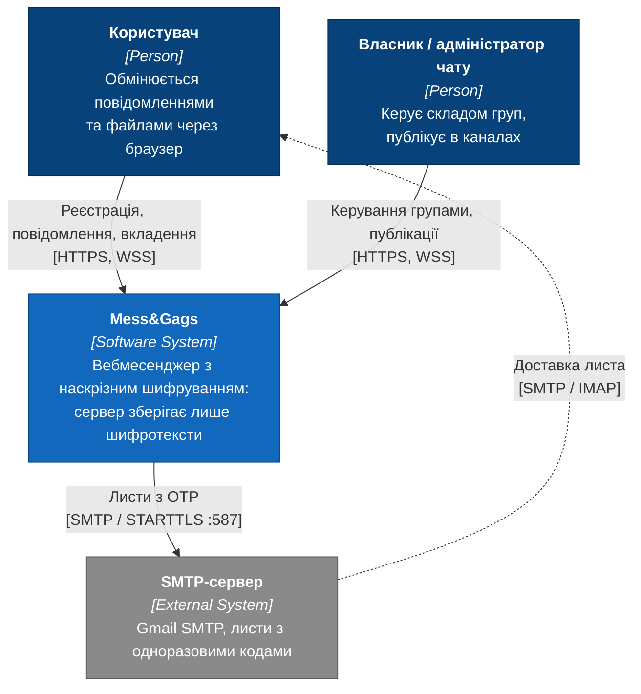
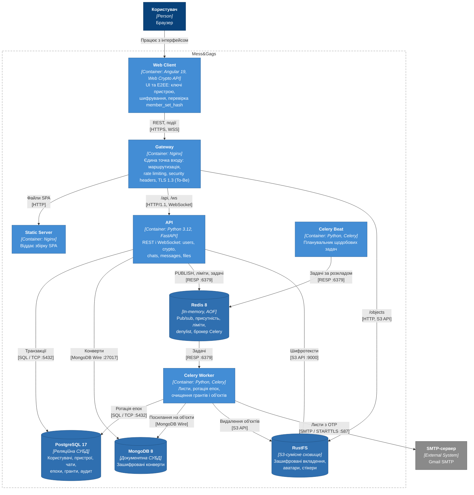
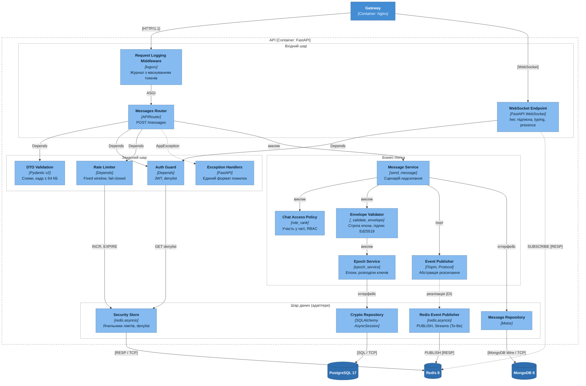

# РОЗДІЛ 2. ПРОЄКТУВАННЯ АРХІТЕКТУРИ СИСТЕМИ

> Розділ реалізує завдання 2–4 проєкту. Етапи 2–4 календарного плану: 19.10.2026 – 28.02.2027. Вимоги, на які посилаються діаграми, наведено в [специфікації вимог (SRS)](srs.md), ключове архітектурне рішення – в [ADR-001](adr/0001-choice-of-technology.md).

## 2.1 Контекстне та контейнерне моделювання системи (C4 Model)

Архітектуру описано за моделлю C4 у нотації Mermaid.js (Diagrams-as-Code): діаграми побудовано як flowchart зі стилями елементів C4 (Person, Software System, Container, Component, Database) і межами систем у вигляді subgraph. Діаграми зберігаються в репозиторії поруч із текстом і рендеряться GitHub.

### 2.1.1 Діаграма контексту (C4 Level 1)

Рисунок 2.1 – Діаграма контексту системи (C4 Level 1)

| Елемент | Тип | Опис | Вимоги |
|---|---|---|---|
| Користувач | Person | Реєструється, обмінюється повідомленнями та вкладеннями через браузер | [SRS-FUN-01](srs.md#srs-fun-01), [SRS-FUN-18](srs.md#srs-fun-18) |
| Власник / адміністратор чату | Person | Змінює склад групи, публікує в каналах | [SRS-FUN-23](srs.md#srs-fun-23), [SRS-FUN-24](srs.md#srs-fun-24) |
| Mess&Gags | Software System | Вебмесенджер з наскрізним шифруванням; сервер зберігає лише шифротексти | [SRS, розділ 1](srs.md#1-system-context-контекст-системи) |
| SMTP-сервер | External System | Доставляє листи з одноразовими кодами підтвердження | [SRS-FUN-02](srs.md#srs-fun-02) |

| Зв’язок | Протокол | Призначення |
|---|---|---|
| Користувач → Mess&Gags | HTTPS, WSS | REST-запити та двобічний канал подій |
| Власник / адміністратор → Mess&Gags | HTTPS, WSS | Керування групами, публікації в каналах |
| Mess&Gags → SMTP-сервер | SMTP / STARTTLS, порт 587 | Надсилання OTP |
| SMTP-сервер → Користувач | SMTP / IMAP | Доставка листа до поштової скриньки |

### 2.1.2 Діаграма контейнерів (C4 Level 2)

Рисунок 2.2 – Діаграма контейнерів системи (C4 Level 2)

Назовні опубліковано лише контейнер Gateway; СУБД, Redis і API доступні тільки у внутрішній мережі Docker Compose.

| Контейнер | Технологія | Відповідальність | Вимоги |
|---|---|---|---|
| Web Client | Angular 19, Web Crypto API | Інтерфейс; генерація ключів пристрою, шифрування повідомлень і вкладень, перевірка `member_set_hash`, safety number | [SRS-FUN-06](srs.md#srs-fun-06), [SRS-FUN-07](srs.md#srs-fun-07), [SRS-FUN-14](srs.md#srs-fun-14), [SRS-FUN-15](srs.md#srs-fun-15), [SRS-FUN-25](srs.md#srs-fun-25), [SRS-FUN-26](srs.md#srs-fun-26) |
| Gateway | Nginx | Єдина точка входу, маршрутизація `/api`, `/ws`, `/objects`, rate limiting, security headers, ліміт тіла запиту, TLS 1.3 (To-Be) | [SRS-NFR-SEC-02](srs.md#srs-nfr-sec-02) – [SRS-NFR-SEC-05](srs.md#srs-nfr-sec-05) |
| Static Server | Nginx | Віддає зібраний SPA | – |
| API | Python 3.12, FastAPI, Uvicorn | REST і WebSocket; домени `users`, `crypto`, `chats`, `messages`, `files`; перевірка епохи й підпису конвертів | [SRS-FUN-01](srs.md#srs-fun-01) – [SRS-FUN-04](srs.md#srs-fun-04), [SRS-FUN-08](srs.md#srs-fun-08) – [SRS-FUN-11](srs.md#srs-fun-11), [SRS-FUN-16](srs.md#srs-fun-16) – [SRS-FUN-24](srs.md#srs-fun-24), [SRS-FUN-27](srs.md#srs-fun-27), [SRS-FUN-28](srs.md#srs-fun-28) |
| Celery Worker | Python, Celery | Надсилання листів, ротація епох, очищення грантів, журналу аудиту та осиротілих об’єктів | [SRS-FUN-02](srs.md#srs-fun-02), [SRS-FUN-12](srs.md#srs-fun-12), [SRS-FUN-13](srs.md#srs-fun-13), [SRS-NFR-COMP-02](srs.md#srs-nfr-comp-02) |
| Celery Beat | Python, Celery | Планувальник щодобових задач | [SRS-FUN-12](srs.md#srs-fun-12) |
| PostgreSQL 17 | Реляційна СУБД | Користувачі, пристрої, чати, учасники, епохи, розподіли ключів, гранти, журнал аудиту (ACID-транзакції для атомарної ротації) | [SRS-FUN-11](srs.md#srs-fun-11) |
| MongoDB 8 | Документна СУБД | Незмінні зашифровані конверти повідомлень | [SRS-FUN-18](srs.md#srs-fun-18) |
| Redis 8 | In-memory, AOF | Pub/sub подій, присутність, лічильники rate limiting, denylist токенів, брокер Celery; персональні черги Redis Streams (To-Be) | [SRS-FUN-04](srs.md#srs-fun-04), [SRS-FUN-19](srs.md#srs-fun-19), [SRS-NFR-SEC-03](srs.md#srs-nfr-sec-03) |
| RustFS | S3-сумісне сховище | Шифротексти вкладень, аватари, стікери | [SRS-FUN-27](srs.md#srs-fun-27) |

| Зв’язок | Протокол | Призначення |
|---|---|---|
| Web Client → Gateway | HTTPS, WSS | REST-запити та події реального часу |
| Gateway → Static Server | HTTP | Статичні файли SPA |
| Gateway → API | HTTP/1.1, WebSocket | Проксіювання `/api` і `/ws` |
| Gateway → RustFS | HTTP, S3 API | Публічні об’єкти (`/objects`) |
| API → PostgreSQL | SQL / TCP 5432 (asyncpg) | Транзакції епох, чатів, ключів |
| API → MongoDB | MongoDB Wire Protocol / TCP 27017 (Motor) | Запис і читання конвертів |
| API → Redis | RESP / TCP 6379 | `PUBLISH` подій, лічильники, denylist, постановка задач Celery |
| API → RustFS | S3 API / HTTP 9000 (aiobotocore) | Збереження шифротекстів вкладень |
| Celery Beat → Redis | RESP / TCP 6379 | Публікація задач за розкладом |
| Celery Worker → Redis | RESP / TCP 6379 | Отримання задач |
| Celery Worker → PostgreSQL, MongoDB, RustFS | SQL / TCP, MongoDB Wire / TCP, S3 API / HTTP | Ротація епох, очищення грантів і об’єктів |
| Celery Worker → SMTP-сервер | SMTP / STARTTLS, порт 587 | Надсилання OTP |

## 2.2 Компонентне моделювання критичного сервісу системи

Для декомпозиції обрано контейнер **API** (FastAPI), оскільки в ньому зосереджено перевірку інваріантів E2EE на сервері: строгої епохи, підпису конверта та прав учасника. Діаграма відображає шлях надсилання зашифрованого повідомлення.

Рисунок 2.3 – Діаграма компонентів контейнера API (C4 Level 3)

| Шар | Компонент | Відповідальність | Взаємодія | Вимоги |
|---|---|---|---|---|
| Наскрізний | Request Logging Middleware | Журнал запитів з маскуванням токенів у шляху | ASGI-конвеєр | [SRS-NFR-OBS-01](srs.md#srs-nfr-obs-01), [SRS-NFR-COMP-02](srs.md#srs-nfr-comp-02) |
| Вхідний | Messages Router | Кінцеві точки REST для повідомлень | Отримує залежності через `Depends`, викликає Message Service | [SRS-FUN-18](srs.md#srs-fun-18) |
| Вхідний | WebSocket Endpoint | Підключення, підписка на персональний канал, typing, presence | `Depends(get_ws_current_user)`, `SUBSCRIBE` у Redis | [SRS-FUN-18](srs.md#srs-fun-18), [SRS-NFR-SEC-04](srs.md#srs-nfr-sec-04) |
| Вхідний | DTO Validation | Валідація тіла запиту схемами Pydantic, ліміт кадру 64 КБ | Автоматично до виклику обробника | [SRS-NFR-SEC-04](srs.md#srs-nfr-sec-04) |
| Захисний | Auth Guard | Перевірка JWT з cookie та denylist | `Depends`, читання через Security Store | [SRS-FUN-03](srs.md#srs-fun-03), [SRS-FUN-04](srs.md#srs-fun-04) |
| Захисний | Rate Limiter | Fixed window, fail-closed | `Depends`, `INCR` / `EXPIRE` через Security Store | [SRS-NFR-SEC-03](srs.md#srs-nfr-sec-03) |
| Захисний | Exception Handlers | Перетворення `AppException`, `RequestValidationError` і необроблених винятків у єдиний формат відповіді | Обробники винятків FastAPI | – |
| Бізнес-логіка | Message Service | Сценарій надсилання: перевірка доступу, валідація конверта, збереження, публікація події | Інтерфейсні виклики портів | [SRS-FUN-18](srs.md#srs-fun-18) |
| Бізнес-логіка | Chat Access Policy | Участь у чаті, ранги ролей OWNER/ADMIN/MEMBER | Виклик функції | [SRS-FUN-23](srs.md#srs-fun-23), [SRS-FUN-24](srs.md#srs-fun-24) |
| Бізнес-логіка | Envelope Validator | Строга рівність епохи, наявність sender key, підпис Ed25519 | Виклик функції | [SRS-FUN-16](srs.md#srs-fun-16), [SRS-FUN-17](srs.md#srs-fun-17), [ADR-001](adr/0001-choice-of-technology.md) |
| Бізнес-логіка | Epoch Service | Поточна епоха, розподіли ключів, ротація | Через Crypto Repository | [SRS-FUN-11](srs.md#srs-fun-11), [ADR-001](adr/0001-choice-of-technology.md) |
| Бізнес-логіка | Event Publisher (порт) | Абстракція розсилання подій, від якої залежить Message Service | Protocol, реалізація через DI | [SRS-FUN-18](srs.md#srs-fun-18), [SRS-FUN-19](srs.md#srs-fun-19) |
| Дані | Message Repository | Збереження та читання конвертів | Motor → MongoDB | [SRS-FUN-18](srs.md#srs-fun-18) |
| Дані | Crypto Repository | Епохи, розподіли, гранти | SQLAlchemy AsyncSession → PostgreSQL | [SRS-FUN-11](srs.md#srs-fun-11) |
| Дані | Redis Event Publisher | Реалізація порту: `PUBLISH user:{id}`, у To-Be – `XADD` у Redis Streams | redis.asyncio → Redis | [SRS-FUN-19](srs.md#srs-fun-19) |
| Дані | Security Store | Лічильники rate limiting і denylist токенів | redis.asyncio → Redis | [SRS-FUN-04](srs.md#srs-fun-04), [SRS-NFR-SEC-03](srs.md#srs-nfr-sec-03) |

Залежності спрямовані від вхідного шару до бізнес-логіки, а від бізнес-логіки – до портів. Реалізації портів (репозиторії, Redis Event Publisher) підставляються механізмом `Depends`, тому сервіси не залежать від драйверів СУБД. Розподіл на порти Message Repository, Crypto Repository та Event Publisher є цільовою структурою: у поточному коді сервіси використовують `AsyncSession` і колекції Motor безпосередньо, а розсилання подій виконує функція `_broadcast` у модулі маршрутизатора (router). Перенесення розсилання в Event Publisher виконується разом із реалізацією черги Redis Streams ([SRS-FUN-19](srs.md#srs-fun-19)).

## 2.3 Документування архітектурних рішень (Architecture Decision Records)

Архітектурні рішення фіксуються у форматі ADR за шаблоном Майкла Нігардза в каталозі [adr/](adr/).

| ADR | Рішення | Статус |
|---|---|---|
| [ADR-001](adr/0001-choice-of-technology.md) | Вибір схеми групового наскрізного шифрування: sender-key ratchet з явною моделлю епох замість попарних сесій Double Ratchet, класичних Sender Keys і MLS | Approved |

## 2.4 Обґрунтування архітектурного стилю та технологічного стеку

## 2.5 UML-моделі взаємодії

### 2.5.1 Реєстрація пристрою та публікація ключів

### 2.5.2 Ротація епохи групових ключів

## 2.6 Схеми даних

### 2.6.1 Реляційна схема PostgreSQL

### 2.6.2 Документна модель MongoDB

## 2.7 Алгоритми критичних вузлів системи

## Висновки до розділу 2
